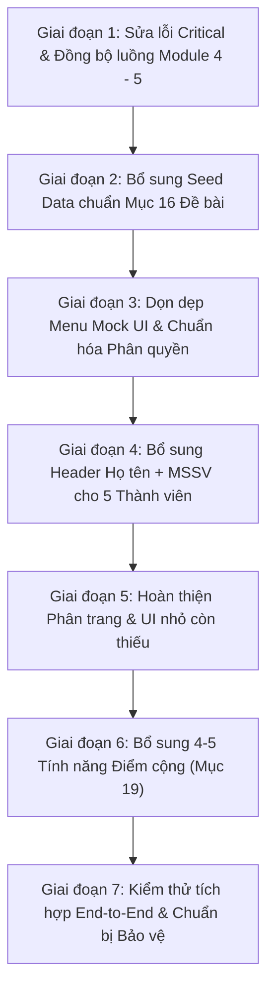

# 08. KẾ HOẠCH ƯU TIÊN HOÀN THIỆN DỰ ÁN (7 GIAI ĐOẠN)

Lộ trình dưới đây được thiết kế theo thứ tự ưu tiên từ cao xuống thấp, giúp nhóm hoàn thiện 100% yêu cầu bắt buộc của **Đề tài 29**, loại bỏ hoàn toàn các rủi ro bị trừ điểm khi bảo vệ mà **không làm hỏng bất kỳ chức năng nào đang chạy ổn định**.

---



---

## Chi tiết từng Giai đoạn thực hiện

### Giai đoạn 1: Sửa lỗi nghiêm trọng (`Critical`) & Đồng bộ luồng nghiệp vụ Module 4 – Module 5
- **Mức ưu tiên:** `P0 - Bắt buộc làm ngay`
- **Module liên quan:** Module 4, Module 5
- **Các công việc & File cần tác động:**
  1. **Thống nhất luồng Lịch khám sàng lọc & Kết quả hiến máu (Module 5):**
     - **File:** [`Controllers/AdminController.cs`](file:///e:/InformationTechnology/visual%20tím/QuanLyHienMau_UNETI2_TI17A5HN/QuanLyHienMau_UNETI2_TI17A5HN/Controllers/AdminController.cs), [`Views/Shared/_AdminLayout.cshtml`](file:///e:/InformationTechnology/visual%20tím/QuanLyHienMau_UNETI2_TI17A5HN/QuanLyHienMau_UNETI2_TI17A5HN/Views/Shared/_AdminLayout.cshtml)
     - **Nội dung:** Tiêm `KhamSangLocService` vào `AdminController` để các action `TaoLichKham`, `SuaLichKham`, `HuyLichKham`, `HoanThanhKham`, `TaoKetQua`, `SuaKetQua` gọi qua `KhamSangLocService` (đảm bảo kiểm tra đầy đủ: không lập lịch quá khứ, không trùng lịch người hiến, không trùng lịch bác sĩ). Đồng thời hỗ trợ truy cập thuận tiện sang `LichKhamSangLocController` và `KetQuaHienMauController`.
  2. **Đồng bộ Session & Cookie Claims cho Filter Module 5:**
     - **File:** [`Filters/KiemTraQuyenAttribute.cs`](file:///e:/InformationTechnology/visual%20tím/QuanLyHienMau_UNETI2_TI17A5HN/QuanLyHienMau_UNETI2_TI17A5HN/Filters/KiemTraQuyenAttribute.cs), [`Controllers/LichKhamSangLocController.cs`](file:///e:/InformationTechnology/visual%20tím/QuanLyHienMau_UNETI2_TI17A5HN/QuanLyHienMau_UNETI2_TI17A5HN/Controllers/LichKhamSangLocController.cs), [`Controllers/KetQuaHienMauController.cs`](file:///e:/InformationTechnology/visual%20tím/QuanLyHienMau_UNETI2_TI17A5HN/QuanLyHienMau_UNETI2_TI17A5HN/Controllers/KetQuaHienMauController.cs)
     - **Nội dung:** Nếu `Session.GetInt32("MaTaiKhoan")` trả về `null`, tự động đọc từ `ClaimTypes.NameIdentifier` của Cookie Authentication và nạp lại vào Session.
  3. **Chặn chuyển trạng thái phiếu sang `"Chờ khám sàng lọc"` mà không lập lịch:**
     - **File:** [`Controllers/AdminController.cs`](file:///e:/InformationTechnology/visual%20tím/QuanLyHienMau_UNETI2_TI17A5HN/QuanLyHienMau_UNETI2_TI17A5HN/Controllers/AdminController.cs#L347-L353)
     - **Nội dung:** Trong `LaChuyenTrangThaiHopLe`, từ `"Đã xác nhận"` chỉ chuyển sang `"Chờ khám sàng lọc"` thông qua hành động Lập lịch khám sàng lọc (hoặc từ chối phiếu), tránh làm phiếu bị treo không có lịch.
- **Rủi ro:** Thấp.
- **Tiêu chí hoàn thành:** Không thể tạo lịch khám trong quá khứ hoặc trùng lịch bác sĩ/người hiến ở bất kỳ màn hình nào; mọi phiếu ở trạng thái `"Chờ khám sàng lọc"` đều có bản ghi `LichKhamSangLoc` đi kèm.

---

### Giai đoạn 2: Nâng cấp Dữ liệu mẫu (`DbInitializer.cs`) đạt 100% yêu cầu Mục 16 Đề bài
- **Mức ưu tiên:** `P0 - Bắt buộc làm ngay`
- **Module liên quan:** Toàn bộ 5 Module
- **File cần tác động:** [`Data/DbInitializer.cs`](file:///e:/InformationTechnology/visual%20tím/QuanLyHienMau_UNETI2_TI17A5HN/QuanLyHienMau_UNETI2_TI17A5HN/Data/DbInitializer.cs)
- **Nội dung thực hiện:**
  Mở rộng dữ liệu seed tự động (sử dụng kiểm tra idempotent theo từng bảng hoặc bổ sung bản ghi còn thiếu) để đạt tối thiểu:
  - **06** `DonViToChuc` (Bệnh viện Huyết học, Viện TW, BV Việt Đức, BV Bạch Mai, ĐH Kinh tế - Kỹ thuật Công nghiệp UNETI, Hội Chữ thập đỏ Hà Nội).
  - **16** `DotHienMau` (Đủ các trạng thái: `Đang mở đăng ký`, `Chưa mở`, `Tạm dừng`, `Đã đóng`; chia thành **3 trang** trên cả giao diện cộng đồng và Admin).
  - **02** tài khoản `Admin`, **03** tài khoản `Medical Staff`, **30** tài khoản `Donor` gắn với **30** hồ sơ `NguoiHienMau` đa dạng nhóm máu (`O`, `A`, `B`, `AB`), cân nặng, độ tuổi.
  - **45** `PhieuDangKyHienMau` rải đều qua 6 trạng thái (`Chờ xác nhận`, `Đã xác nhận`, `Từ chối`, `Đã hủy`, `Chờ khám sàng lọc`, `Đã khám sàng lọc`, `Hiến máu thành công`, `Không đủ điều kiện hiến`) và rải qua nhiều tháng để biểu đồ theo tháng có số liệu đẹp.
  - **18** `LichKhamSangLoc` (`Đã lên lịch`, `Đã hoàn thành`, `Đã hủy`).
  - **12** `KetQuaHienMau` (gồm cả `"Hiến máu thành công"` và `"Không đủ điều kiện hiến"`).
- **Rủi ro:** Không ảnh hưởng code cũ.
- **Tiêu chí hoàn thành:** Mở trang Đợt hiến máu có >= 3 trang phân trang; mở trang Lịch khám, Kết quả, Thống kê đều có dữ liệu đầy đủ ngay từ lần chạy đầu tiên.

---

### Giai đoạn 3: Chuẩn hóa Phân quyền & Dọn dẹp 6 Menu Mock UI ngoài phạm vi
- **Mức ưu tiên:** `P1 - Cao`
- **Module liên quan:** Module 1, Module 3, Giao diện quản trị chung
- **Các công việc & File cần tác động:**
  1. Thêm `[Authorize(Roles = "Admin")]` cho `AdminController.KhoaMoKhoaNguoiHien` (và kiểm tra hiển thị nút trên `Views/Admin/NguoiHienMau.cshtml`).
  2. Ẩn 6 mục menu tĩnh ngoài phạm vi đề tài (`HoSoBenhSu`, `TieuHuy`, `GiamSatTuiMau`, `KhoLuuTruMau`, `RBAC`, `KhoLanhIoT`) trên [`Views/Shared/_AdminLayout.cshtml`](file:///e:/InformationTechnology/visual%20tím/QuanLyHienMau_UNETI2_TI17A5HN/QuanLyHienMau_UNETI2_TI17A5HN/Views/Shared/_AdminLayout.cshtml) (và ẩn menu dành riêng cho Admin khi đang đăng nhập bằng tài khoản `Medical Staff`).
  3. Gắn `<form method="get" asp-controller="Admin" asp-action="PhieuDangKyHienMau">` cho ô tìm kiếm trên Topbar `_AdminLayout.cshtml`.
- **Tiêu chí hoàn thành:** Sidebar Admin chỉ hiển thị các chức năng thật 100% thuộc 5 Module của Đề tài 29; `Medical Staff` không thấy và không gọi được chức năng của `Admin`.

---

### Giai đoạn 4: Bổ sung Header Họ tên + Mã sinh viên trên toàn bộ file theo Mục 18 Đề bài
- **Mức ưu tiên:** `P1 - Cao`
- **Module liên quan:** Module 3, Module 4, Module 5
- **Nội dung thực hiện:**
  Bổ sung 3 dòng comment chuẩn ở đầu tất cả các file `Model`, `ViewModel`, `Controller`, `Repository`, `Service`, `View` chính của từng thành viên:
  ```csharp
  // Họ và tên: [Tên sinh viên phụ trách Module]
  // Mã sinh viên: [MSSV]
  // Nội dung thực hiện: [Tên Module & Nghiệp vụ phụ trách]
  ```
- **Tiêu chí hoàn thành:** 100% file code trong dự án đều có thông tin tác giả rõ ràng theo đúng Mục 18 đề bài.

---

### Giai đoạn 5: Hoàn thiện Phân trang danh sách Người hiến máu & liên kết Lịch khám/Kết quả cho Donor
- **Mức ưu tiên:** `P2 - Trung bình`
- **Module liên quan:** Module 3, Module 5
- **Các công việc & File cần tác động:**
  1. Bổ sung phân trang `Skip/Take` thật cho `AdminController.NguoiHienMau` và `Views/Admin/NguoiHienMau.cshtml`.
  2. Bổ sung nút/tab xem nhanh Lịch khám sàng lọc (`/LichKhamSangLoc/CuaToi`) và Kết quả hiến máu (`/KetQuaHienMau/CuaToi`) từ trang `/DangKy/TheoDoi` hoặc menu người dùng.

---

### Giai đoạn 6: Triển khai các tính năng mở rộng ăn điểm cộng (Mục 19 Đề bài)
- **Mức ưu tiên:** `P3 - Điểm cộng nâng cao`
- **Các tính năng chọn lọc an toàn nhất:**
  1. Vẽ biểu đồ trực quan (Chart.js) cho số phiếu theo trạng thái và xu hướng đăng ký theo tháng trên `Views/ThongKe/Index.cshtml`.
  2. Thêm nút **Xuất báo cáo CSV/Excel (UTF-8 BOM)** trên trang Quản lý Phiếu đăng ký và trang Thống kê.
  3. Thêm bộ lọc nhanh **"Gợi ý đợt phù hợp với nhóm máu & cân nặng của tôi"** trên `Views/DotHienMau/Index.cshtml` khi người hiến máu đã đăng nhập.
  4. Hiển thị cảnh báo nổi bật khi người hiến máu có **Lịch khám sàng lọc sắp diễn ra trong 48 giờ tới**.

---

### Giai đoạn 7: Kiểm thử tích hợp toàn diện (End-to-End) & Chuẩn bị kịch bản Demo Bảo vệ
- **Mức ưu tiên:** `P1 - Trước khi nộp bài`
- **Nội dung thực hiện:**
  - Chạy kiểm thử xuyên suốt 1 vòng đời phiếu đăng ký từ đầu đến cuối qua cả 5 Module:
    `Admin tạo Đơn vị (M1)` → `Mở Đợt hiến máu (M2)` → `Người hiến đăng ký TK (M1), cập nhật Hồ sơ & Nộp phiếu (M3)` → `Nhân viên y tế Xác nhận phiếu (M4)` → `Lập lịch khám sàng lọc & Hoàn thành khám (M5)` → `Ghi nhận Kết quả "Hiến máu thành công" (M5)` → `Kiểm tra chặn 84 ngày khi đăng ký đợt tiếp theo (M3)` → `Kiểm tra số liệu nhảy tức thì trên Dashboard & Thống kê (M5)`.
