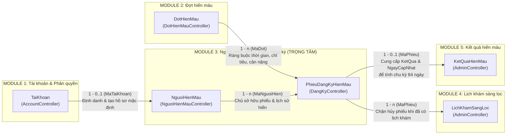
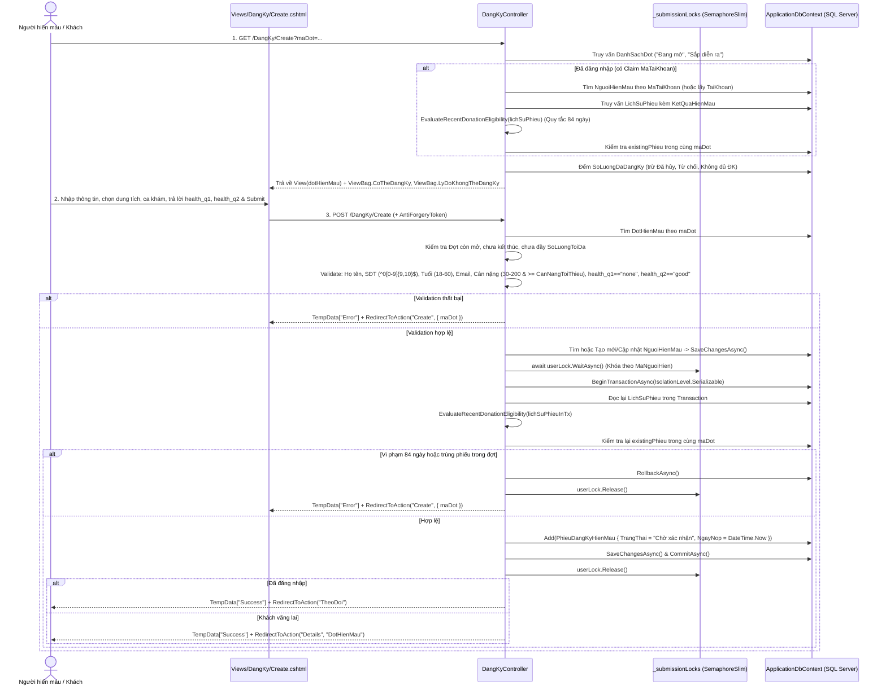
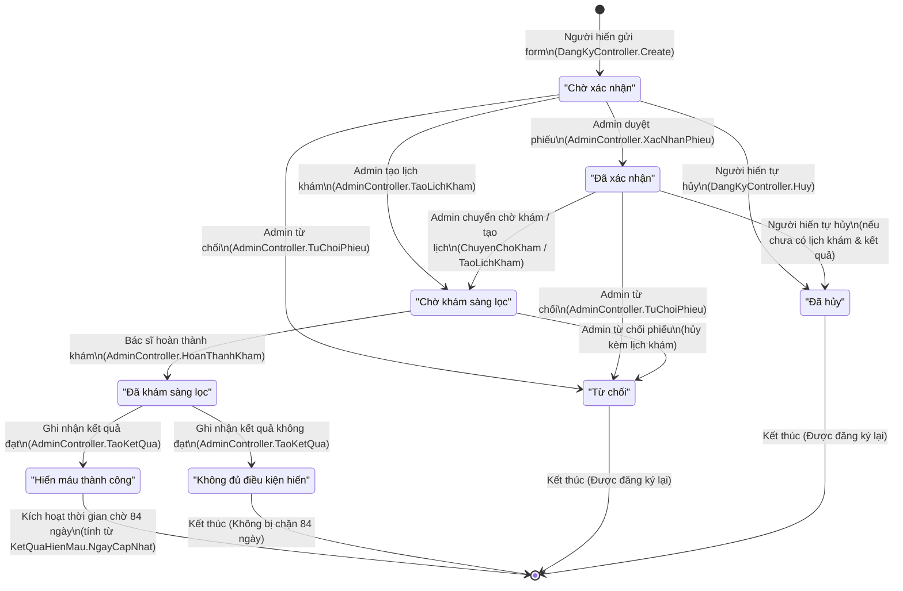

# PHẦN I: KHẢO SÁT TOÀN BỘ MODULE 3 — QUẢN LÝ NGƯỜI HIẾN MÁU VÀ PHIẾU ĐĂNG KÝ HIẾN MÁU

> **Thông tin xác minh môi trường & mã nguồn:**
> - **Repository:** `E:\InformationTechnology\visual tím\QuanLyHienMau_UNETI2_TI17A5HN`
> - **Nhánh Git đang kiểm tra:** `DamThuTrang_23103100243` (đồng bộ với `origin/DamThuTrang_23103100243`)
> - **Nền tảng kỹ thuật:** ASP.NET Core MVC (`.NET 10.0` - `<TargetFramework>net10.0</TargetFramework>`), Entity Framework Core (`Microsoft.EntityFrameworkCore.SqlServer` `10.0.5`), Cookie Authentication (`CookieAuthenticationDefaults.AuthenticationScheme`).
> - **Nguyên tắc đối chiếu:** Toàn bộ nội dung dưới đây được trích xuất **trực tiếp từ mã nguồn thực tế trên nhánh `DamThuTrang_23103100243`**. Những điểm khác biệt giữa 5 file báo cáo `.md` cũ trong thư mục gốc (vốn được sinh ra trên nhánh `integration`) và code hiện tại được liệt kê rõ tại Mục 5 của tài liệu này.

---

## 1. BẢNG KHẢO SÁT TOÀN BỘ FILE LIÊN QUAN ĐẾN MODULE 3

Dưới đây là bảng tổng hợp tất cả các file thuộc phạm vi trực tiếp của **Module 3 (Quản lý người hiến máu và Phiếu đăng ký hiến máu)** cũng như các file thuộc Module 1, 2, 4, 5 có tương tác trực tiếp với dữ liệu của Module 3:

| STT | File (Đường dẫn trong dự án) | Vai trò trong kiến trúc | Class / Phương thức / Thuộc tính quan trọng | Chức năng nghiệp vụ | Liên quan trực tiếp đến file nào |
|---|---|---|---|---|---|
| 1 | `QuanLyHienMau_UNETI2_TI17A5HN/Controllers/DangKyController.cs` | **Controller chính của Module 3** (Xử lý nghiệp vụ đăng ký, theo dõi, hủy phiếu và kiểm tra quy tắc 84 ngày) | Class `DangKyController`: - Const `SoNgayChoToiThieuGiuaHaiLanHien = 84` - Static `_submissionLocks` (`ConcurrentDictionary<int, SemaphoreSlim>`) - Record `RecentDonationEligibilityResult` - `IsConfirmedSuccessfulDonation(PhieuDangKyHienMau)` - `GetActualDonationDate(PhieuDangKyHienMau)` - `EvaluateRecentDonationEligibility(IEnumerable<PhieuDangKyHienMau>, DateTime?)` - `NormalizePhone(string?)`, `IsValidPhone(string?)`, `IsValidAge(DateTime, DateTime?)` - `Create(int? maDot)` `[HttpGet]` - `Create(int maDot, string hoTen, DateTime? ngaySinh, string? gioiTinh, string soDienThoai, string? email, string? diaChi, string? nhomMau, string? ngheNghiep, double? canNang, string? ghiChuSucKhoe, string? lyDoHienMau, string? ghiChu, string? volume, string? timeSlot, string? health_q1, string? health_q2)` `[HttpPost, ValidateAntiForgeryToken]` - `TheoDoi()` `[HttpGet]` - `Huy(int id)` `[HttpPost, ValidateAntiForgeryToken]` | 1. Hiển thị form đăng ký hiến máu, tự động điền thông tin từ `NguoiHienMau` hoặc `TaiKhoan`. 2. Kiểm tra điều kiện chiến dịch (`Đang mở` / `Sắp diễn ra`, chưa kết thúc, chưa đầy chỉ tiêu). 3. Kiểm tra quy tắc 84 ngày kể từ ngày thực tế có kết quả `"Hiến máu thành công"` (`KetQuaHienMau.NgayCapNhat`). 4. Kiểm tra tuổi (18–60), SĐT (`^0[0-9]{9,10}$`), email, cân nặng (30–200kg và `>= dotHienMau.CanNangToiThieu`), khảo sát sức khỏe (`health_q1`, `health_q2`). 5. Tạo mới hoặc cập nhật hồ sơ `NguoiHienMau` và tạo `PhieuDangKyHienMau` ở trạng thái `"Chờ xác nhận"` bên trong Transaction `IsolationLevel.Serializable` kết hợp khóa `SemaphoreSlim` theo `MaNguoiHien`. 6. Hiển thị danh sách phiếu đăng ký và tiến trình của người dùng. 7. Cho phép người dùng tự hủy phiếu khi ở trạng thái `"Chờ xác nhận"` hoặc `"Đã xác nhận"`, chưa có lịch khám hoạt động và chưa có kết quả hiến máu. | - `Models/NguoiHienMau.cs` - `Models/PhieuDangKyHienMau.cs` - `Models/DotHienMau.cs` - `Models/KetQuaHienMau.cs` - `Models/LichKhamSangLoc.cs` - `Models/TaiKhoan.cs` - `Data/ApplicationDbContext.cs` - `Views/DangKy/Create.cshtml` - `Views/DangKy/TheoDoi.cshtml` |
| 2 | `QuanLyHienMau_UNETI2_TI17A5HN/Controllers/NguoiHienMauController.cs` | **Controller chính của Module 3** (Quản lý hồ sơ cá nhân và lịch sử hiến máu phía người hiến) | Class `NguoiHienMauController` (`[Authorize]`): - `NormalizePhone(string?)`, `IsValidPhone(string?)`, `IsValidAge(DateTime, DateTime?)` - `HoSoCaNhan()` `[HttpGet]` - `HoSoCaNhan(NguoiHienMau model)` `[HttpPost, ValidateAntiForgeryToken]` | 1. Truy xuất hồ sơ `NguoiHienMau` gắn với `MaTaiKhoan` đang đăng nhập. 2. Trường hợp tài khoản mới chưa có bản ghi `NguoiHienMau`: khởi tạo đối tượng tạm trên bộ nhớ từ `TaiKhoan` (`HoTen`, `Email`, `SoDienThoai`) để hiển thị lên View. 3. Tính toán thống kê hiến máu thành công dựa trên `DangKyController.IsConfirmedSuccessfulDonation`, `GetActualDonationDate` và `EvaluateRecentDonationEligibility` để truyền sang View qua `ViewBag`. 4. Validate dữ liệu cập nhật hồ sơ (Họ tên, SĐT, Ngày sinh 18–60, Giới tính, Email, Địa chỉ, Cân nặng 30–200kg) và lưu vào DB (tạo mới hoặc cập nhật `NguoiHienMau`, đồng bộ `HoTen` sang `TaiKhoan`). | - `Models/NguoiHienMau.cs` - `Models/TaiKhoan.cs` - `Models/PhieuDangKyHienMau.cs` - `Controllers/DangKyController.cs` - `Data/ApplicationDbContext.cs` - `Views/NguoiHienMau/HoSoCaNhan.cshtml` |
| 3 | `QuanLyHienMau_UNETI2_TI17A5HN/Models/NguoiHienMau.cs` | **Entity Model cốt lõi của Module 3** (Bảng `NguoiHienMau`) | Class `NguoiHienMau`: - PK: `MaNguoiHien` (`int`) - FK: `MaTaiKhoan` (`int?`) - Thông tin cá nhân: `HoTen`, `NgaySinh`, `GioiTinh`, `SoDienThoai`, `Email`, `DiaChi` - Thông tin y tế: `NhomMau`, `NgheNghiep`, `CanNang`, `GhiChuSucKhoe`, `TrangThai` (mặc định `"Hoạt động"`) - Navigation: `TaiKhoan`, `PhieuDangKyHienMaus` | Định nghĩa cấu trúc dữ liệu bảng `NguoiHienMau` trong SQL Server và các Data Annotations kiểm tra dữ liệu (`[Required]`, `[StringLength]`, `[RegularExpression(@"^0[0-9]{9,10}$")]`, `[EmailAddress]`, `[Range(30, 200)]`). | - `Data/ApplicationDbContext.cs` - `Models/TaiKhoan.cs` - `Models/PhieuDangKyHienMau.cs` - `Controllers/DangKyController.cs` - `Controllers/NguoiHienMauController.cs` - `Controllers/AdminController.cs` |
| 4 | `QuanLyHienMau_UNETI2_TI17A5HN/Models/PhieuDangKyHienMau.cs` | **Entity Model cốt lõi của Module 3** (Bảng `PhieuDangKyHienMau`) | Class `PhieuDangKyHienMau`: - PK: `MaPhieu` (`int`) - FK: `MaNguoiHien` (`int`), `MaDot` (`int`) - Thuộc tính: `NgayNop` (mặc định `DateTime.Now`), `LyDoHienMau`, `GhiChu`, `TrangThai` (mặc định `"Chờ xác nhận"`), `NgayXuLy`, `GhiChuXacNhan` - Navigation: `NguoiHienMau`, `DotHienMau`, `LichKhamSangLocs`, `KetQuaHienMau` | Định nghĩa cấu trúc bảng `PhieuDangKyHienMau` lưu trữ phiếu đăng ký tham gia đợt hiến máu của người hiến, kết nối giữa Người hiến máu (Module 3), Đợt hiến máu (Module 2), Lịch khám sàng lọc (Module 4) và Kết quả hiến máu (Module 5). | - `Data/ApplicationDbContext.cs` - `Models/NguoiHienMau.cs` - `Models/DotHienMau.cs` - `Models/LichKhamSangLoc.cs` - `Models/KetQuaHienMau.cs` |
| 5 | `QuanLyHienMau_UNETI2_TI17A5HN/Views/DangKy/Create.cshtml` | **View Giao diện của Module 3** (Màn hình Đăng ký hiến máu) | `@model QuanLyHienMau_UNETI2_TI17A5HN.Models.DotHienMau` - Sử dụng `ViewBag.NguoiHienMau`, `ViewBag.TaiKhoan`, `ViewBag.DanhSachDot`, `ViewBag.CoTheDangKy`, `ViewBag.LyDoKhongTheDangKy`, `ViewBag.SoLuongDaDangKy` - JS: `changeCampaign(maDot)`, `selectOption(el)`, validation sự kiện `submit` | Hiển thị thông tin đợt hiến máu, thanh tiến độ chỉ tiêu, cảnh báo chặn đăng ký (nếu vi phạm 84 ngày hoặc đã có phiếu), form thông tin cá nhân & chỉ số cơ thể, chọn dung tích (`250ml`/`350ml`/`450ml`), ca khám (`timeSlot`), và bảng câu hỏi sàng lọc (`health_q1`, `health_q2`). | - `Controllers/DangKyController.cs` (`Create` GET/POST) - `Views/Shared/_Layout.cshtml` |
| 6 | `QuanLyHienMau_UNETI2_TI17A5HN/Views/DangKy/TheoDoi.cshtml` | **View Giao diện của Module 3** (Màn hình Theo dõi đăng ký & Lịch sử) | `@model IEnumerable<PhieuDangKyHienMau>` - Nhận `ViewBag.EligibilityResult` (`RecentDonationEligibilityResult`) - Hiển thị phiếu đang hoạt động (`activePhieu`) với Stepper 4 bước - Form `POST /DangKy/Huy` kèm modal xác nhận - Bảng lịch sử đăng ký đầy đủ | Giúp người hiến máu theo dõi trạng thái xử lý của phiếu đăng ký hiện tại theo thời gian thực (Stepper 4 bước: Gửi phiếu → Xác nhận & Lịch khám → Khám sàng lọc → Kết quả hiến máu), xem thông báo thời gian chờ 84 ngày, tự hủy phiếu khi còn hợp lệ, và tra cứu lịch sử các phiếu cũ. | - `Controllers/DangKyController.cs` (`TheoDoi`, `Huy`) - `Views/Shared/_Layout.cshtml` |
| 7 | `QuanLyHienMau_UNETI2_TI17A5HN/Views/NguoiHienMau/HoSoCaNhan.cshtml` | **View Giao diện của Module 3** (Màn hình Hồ sơ cá nhân & Sổ tay sức khỏe) | `@model QuanLyHienMau_UNETI2_TI17A5HN.Models.NguoiHienMau` - Nhận `ViewBag.ConfirmedSuccessfulCount`, `ViewBag.LastActualDonationDate`, `ViewBag.NextEligibleDonationDate`, `ViewBag.RemainingCooldownDays`, `ViewBag.IsEligibleToDonateNow`, `ViewBag.HasMissingActualDonationDate` - Form `POST /NguoiHienMau/HoSoCaNhan` | Hiển thị thẻ hồ sơ người hiến máu, nhóm máu, số lần hiến máu thành công thực tế, đếm ngược chu kỳ 84 ngày, form chỉnh sửa và lưu thông tin cá nhân/sức khỏe vào DB, và bảng lịch sử các lần hiến máu. | - `Controllers/NguoiHienMauController.cs` (`HoSoCaNhan` GET/POST) - `Views/Shared/_Layout.cshtml` |
| 8 | `QuanLyHienMau_UNETI2_TI17A5HN/Views/Admin/NguoiHienMau.cshtml` | **View Giao diện Quản trị liên quan Module 3** (Danh sách & Quản lý Người hiến máu cho Admin/Staff) | `@model IEnumerable<NguoiHienMau>` - Bộ lọc tìm kiếm (`search`, `nhomMau`, `trangThai`, `page`) - Bảng danh sách người hiến máu kèm nhóm máu, cân nặng, số lần hiến, trạng thái chờ 84 ngày - Link sang `Admin/PhieuDangKyHienMau` lọc theo tên người hiến | Giao diện dành cho `Admin` và `NhanVienYTe` tra cứu danh sách người hiến máu toàn hệ thống, lọc theo nhóm máu/trạng thái, xem thống kê nhóm máu và điều hướng sang danh sách phiếu đăng ký của từng người hiến. | - `Controllers/AdminController.cs` (`NguoiHienMau`) - `Views/Shared/_AdminLayout.cshtml` |
| 9 | `QuanLyHienMau_UNETI2_TI17A5HN/Controllers/AdminController.cs` | **Controller Quản trị (Tích hợp Module 2, 3, 4, 5 trên nhánh hiện tại)** | Class `AdminController` (`[Authorize(Roles = "Admin,NhanVienYTe")]`): - Action Module 3: `NguoiHienMau(...)`, `PhieuDangKyHienMau(...)`, `ChiTietPhieuDangKy(int id)`, `XacNhanPhieu(...)`, `TuChoiPhieu(...)`, `ChuyenChoKham(...)` - Action Module 4: `LichKhamSangLoc`, `TaoLichKham`, `SuaLichKham`, `HuyLichKham`, `HoanThanhKham` - Action Module 5: `KetQuaHienMau`, `ChiTietKetQua`, `TaoKetQua`, `SuaKetQua` | Cung cấp toàn bộ chức năng phía Quản trị viên / Nhân viên y tế: tra cứu người hiến máu, duyệt/từ chối phiếu đăng ký, xếp lịch khám sàng lọc, hoàn thành khám và ghi nhận kết quả hiến máu (`KetQuaHienMau`) — qua đó cập nhật trạng thái phiếu của Module 3. | - `Models/NguoiHienMau.cs` - `Models/PhieuDangKyHienMau.cs` - `Models/LichKhamSangLoc.cs` - `Models/KetQuaHienMau.cs` - `Views/Admin/*.cshtml` |
| 10 | `QuanLyHienMau_UNETI2_TI17A5HN/Views/Admin/PhieuDangKyHienMau.cshtml` & `ChiTietPhieuDangKy.cshtml` | **View Quản trị Phiếu đăng ký** (Duyệt phiếu, xem chi tiết phiếu, tạo lịch khám & tạo kết quả nhanh) | `@model IEnumerable<PhieuDangKyHienMau>` và `@model PhieuDangKyHienMau` - Các form `XacNhanPhieu`, `TuChoiPhieu`, `ChuyenChoKham`, `TaoLichKham`, `HoanThanhKham`, `TaoKetQua` | Cho phép Admin/Nhân viên y tế xem danh sách phiếu đăng ký của người hiến, lọc theo trạng thái/đợt hiến máu, xác nhận hoặc từ chối phiếu, và cập nhật tiến trình khám/hiến máu. | - `Controllers/AdminController.cs` - `Models/PhieuDangKyHienMau.cs` |
| 11 | `QuanLyHienMau_UNETI2_TI17A5HN/Models/KetQuaHienMau.cs` | **Entity Model Module 5** (Quyết định điều kiện 84 ngày của Module 3) | Class `KetQuaHienMau`: - PK: `MaKetQua` - FK Unique: `MaPhieu` - `KetQua` (`"Hiến máu thành công"` / `"Không đủ điều kiện hiến"`), `NgayCapNhat`, `NhanVienXacNhan`, `GhiChu` | Lưu kết quả hiến máu thực tế của một phiếu. Thuộc tính `KetQua` và `NgayCapNhat` là căn cứ duy nhất để `DangKyController` xác định lần hiến máu thành công và tính chu kỳ 84 ngày. | - `Models/PhieuDangKyHienMau.cs` - `Controllers/DangKyController.cs` - `Controllers/AdminController.cs` |
| 12 | `QuanLyHienMau_UNETI2_TI17A5HN/Models/LichKhamSangLoc.cs` | **Entity Model Module 4** (Ràng buộc điều kiện hủy phiếu của Module 3) | Class `LichKhamSangLoc`: - PK: `MaLichKham`, FK: `MaPhieu` - `ThoiGianKham`, `DiaDiemKham`, `BacSiPhuTrach`, `KetQuaSangLoc`, `TrangThai` | Lưu lịch khám sàng lọc của phiếu đăng ký. Nếu phiếu đã có lịch khám với `TrangThai != "Đã hủy"`, `DangKyController.Huy` sẽ chặn không cho người hiến tự hủy phiếu. | - `Models/PhieuDangKyHienMau.cs` - `Controllers/DangKyController.cs` - `Controllers/AdminController.cs` |
| 13 | `QuanLyHienMau_UNETI2_TI17A5HN/Models/DotHienMau.cs` | **Entity Model Module 2** (Đợt hiến máu mà phiếu đăng ký tham chiếu tới) | Class `DotHienMau`: - PK: `MaDot` - `TenDot`, `BatDau`, `KetThuc`, `SoLuongToiDa`, `CanNangToiThieu`, `DoTuoiToiThieu`, `DoTuoiToiDa`, `TrangThai` | Cung cấp thông tin chiến dịch hiến máu và các ngưỡng điều kiện (`CanNangToiThieu`, `SoLuongToiDa`, `KetThuc`, `TrangThai`) để `DangKyController.Create` kiểm tra trước khi nhận phiếu. | - `Models/PhieuDangKyHienMau.cs` - `Controllers/DangKyController.cs` - `Controllers/DotHienMauController.cs` |
| 14 | `QuanLyHienMau_UNETI2_TI17A5HN/Models/TaiKhoan.cs` & `Controllers/AccountController.cs` | **Entity Model & Controller Module 1** (Tài khoản, Xác thực & Tự động tạo hồ sơ người hiến) | Class `TaiKhoan` (`MaTaiKhoan`, `TenDangNhap`, `MatKhau`, `HoTen`, `Email`, `SoDienThoai`, `VaiTro`, `TrangThai`) & `AccountController` (`Login`, `Register`, `Logout`) | 1. Khi đăng ký tài khoản mới (`AccountController.Register`), hệ thống tự động tạo luôn bản ghi `NguoiHienMau` gắn `MaTaiKhoan`. 2. Khi đăng nhập (`AccountController.Login`), hệ thống phát hành Cookie chứa Claim `MaTaiKhoan`, `ClaimTypes.Role`, `ClaimTypes.Name` để Module 3 định danh người dùng. | - `Models/NguoiHienMau.cs` - `Controllers/DangKyController.cs` - `Controllers/NguoiHienMauController.cs` |
| 15 | `QuanLyHienMau_UNETI2_TI17A5HN/Data/ApplicationDbContext.cs` & `Data/DbInitializer.cs` | **Lớp Truy cập CSDL (EF Core DbContext) & Seed Data** | Class `ApplicationDbContext` (`OnModelCreating`) & `DbInitializer.Initialize` | 1. Cấu hình 7 `DbSet<T>`, khóa ngoại, Unique Filtered Index trên `NguoiHienMau.MaTaiKhoan`, Unique Index trên `KetQuaHienMau.MaPhieu`, và hành vi xóa (`SetNull`, `Restrict`, `Cascade`). 2. Khởi tạo dữ liệu mẫu gồm tài khoản, người hiến máu, đợt hiến máu, phiếu đăng ký, lịch khám và kết quả hiến máu. | Toàn bộ `Models/*.cs` và `Controllers/*.cs` |
| 16 | `QuanLyHienMau_UNETI2_TI17A5HN/Program.cs` | **Cấu hình ứng dụng & Middleware Pipeline** | Cấu hình `AddDbContext<ApplicationDbContext>`, `AddAuthentication(CookieAuthenticationDefaults.AuthenticationScheme)`, `UseAuthentication()`, `UseAuthorization()` | Đăng ký Dependency Injection cho `ApplicationDbContext`, cấu hình Cookie Authentication (`LoginPath = "/Account/Login"`, `ExpireTimeSpan = 7 days`), gọi `DbInitializer.Initialize(context)` khi khởi động. | Toàn bộ dự án |

---

## 2. PHÂN LOẠI TRÁCH NHIỆM CÁC FILE TRONG MODULE 3

Để trả lời rõ ràng khi giảng viên hỏi *"Em hãy chỉ rõ trong Module 3 file nào làm nhiệm vụ gì?"*, sinh viên cần phân biệt 5 nhóm sau:

1. **File xử lý nghiệp vụ (Business Logic & Controller):**
   - `Controllers/DangKyController.cs`: Chứa toàn bộ logic kiểm tra điều kiện đăng ký hiến máu (tuổi 18–60, SĐT 10–11 số bắt đầu bằng `0`, cân nặng 30–200kg và đạt ngưỡng tối thiểu của đợt, 2 câu hỏi sàng lọc sức khỏe, kiểm tra đợt hiến máu còn mở và còn chỉ tiêu), thuật toán kiểm tra thời gian chờ 84 ngày kể từ ngày có kết quả hiến máu thành công thực tế (`EvaluateRecentDonationEligibility`), kiểm soát đồng thời (`SemaphoreSlim` + Transaction `Serializable`), theo dõi phiếu (`TheoDoi`) và hủy phiếu (`Huy`).
   - `Controllers/NguoiHienMauController.cs`: Chứa logic hiển thị hồ sơ cá nhân, tổng hợp thống kê hiến máu thành công và cập nhật thông tin cá nhân/y tế của người hiến máu (`HoSoCaNhan` GET/POST).
   - `Controllers/AdminController.cs`: Chứa logic tra cứu danh sách người hiến máu (`NguoiHienMau`), quản lý danh sách phiếu đăng ký (`PhieuDangKyHienMau`, `ChiTietPhieuDangKy`) và chuyển trạng thái phiếu (`XacNhanPhieu`, `TuChoiPhieu`, `ChuyenChoKham`).

2. **File hiển thị giao diện (Presentation / Razor Views):**
   - Giao diện phía Người hiến máu (sử dụng `_Layout.cshtml`):
     - `Views/DangKy/Create.cshtml`: Giao diện lập phiếu đăng ký hiến máu trực tuyến.
     - `Views/DangKy/TheoDoi.cshtml`: Giao diện theo dõi tiến trình phiếu đăng ký (Stepper 4 bước), hủy phiếu và xem lịch sử đăng ký.
     - `Views/NguoiHienMau/HoSoCaNhan.cshtml`: Giao diện xem/cập nhật hồ sơ cá nhân, sổ tay sức khỏe và thống kê chu kỳ 84 ngày.
   - Giao diện phía Quản trị / Nhân viên y tế (sử dụng `_AdminLayout.cshtml`):
     - `Views/Admin/NguoiHienMau.cshtml`: Giao diện quản lý danh sách người hiến máu.
     - `Views/Admin/PhieuDangKyHienMau.cshtml` & `Views/Admin/ChiTietPhieuDangKy.cshtml`: Giao diện quản lý và xử lý phiếu đăng ký hiến máu.

3. **File định nghĩa cấu trúc dữ liệu (Domain / Entity Models):**
   - `Models/NguoiHienMau.cs`: Thực thể Người hiến máu.
   - `Models/PhieuDangKyHienMau.cs`: Thực thể Phiếu đăng ký hiến máu.
   - `DangKyController.RecentDonationEligibilityResult` (nested record trong `Controllers/DangKyController.cs`, dòng 28–36): Cấu trúc dữ liệu kết quả đánh giá điều kiện hiến máu gần nhất.

4. **File truy cập cơ sở dữ liệu (Data Access Layer):**
   - `Data/ApplicationDbContext.cs`: Lớp kế thừa `DbContext` của Entity Framework Core, ánh xạ các `DbSet<NguoiHienMau>`, `DbSet<PhieuDangKyHienMau>` và cấu hình Fluent API trong `OnModelCreating`.
   - `Migrations/20261007035106_InitialCreate.cs`: File migration tạo bảng, khóa chính, khóa ngoại và index trong SQL Server.
   - *Lưu ý kiến trúc:* Dự án trên nhánh `DamThuTrang_23103100243` **không tách tầng Repository hay Service riêng cho Module 3** mà tiêm trực tiếp `ApplicationDbContext` vào `DangKyController`, `NguoiHienMauController` và `AdminController` qua Constructor Dependency Injection.

5. **File thực hiện xác thực và phân quyền (Authentication & Authorization):**
   - `Program.cs`: Cấu hình Cookie Authentication (`CookieAuthenticationDefaults.AuthenticationScheme`) và middleware `app.UseAuthentication()`, `app.UseAuthorization()`.
   - `Controllers/AccountController.cs`: Xác thực thông tin đăng nhập, khởi tạo `ClaimsIdentity` gồm `ClaimTypes.Name`, `ClaimTypes.Email`, `ClaimTypes.Role` (`"Admin"`, `"NhanVienYTe"`, `"NguoiHienMau"`) và custom claim `"MaTaiKhoan"`.
   - Các thuộc tính `[Authorize]` trên `NguoiHienMauController`, `[Authorize]` trên `DangKyController.TheoDoi` và `DangKyController.Huy`, cùng `[Authorize(Roles = "Admin,NhanVienYTe")]` trên `AdminController`.

---

## 3. SỰ PHỤ THUỘC GIỮA MODULE 3 VỚI CÁC MODULE 1, 2, 4, 5

Module 3 đóng vai trò là **trục xương sống nghiệp vụ (Core Workflow Bridge)** nối người hiến máu với toàn bộ quy trình tổ chức và tiếp nhận máu:

- **Phụ thuộc vào Module 1 (`TaiKhoan`, `AccountController`):**
  - `AccountController.Register` tự động tạo mới một bản ghi `NguoiHienMau` liên kết qua khóa ngoại `MaTaiKhoan` ngay khi người dùng đăng ký tài khoản (dòng 150–162 `AccountController.cs`).
  - `DangKyController` và `NguoiHienMauController` đọc `User.FindFirst("MaTaiKhoan")?.Value` từ Cookie để tìm đúng hồ sơ `NguoiHienMau` của người đang đăng nhập.
- **Phụ thuộc vào Module 2 (`DotHienMau`, `DotHienMauController`):**
  - Mỗi `PhieuDangKyHienMau` bắt buộc phải thuộc về một `DotHienMau` (`MaDot`).
  - `DangKyController.Create` kiểm tra `DotHienMau.TrangThai` (phải là `"Đang mở"` hoặc `"Sắp diễn ra"`), `DotHienMau.KetThuc >= DateTime.Now`, số phiếu hợp lệ hiện tại `< DotHienMau.SoLuongToiDa`, và `canNang >= DotHienMau.CanNangToiThieu`.
- **Phụ thuộc vào Module 4 (`LichKhamSangLoc` trong `AdminController`):**
  - Khi nhân viên y tế tạo lịch khám (`TaoLichKham`) hoặc hoàn thành khám (`HoanThanhKham`), trạng thái của `PhieuDangKyHienMau` được cập nhật sang `"Chờ khám sàng lọc"` hoặc `"Đã khám sàng lọc"`.
  - Khi người dùng bấm hủy phiếu (`DangKyController.Huy`), Module 3 phải kiểm tra `phieu.LichKhamSangLocs.Any(l => l.TrangThai != "Đã hủy")` — nếu đã có lịch khám hoạt động thì từ chối cho hủy.
- **Phụ thuộc vào Module 5 (`KetQuaHienMau` trong `AdminController`):**
  - Đây là phụ thuộc quan trọng nhất về mặt quy tắc nghiệp vụ: `DangKyController` đọc `phieu.KetQuaHienMau.KetQua == "Hiến máu thành công"` và `phieu.KetQuaHienMau.NgayCapNhat` để xác định **ngày hiến máu thành công thực tế** và tính thời gian chờ **84 ngày** trước khi cho phép đăng ký lần tiếp theo.
  - Ngoài ra, nếu `phieu.KetQuaHienMau != null`, `DangKyController.Huy` tuyệt đối không cho phép hủy phiếu.

---

## 4. SƠ ĐỒ LUỒNG XỬ LÝ THỰC TẾ CỦA MODULE 3

Khác với mô hình lý thuyết có tầng `Service` tách rời, **kiến trúc thực tế trên nhánh `DamThuTrang_23103100243`** đi theo luồng:
`Người dùng (Browser) → Razor View (.cshtml) → Controller (DangKyController / NguoiHienMauController) → Kiểm tra nghiệp vụ & Validation trực tiếp tại Controller → ApplicationDbContext (EF Core) → SQL Server Database → Redirect (PRG Pattern) + TempData / ViewBag → Razor View`.

### 4.1. Sơ đồ luồng Đăng ký hiến máu (`GET` & `POST /DangKy/Create`)

### 4.2. Sơ đồ Vòng đời Trạng thái Phiếu đăng ký (`PhieuDangKyHienMau.TrangThai`)

---

## 5. ĐỐI CHIẾU SỰ KHÁC BIỆT GIỮA CÁC BÁO CÁO CŨ (`MODULE3_*.md`) VÀ CODE THỰC TẾ TRÊN NHÁNH `DamThuTrang_23103100243`

> [!IMPORTANT]
> Trong thư mục gốc của repository hiện có 5 file báo cáo chưa đưa vào Git (`MODULE3_AUDIT_REPORT.md`, `MODULE3_FINAL_COMPLETION_REPORT.md`, `MODULE3_FIX_REPORT.md`, `MODULE3_RECENT_DONATION_RULE_REPORT.md`, `MODULE3_REGRESSION_AUDIT.md`). Các báo cáo này được tạo khi kiểm tra nhánh `integration`. Khi bảo vệ trên nhánh **`DamThuTrang_23103100243`**, sinh viên **bắt buộc phải trả lời theo code thực tế của nhánh `DamThuTrang_23103100243`** dưới đây để không bị lệch với mã nguồn mở trên máy:

| STT | Nội dung đối chiếu | Mô tả trong các báo cáo cũ (`MODULE3_*.md` trên nhánh `integration`) | Thực tế trong code nhánh `DamThuTrang_23103100243` (Ưu tiên tuyệt đối khi bảo vệ) |
|---|---|---|---|
| 1 | **Cấu trúc Controller & Service của Module 4, 5** | Nhắc tới các file `Models/Module5TrangThai.cs`, `Services/Module5Service.cs`, `Services/ThongKeService.cs`, `Controllers/KetQuaHienMauController.cs`, `Controllers/LichKhamSangLocController.cs`. | Các file trên **không tồn tại** trên nhánh `DamThuTrang_23103100243`. Toàn bộ chức năng quản lý phiếu, lịch khám sàng lọc và kết quả hiến máu phía quản trị được đặt tập trung trong `Controllers/AdminController.cs`. |
| 2 | **Số lượng file Migration** | Nhắc tới 3 bản migration (`InitialCreate`, `Thao`, `Thai`). | Nhánh `DamThuTrang_23103100243` chỉ có **1 bản migration duy nhất**: `Migrations/20261007035106_InitialCreate.cs`. |
| 3 | **Câu hỏi khảo sát sức khỏe khi đăng ký (`DangKyController.Create`)** | `MODULE3_FINAL_COMPLETION_REPORT.md` mô tả có 4 câu hỏi (`q1`, `q2`, `q3`, `q4`). | Code thực tế tại `DangKyController.cs` (dòng 330–331, 513–517) và `Views/DangKy/Create.cshtml` (dòng 365–382) có **2 câu hỏi khảo sát sức khỏe**: `health_q1` (tiền sử bệnh lây truyền qua đường máu, hợp lệ khi `== "none"`) và `health_q2` (tình trạng sức khỏe trong 3 tháng gần đây, hợp lệ khi `== "good"`). |
| 4 | **Điều kiện kiểm tra cân nặng (`DangKyController.Create`)** | Báo cáo cũ ghi sử dụng `minWeight = Math.Max(42, dotHienMau.CanNangToiThieu)`. | Code thực tế tại `DangKyController.cs` (dòng 500–511) kiểm tra 2 bước rõ ràng: (1) `finalWeight.Value < 30.0 || finalWeight.Value > 200.0` và (2) `finalWeight.Value < dotHienMau.CanNangToiThieu` (trong Model `DotHienMau`, giá trị mặc định của `CanNangToiThieu` là `45` kg). |
| 5 | **Các trạng thái cho phép người hiến tự hủy phiếu (`DangKyController.Huy`)** | `MODULE3_FINAL_COMPLETION_REPORT.md` ghi cho phép hủy ở 3 trạng thái (`Chờ xác nhận`, `Đã xác nhận`, `Chờ khám sàng lọc`). | Code thực tế tại `DangKyController.cs` (dòng 757) chỉ cho phép hủy ở **2 trạng thái**: `var trangThaiChoPhep = new[] { "Chờ xác nhận", "Đã xác nhận" };` đồng thời bắt buộc `!phieu.LichKhamSangLocs.Any(l => l.TrangThai != "Đã hủy")` và `phieu.KetQuaHienMau == null`. |
| 6 | **Nút xem danh sách phiếu từ trang Admin Người hiến máu** | `MODULE3_AUDIT_REPORT.md` từng báo lỗi truyền `tenNguoiHien` không khớp tham số `search`. | Trong `Views/Admin/NguoiHienMau.cshtml` (dòng 547) trên nhánh hiện tại, thẻ `<a>` truyền cả `asp-route-search="@donor.HoTen"` và `asp-route-tenNguoiHien="@donor.HoTen"`, nên khớp hoàn toàn với tham số `string? search` của `AdminController.PhieuDangKyHienMau`. |
| 7 | **Kết quả biên dịch (`dotnet build`)** | Báo cáo cũ ghi có 27 warnings từ `Module5Service.cs` và `ThongKeService.cs`. | Trên nhánh `DamThuTrang_23103100243`, dự án biên dịch sạch sẽ với **0 Error(s) và 0 C# Compiler Warning(s)**. |
| 8 | **Sự khác biệt trong cách tính thống kê tại `AdminController.NguoiHienMau`** | Chưa được nhấn mạnh trong báo cáo cũ. | Trong khi `DangKyController` và `NguoiHienMauController` đã chuẩn hóa việc tính lần hiến thành công và chu kỳ 84 ngày qua `IsConfirmedSuccessfulDonation` + `GetActualDonationDate` (`KetQuaHienMau.NgayCapNhat`), thì `AdminController.NguoiHienMau` (dòng 656–665, 739–775) và `Views/Admin/NguoiHienMau.cshtml` (dòng 391, 402, 481) vẫn dùng công thức cũ (`p.TrangThai == "Hiến máu thành công" || p.KetQuaHienMau != null` và lấy `p.NgayXuLy ?? p.NgayNop`). Đây là điểm sinh viên cần biết để trả lời trung thực nếu giảng viên hỏi sâu về trang Admin. |
