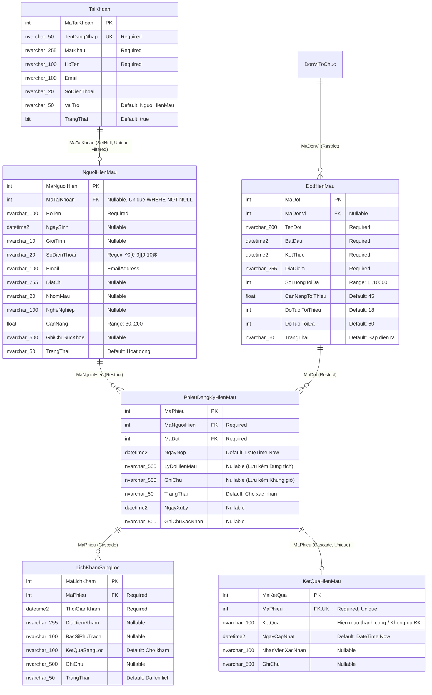

# PHẦN II (NHÓM D, E, F): CÂU HỎI VỀ ASP.NET CORE MVC, MODEL & CƠ SỞ DỮ LIỆU (KÈM ERD), BẢO MẬT & PHÂN QUYỀN

> **Mục tiêu tài liệu:** Bao phủ toàn bộ kiến thức kỹ thuật nền tảng và chuyên sâu gắn trực tiếp với mã nguồn thực tế của Module 3 gồm:
> - **Nhóm D:** Kiến trúc ASP.NET Core MVC, Routing, Model Binding, Validation, EF Core (`.Include`, `.ThenInclude`, `FirstOrDefaultAsync`, `SaveChangesAsync`), `ViewBag`/`ViewData`/`TempData`, Dependency Injection, PRG Pattern, Transaction & Concurrency.
> - **Nhóm E:** Thiết kế Entity Model & Cơ sở dữ liệu SQL Server, sơ đồ ERD (Mermaid), bảng ánh xạ đầy đủ các cột/khóa/ràng buộc và 12 câu hỏi phản biện CSDL.
> - **Nhóm F:** Cơ chế Xác thực (Cookie Authentication), Phân quyền (`[Authorize]`, Role-based), chống CSRF (`[ValidateAntiForgeryToken]`), chống IDOR và chống Mass Assignment.

---

## NHÓM D — CÂU HỎI VỀ ASP.NET CORE MVC TRONG MODULE 3

### Câu D1: Mô hình MVC là gì? Hãy chỉ rõ Model, View, Controller của Module 3 nằm ở những file nào trong dự án?
- **Mức độ:** Cơ bản
- **Câu trả lời mẫu:**
  Thưa cô, **MVC (Model – View – Controller)** là mẫu kiến trúc phần mềm tách ứng dụng thành 3 thành phần có trách nhiệm độc lập:
  1. **Model (Dữ liệu & Quy tắc dữ liệu):** Đại diện cho cấu trúc dữ liệu của hệ thống và các ràng buộc kiểm tra. Trong Module 3, Model gồm `Models/NguoiHienMau.cs` và `Models/PhieuDangKyHienMau.cs` (cùng các model liên kết như `DotHienMau.cs`, `KetQuaHienMau.cs`, `LichKhamSangLoc.cs`, `TaiKhoan.cs`) và lớp ngữ cảnh CSDL `Data/ApplicationDbContext.cs`.
  2. **View (Giao diện hiển thị):** Chịu trách nhiệm trình bày dữ liệu lên trình duyệt cho người dùng bằng cú pháp Razor (`.cshtml`). Trong Module 3, View gồm `Views/DangKy/Create.cshtml`, `Views/DangKy/TheoDoi.cshtml`, `Views/NguoiHienMau/HoSoCaNhan.cshtml` và các trang quản trị `Views/Admin/NguoiHienMau.cshtml`, `Views/Admin/PhieuDangKyHienMau.cshtml`, `Views/Admin/ChiTietPhieuDangKy.cshtml`.
  3. **Controller (Điều phối & Xử lý nghiệp vụ):** Tiếp nhận HTTP Request từ người dùng, gọi kiểm tra nghiệp vụ, tương tác với CSDL qua `ApplicationDbContext` và quyết định trả về View nào hoặc Redirect đi đâu. Trong Module 3, Controller gồm `Controllers/DangKyController.cs`, `Controllers/NguoiHienMauController.cs` và một phần trong `Controllers/AdminController.cs`.
- **Bằng chứng trong dự án:** Cấu trúc thư mục `Models/`, `Views/`, `Controllers/` trong `QuanLyHienMau_UNETI2_TI17A5HN`.
- **Câu hỏi phụ:** *Trong dự án này có tách tầng `Service` hay `Repository` riêng cho Module 3 không?*
- **Trả lời câu hỏi phụ:** Dạ trên nhánh `DamThuTrang_23103100243` hiện tại, dự án không tách tầng Repository hay Service riêng mà tiêm trực tiếp `ApplicationDbContext` vào các Controller (`DangKyController`, `NguoiHienMauController`, `AdminController`), đồng thời các hàm xử lý nghiệp vụ cốt lõi như `EvaluateRecentDonationEligibility` được viết thành các phương thức tĩnh dùng chung ngay trong `DangKyController`.

---

### Câu D2: Một request từ trình duyệt đi vào Module 3 được ASP.NET Core xử lý theo đường đi (Request Pipeline & Routing) như thế nào?
- **Mức độ:** Trung bình
- **Câu trả lời mẫu:**
  Thưa cô, khi người dùng truy cập một đường dẫn (ví dụ `GET /DangKy/TheoDoi` hoặc `POST /NguoiHienMau/HoSoCaNhan`), request sẽ đi qua chuỗi Middleware được cấu hình trong `Program.cs` theo đúng thứ tự:
  1. `UseStaticFiles()` (phục vụ CSS/JS/ảnh nếu là file tĩnh).
  2. `UseRouting()` (phân tích URL để khớp với mẫu định tuyến mặc định `{controller=Home}/{action=Index}/{id?}` ở dòng 60–62 `Program.cs`).
  3. `UseAuthentication()` (đọc Cookie đăng nhập, giải mã ra `ClaimsPrincipal` và gán vào `HttpContext.User`).
  4. `UseAuthorization()` (kiểm tra thuộc tính `[Authorize]` trên `NguoiHienMauController` hoặc `DangKyController.TheoDoi` — nếu chưa đăng nhập sẽ chặn lại và chuyển hướng về `/Account/Login`).
  5. Khởi tạo `Controller` tương ứng (DI Container tự động khởi tạo `ApplicationDbContext` truyền vào Constructor của Controller), thực hiện **Model Binding** ánh xạ dữ liệu từ URL/Form vào tham số của Action.
  6. Thực thi code trong Action (truy vấn/cập nhật DB qua EF Core) và trả về `IActionResult` (`ViewResult` để render file `.cshtml` hoặc `RedirectToActionResult` để chuyển hướng).
- **Bằng chứng trong dự án:** `Program.cs` (dòng 38–62).
- **Câu hỏi phụ:** *Nếu trong `Program.cs` em đặt `app.UseAuthorization()` nằm trước `app.UseAuthentication()` thì chuyện gì xảy ra khi vào `/NguoiHienMau/HoSoCaNhan`?*
- **Trả lời câu hỏi phụ:** Dạ khi đó lúc `UseAuthorization()` chạy kiểm tra quyền thì `UseAuthentication()` chưa chạy để đọc Cookie, dẫn tới `HttpContext.User` luôn bị coi là chưa đăng nhập và người dùng dù đã đăng nhập rồi vẫn bị đá văng ra trang `/Account/Login`.

---

### Câu D3: Sự khác nhau giữa `[HttpGet]` và `[HttpPost]` trong Module 3 là gì? Cho ví dụ cụ thể?
- **Mức độ:** Cơ bản
- **Câu trả lời mẫu:**
  Thưa cô:
  - **`[HttpGet]`** dùng cho các thao tác **truy vấn và hiển thị dữ liệu** lên màn hình, không làm thay đổi dữ liệu trong CSDL, tham số truyền qua URL Query String. Ví dụ: `[HttpGet] Create(int? maDot)` trong `DangKyController.cs` (dòng 207) dùng để mở form đăng ký hiến máu của đợt `maDot`; `[HttpGet] HoSoCaNhan()` trong `NguoiHienMauController.cs` (dòng 48) dùng để xem hồ sơ cá nhân.
  - **`[HttpPost]`** dùng cho các thao tác **gửi dữ liệu từ form lên để thêm mới, cập nhật hoặc hủy dữ liệu** trong CSDL, dữ liệu nằm trong phần thân (Request Body) của gói tin HTTP và đi kèm `[ValidateAntiForgeryToken]`. Ví dụ: `[HttpPost] Create(...)` (dòng 312), `[HttpPost] Huy(int id)` (dòng 725) và `[HttpPost] HoSoCaNhan(NguoiHienMau model)` (dòng 103).
- **Bằng chứng trong dự án:** `DangKyController.cs` (dòng 207, 312, 725), `NguoiHienMauController.cs` (dòng 48, 103).
- **Câu hỏi phụ:** *Vì sao không dùng `[HttpGet]` cho chức năng Hủy phiếu (`/DangKy/Huy/5`) để chỉ cần gắn thẻ `<a href="/DangKy/Huy/5">` cho tiện?*
- **Trả lời câu hỏi phụ:** Dạ nếu dùng `GET` để hủy phiếu sẽ cực kỳ nguy hiểm vì: (1) Không có Anti-Forgery Token nên dễ bị tấn công CSRF (kẻ xấu chèn thẻ `` vào trang khác là người dùng bị hủy phiếu), và (2) Trình duyệt tự tải trước link (Prefetching) hoặc bấm F5 cũng làm thay đổi dữ liệu. Vì vậy bắt buộc phải dùng `<form method="post">` kết hợp `[HttpPost]` và `[ValidateAntiForgeryToken]`.

---

### Câu D4: Model Binding trong ASP.NET Core MVC là gì? Tại sao `NguoiHienMauController.HoSoCaNhan` nhận `NguoiHienMau model` còn `DangKyController.Create` lại nhận từng tham số rời (`int maDot, string hoTen, ...`)?
- **Mức độ:** Trung bình / Khó
- **Câu trả lời mẫu:**
  Thưa cô, **Model Binding** là cơ chế tự động của ASP.NET Core ánh xạ dữ liệu từ HTTP Request (Form fields, Route data, Query string) theo thuộc tính `name` của thẻ HTML vào các tham số của phương thức Action trong Controller.
  Trong Module 3 đang sử dụng cả 2 cách Model Binding:
  1. **Binding theo đối tượng phức hợp (`Complex Object Binding`) tại `NguoiHienMauController.HoSoCaNhan(NguoiHienMau model)` (dòng 105):** Vì form `Views/NguoiHienMau/HoSoCaNhan.cshtml` dùng Tag Helper `asp-for="HoTen"`, `asp-for="SoDienThoai"`, `asp-for="CanNang"`... khớp 1–1 với các thuộc tính của một bảng duy nhất là `NguoiHienMau`.
  2. **Binding theo từng tham số nguyên thủy (`Primitive Parameter Binding`) tại `DangKyController.Create(int maDot, string hoTen, ..., string? volume, string? timeSlot, string? health_q1, string? health_q2)` (dòng 314–332):** Vì form `Views/DangKy/Create.cshtml` là một **form tổng hợp (Composite Form)** thu thập dữ liệu của nhiều nơi cùng lúc: vừa có thông tin của bảng `NguoiHienMau` (`hoTen`, `ngaySinh`, `canNang`), vừa có thông tin của bảng `PhieuDangKyHienMau` (`maDot`, `lyDoHienMau`, `ghiChu`), lại vừa có các trường phụ trợ không có cột riêng trong DB (`volume`, `timeSlot`, `health_q1`, `health_q2`). Nhận theo tham số rời giúp Controller kiểm soát chính xác những trường được phép gửi lên mà không bị lỗi Over-posting.
- **Bằng chứng trong dự án:** `NguoiHienMauController.cs` (dòng 105), `DangKyController.cs` (dòng 314–332).

---

### Câu D5: `ModelState` là gì? Tại sao trong `DangKyController` và `NguoiHienMauController` em lại tự viết code kiểm tra dữ liệu (`errors.Add(...)`) thay vì chỉ dựa vào `ModelState.IsValid`?
- **Mức độ:** Khó / Phản biện
- **Câu trả lời mẫu:**
  Thưa cô, `ModelState` là đối tượng lưu trạng thái của quá trình Model Binding và kết quả kiểm tra các Data Annotations (`[Required]`, `[StringLength]`, `[Range]`, `[RegularExpression]`) khai báo trên class Model.
  Trong `NguoiHienMauController` và `DangKyController`, bên cạnh việc khai báo Data Annotations trong `Models/NguoiHienMau.cs`, em viết tường minh bộ kiểm tra (`NormalizePhone`, `IsValidPhone`, `IsValidAge`, `errors.Add(...)`) ở Controller vì 3 lý do thực tế:
  1. **Xử lý chuẩn hóa trước khi kiểm tra:** Ví dụ người dùng nhập SĐT `0912 345 678` (có khoảng trắng). Nếu chỉ dùng `ModelState.IsValid` với `[RegularExpression(@"^0[0-9]{9,10}$")]`, `ModelState` sẽ báo lỗi ngay lúc binding. Trong khi đó, kiểm tra thủ công ở Controller cho phép gọi `NormalizePhone` xóa khoảng trắng trước rồi mới kiểm tra Regex.
  2. **Kiểm tra các quy tắc nghiệp vụ động và phụ thuộc thời gian:** Data Annotations mặc định như `[Range]` không tự tính được tuổi `18–60` chính xác theo ngày sinh nhật hiện tại (`IsValidAge`), không đối chiếu được cân nặng với ngưỡng động `dotHienMau.CanNangToiThieu` lấy từ CSDL, và không kiểm tra được chu kỳ 84 ngày.
  3. **Tránh lỗi Navigation Property hoặc trường không có trên form làm `ModelState.IsValid == false`:** Gom lỗi vào `List<string> errors` rồi đưa ra `TempData["Error"]` giúp thông báo tiếng Việt rõ ràng và thống nhất trên toàn bộ giao diện.
- **Bằng chứng trong dự án:** `NguoiHienMauController.cs` (dòng 126–198), `DangKyController.cs` (dòng 422–523).

---

### Câu D6: Giải thích cách hoạt động của `DbContext`, `DbSet<T>` và Dependency Injection (`readonly ApplicationDbContext _context`) trong Module 3?
- **Mức độ:** Cơ bản / Trung bình
- **Câu trả lời mẫu:**
  Thưa cô:
  - **`ApplicationDbContext` (kế thừa `DbContext` của EF Core):** Là lớp đại diện cho một phiên làm việc (Session) với cơ sở dữ liệu SQL Server, chịu trách nhiệm mở kết nối, theo dõi thay đổi của các đối tượng (Change Tracking), dịch câu lệnh LINQ sang SQL và lưu dữ liệu.
  - **`DbSet<NguoiHienMau>` và `DbSet<PhieuDangKyHienMau>`:** Đại diện cho các bảng `NguoiHienMau` và `PhieuDangKyHienMau` trong CSDL, cho phép thực hiện các truy vấn LINQ và thao tác thêm/sửa/xóa.
  - **Dependency Injection (DI):** Trong `Program.cs` (dòng 9–10), `ApplicationDbContext` được đăng ký vào DI Container thông qua `builder.Services.AddDbContext<ApplicationDbContext>(...)` với vòng đời mặc định là **Scoped** (mỗi HTTP request được cấp một instance `ApplicationDbContext` riêng và tự giải phóng khi kết thúc request). Trong `DangKyController` (dòng 16–21) và `NguoiHienMauController` (dòng 12–18), em khai báo `private readonly ApplicationDbContext _context;` và nhận nó qua Constructor mà không bao giờ phải viết `new ApplicationDbContext()`.
- **Bằng chứng trong dự án:** `Program.cs` (dòng 9–10), `Data/ApplicationDbContext.cs` (dòng 6–19), `DangKyController.cs` (dòng 16–21).

---

### Câu D7: Giải thích ý nghĩa của `.Include()`, `.ThenInclude()`, `FirstOrDefaultAsync()`, `Where()`, `OrderByDescending()` và `SaveChangesAsync()` trong code Module 3?
- **Mức độ:** Trung bình
- **Câu trả lời mẫu:**
  Thưa cô, đây là các phương thức LINQ và Entity Framework Core được sử dụng xuyên suốt trong Module 3:
  1. **`.Include(...)` và `.ThenInclude(...)` (Eager Loading):** Yêu cầu EF Core sinh câu lệnh `LEFT JOIN` / `INNER JOIN` để nạp luôn các bảng liên quan trong cùng một lần truy vấn.
     - *Ví dụ thực tế trong code:* Tại `NguoiHienMauController.cs` (dòng 56–64):
       ```csharp
       var nguoiHienMau = await _context.NguoiHienMaus
           .Include(n => n.TaiKhoan)
           .Include(n => n.PhieuDangKyHienMaus)
               .ThenInclude(p => p.KetQuaHienMau)
           ...
       ```
       Câu lệnh này lấy `NguoiHienMau`, nối sang `PhieuDangKyHienMaus` (`.Include`), rồi từ mỗi phiếu đăng ký lại nối tiếp sang `KetQuaHienMau` (`.ThenInclude`).
  2. **`Where(...)`:** Lọc các bản ghi thỏa mãn điều kiện (dịch thành mệnh đề `WHERE` trong SQL).
  3. **`OrderByDescending(...).ThenByDescending(...)`:** Sắp xếp kết quả giảm dần theo tiêu chí chính và tiêu chí phụ (ví dụ sắp xếp phiếu theo `NgayNop` giảm dần, nếu cùng ngày nộp thì phiếu nào có `MaPhieu` lớn hơn xếp trước — dòng 708–709 `DangKyController.cs`).
  4. **`FirstOrDefaultAsync(...)`:** Thực thi truy vấn bất đồng bộ trả về bản ghi đầu tiên khớp điều kiện (`SELECT TOP(1)`), hoặc trả về `null` nếu không tìm thấy (không ném ngoại lệ như `FirstAsync()`).
  5. **`await _context.SaveChangesAsync()`:** Kiểm tra tất cả các thực thể đang được `DbContext` theo dõi (`Added`, `Modified`, `Deleted`), phát sinh các câu lệnh `INSERT`, `UPDATE`, `DELETE` tương ứng xuống SQL Server bên trong một giao dịch và trả về số dòng bị ảnh hưởng.
- **Bằng chứng trong dự án:** `NguoiHienMauController.cs` (dòng 56–65, 278), `DangKyController.cs` (dòng 268–272, 703–710, 610).

---

### Câu D8: Vì sao các Action trong `DangKyController` và `NguoiHienMauController` đều dùng `async / await` (`Task<IActionResult>`)?
- **Mức độ:** Trung bình
- **Câu trả lời mẫu:**
  Thưa cô, truy vấn và ghi dữ liệu xuống SQL Server là các thao tác vào/ra mạng và đĩa cứng (**I/O-bound operations**) tốn nhiều thời gian chờ đợi. Khi sử dụng `async / await` cùng các hàm bất đồng bộ như `FirstOrDefaultAsync()`, `ToListAsync()`, `SaveChangesAsync()`, trong lúc chờ SQL Server phản hồi, luồng (Thread) của Web Server Kestrel được giải phóng về Thread Pool để phục vụ các HTTP request của những người dùng khác, giúp ứng dụng chịu tải tốt hơn và không bị nghẽn luồng (Thread Starvation).
- **Bằng chứng trong dự án:** Tất cả các action trong `DangKyController.cs` và `NguoiHienMauController.cs` đều trả về `async Task<IActionResult>`.

---

### Câu D9: Phân biệt `ViewBag`, `ViewData` và `TempData` trong dự án? Khi nào dùng cái nào trong Module 3?
- **Mức độ:** Trung bình (Rất hay hỏi)
- **Câu trả lời mẫu:**
  Thưa cô:
  1. **`ViewData` và `ViewBag`:** Đều dùng để truyền dữ liệu phụ từ Controller sang View **chỉ trong phạm vi của 1 HTTP Request hiện tại** (nếu gọi `RedirectToAction` thì dữ liệu trong `ViewBag`/`ViewData` sẽ bị mất trắng). `ViewData` là kiểu từ điển `ViewDataDictionary` truy cập bằng chuỗi khóa (ví dụ `ViewData["Title"] = "Theo dõi đăng ký hiến máu"`), còn `ViewBag` là một lớp bọc kiểu `dynamic` bên trên `ViewData` giúp viết code gọn hơn (ví dụ `ViewBag.CoTheDangKy`, `ViewBag.EligibilityResult`, `ViewBag.ConfirmedSuccessfulCount`).
  2. **`TempData`:** Được lưu tạm qua Cookie/Session để truyền thông báo **sống sót qua một lần chuyển hướng (`RedirectToAction`)**, và sẽ tự động bị xóa sau khi được đọc trên View đích. Trong Module 3, mọi thông báo thành công hoặc báo lỗi sau khi `POST` (`TempData["Success"]`, `TempData["Error"]`) đều dùng `TempData` để hiển thị sau khi redirect về trang `TheoDoi`, `Create` hoặc `HoSoCaNhan`.
- **Bằng chứng trong dự án:**
  - `ViewBag`: `DangKyController.cs` (dòng 237, 267, 290, 305–308, 718), `NguoiHienMauController.cs` (dòng 94–99).
  - `TempData`: `DangKyController.cs` (dòng 231, 426, 547, 670, 779), `NguoiHienMauController.cs` (dòng 202, 279).

---

### Câu D10: Sự khác nhau giữa `return View(...)` và `return RedirectToAction(...)` là gì?
- **Mức độ:** Cơ bản / Trung bình
- **Câu trả lời mẫu:**
  Thưa cô:
  - **`return View(model)`:** Server giữ nguyên HTTP Request hiện tại, nạp file `.cshtml` tương ứng và kết xuất (render) thẳng mã HTML trả về cho trình duyệt (HTTP Status `200 OK`). URL trên thanh địa chỉ của trình duyệt không thay đổi.
  - **`return RedirectToAction("TheoDoi")`:** Server không trả về HTML mà trả về mã phản hồi chuyển hướng (HTTP Status `302 Found`) kèm header `Location: /DangKy/TheoDoi`, yêu cầu trình duyệt của người dùng tự tạo một request `HTTP GET` mới tới địa chỉ `/DangKy/TheoDoi`.

---

## NHÓM E — CÂU HỎI VỀ MODEL VÀ CƠ SỞ DỮ LIỆU (KÈM ERD & BẢNG ÁNH XẠ CHI TIẾT)

### 1. Sơ đồ Thực thể Liên kết (ERD) Tập trung vào Module 3 và các bảng liên quan



---

### 2. Bảng chi tiết các thuộc tính của 2 Entity cốt lõi Module 3 (`NguoiHienMau` & `PhieuDangKyHienMau`)

| Bảng / Entity | Thuộc tính C# | Kiểu dữ liệu C# / SQL | Khóa / Index | Ràng buộc (Model & Controller) | Ý nghĩa nghiệp vụ & Nơi sử dụng |
|---|---|---|---|---|---|
| **`NguoiHienMau`** | `MaNguoiHien` | `int` / `int IDENTITY(1,1)` | **PK** (`[Key]`) | Tự tăng, bắt buộc | Mã định danh duy nhất của hồ sơ người hiến máu. |
| `NguoiHienMau` | `MaTaiKhoan` | `int?` / `int NULL` | **FK** -> `TaiKhoan.MaTaiKhoan`<br>**Unique Filtered Index** (`[MaTaiKhoan] IS NOT NULL`) | Cho phép `null` (khách vãng lai), duy nhất nếu khác `null`. `OnDelete(SetNull)` | Liên kết `1 - 0..1` với tài khoản đăng nhập. Dùng trong `DangKyController`, `NguoiHienMauController`. |
| `NguoiHienMau` | `HoTen` | `string` / `nvarchar(100)` | - | `[Required]`, `[StringLength(100)]` | Họ và tên người hiến máu. Đồng bộ với `TaiKhoan.HoTen` khi cập nhật hồ sơ. |
| `NguoiHienMau` | `NgaySinh` | `DateTime?` / `datetime2 NULL` | - | Controller bắt buộc nhập khi lưu hồ sơ/đăng ký, kiểm tra tuổi `18–60` (`IsValidAge`) | Ngày tháng năm sinh để tính tuổi đủ điều kiện hiến máu. |
| `NguoiHienMau` | `GioiTinh` | `string?` / `nvarchar(10) NULL` | - | `[StringLength(10)]`, Controller kiểm tra thuộc `{"Nam", "Nữ", "Khác"}` | Giới tính sinh học của người hiến máu. |
| `NguoiHienMau` | `SoDienThoai` | `string?` / `nvarchar(20) NULL` | - | `[StringLength(20)]`, `[RegularExpression(@"^0[0-9]{9,10}$")]` | Số điện thoại liên hệ và là khóa tra cứu lịch sử cho khách vãng lai chưa có tài khoản. |
| `NguoiHienMau` | `Email` | `string?` / `nvarchar(100) NULL` | - | `[StringLength(100)]`, `[EmailAddress]` | Địa chỉ email nhận thông báo của người hiến máu. |
| `NguoiHienMau` | `DiaChi` | `string?` / `nvarchar(255) NULL` | - | `[StringLength(255)]`, bắt buộc khi đăng ký/cập nhật hồ sơ | Địa chỉ thường trú hoặc liên hệ hiện tại. |
| `NguoiHienMau` | `NhomMau` | `string?` / `nvarchar(20) NULL` | - | `[StringLength(20)]` (ví dụ `A+`, `O+`, `B-`, `AB+`, `Chưa biết`) | Nhóm máu hệ ABO/Rh. Dùng để thống kê kho máu tại `Admin/NguoiHienMau`. |
| `NguoiHienMau` | `NgheNghiep` | `string?` / `nvarchar(100) NULL` | - | `[StringLength(100)]` | Nghề nghiệp hoặc đơn vị công tác/học tập. |
| `NguoiHienMau` | `CanNang` | `double?` / `float NULL` | - | `[Range(30, 200)]`, khi đăng ký phải `>= dotHienMau.CanNangToiThieu` | Cân nặng hiện tại (kg) để sàng lọc thể lực. |
| `NguoiHienMau` | `GhiChuSucKhoe` | `string?` / `nvarchar(500) NULL` | - | `[StringLength(500)]` | Ghi chú tiền sử bệnh lý, dị ứng hoặc lưu ý y tế cá nhân. |
| `NguoiHienMau` | `TrangThai` | `string` / `nvarchar(50)` | - | `[StringLength(50)]`, mặc định `"Hoạt động"` | Trạng thái hồ sơ (`"Hoạt động"` hoặc `"Tạm ngưng"`). |
| **`PhieuDangKyHienMau`** | `MaPhieu` | `int` / `int IDENTITY(1,1)` | **PK** (`[Key]`) | Tự tăng, bắt buộc | Mã định danh duy nhất của tờ phiếu đăng ký (hiển thị dạng `#DKHM-00001`). |
| `PhieuDangKyHienMau` | `MaNguoiHien` | `int` / `int NOT NULL` | **FK** -> `NguoiHienMau.MaNguoiHien` | `[Required]`, `OnDelete(Restrict)` | Xác định phiếu này thuộc về người hiến máu nào. |
| `PhieuDangKyHienMau` | `MaDot` | `int` / `int NOT NULL` | **FK** -> `DotHienMau.MaDot` | `[Required]`, `OnDelete(Restrict)` | Xác định phiếu này đăng ký tham gia chiến dịch hiến máu nào. |
| `PhieuDangKyHienMau` | `NgayNop` | `DateTime` / `datetime2 NOT NULL` | - | Mặc định `DateTime.Now` | Thời điểm người dùng gửi phiếu đăng ký trực tuyến. |
| `PhieuDangKyHienMau` | `LyDoHienMau` | `string?` / `nvarchar(500) NULL` | - | `[StringLength(500)]` | Lưu lý do hiến máu kèm chuỗi `"Dung tích dự kiến: 250ml/350ml/450ml"`. |
| `PhieuDangKyHienMau` | `GhiChu` | `string?` / `nvarchar(500) NULL` | - | `[StringLength(500)]` | Lưu ghi chú của người hiến kèm chuỗi `"Khung giờ hẹn: Ca 1/Ca 2..."`. |
| `PhieuDangKyHienMau` | `TrangThai` | `string` / `nvarchar(50)` | - | `[StringLength(50)]`, mặc định `"Chờ xác nhận"` | Lưu trạng thái vòng đời phiếu (1 trong 8 trạng thái chuẩn). |
| `PhieuDangKyHienMau` | `NgayXuLy` | `DateTime?` / `datetime2 NULL` | - | Nullable | Thời điểm gần nhất phiếu được duyệt, từ chối, hủy, khám hoặc ghi nhận kết quả. |
| `PhieuDangKyHienMau` | `GhiChuXacNhan` | `string?` / `nvarchar(500) NULL` | - | `[StringLength(500)]` | Ghi chú của Admin/Nhân viên y tế khi duyệt hoặc từ chối phiếu. |

---

### 3. Giải đáp các câu hỏi phản biện về Cơ sở dữ liệu (Nhóm E)

#### Câu E1: Vì sao trong bảng `NguoiHienMau`, khóa ngoại `MaTaiKhoan` lại cho phép `NULL` (`int?`) và phải cấu hình `.HasFilter("[MaTaiKhoan] IS NOT NULL")` trên Unique Index?
- **Mức độ:** Khó / Phản biện
- **Câu trả lời mẫu:**
  Thưa cô:
  1. `MaTaiKhoan` được thiết kế là `int?` (cho phép `NULL`) vì hệ thống hỗ trợ cả trường hợp **khách vãng lai chưa có tài khoản đăng nhập** vẫn có thể điền form đăng ký hiến máu hoặc nhân viên y tế nhập hồ sơ trực tiếp tại điểm hiến máu.
  2. Trong SQL Server, nếu chỉ tạo một `UNIQUE INDEX` thông thường trên cột nullable, SQL Server coi `NULL` cũng là một giá trị duy nhất và sẽ **chỉ cho phép tối đa 1 bản ghi có `MaTaiKhoan = NULL`**, bản ghi khách vãng lai thứ 2 sẽ bị báo lỗi trùng khóa `NULL`! Vì vậy, trong `ApplicationDbContext.cs` (dòng 24–26), bắt buộc phải dùng **Filtered Unique Index** `.HasIndex(n => n.MaTaiKhoan).IsUnique().HasFilter("[MaTaiKhoan] IS NOT NULL")` để đảm bảo: nếu đã có `MaTaiKhoan` thì phải là duy nhất `1 - 1`, còn nếu `MaTaiKhoan IS NULL` thì cho phép có nhiều bản ghi.
- **Bằng chứng trong dự án:** `Data/ApplicationDbContext.cs` (dòng 24–26) và `Migrations/20261007035106_InitialCreate.cs` (dòng 221–226).

---

#### Câu E2: Vì sao quan hệ giữa `PhieuDangKyHienMau` và `KetQuaHienMau` là `1 - 0..1` (mỗi phiếu tối đa 1 kết quả), trong khi quan hệ giữa `PhieuDangKyHienMau` và `LichKhamSangLoc` lại là `1 - n` (mỗi phiếu có thể có nhiều lịch khám)?
- **Mức độ:** Trung bình / Khó
- **Câu trả lời mẫu:**
  Thưa cô:
  - **Đối với `KetQuaHienMau` (`1 - 0..1`):** Mỗi tờ phiếu đăng ký trong một đợt hiến máu chỉ dẫn đến tối đa **1 kết quả hiến máu cuối cùng** (hoặc `"Hiến máu thành công"`, hoặc `"Không đủ điều kiện hiến"`, hoặc chưa có kết quả `0`). Do đó trong `ApplicationDbContext.cs` (dòng 77–81), `KetQuaHienMau.MaPhieu` được đánh `IsUnique()`.
  - **Đối với `LichKhamSangLoc` (`1 - n`):** Trong thực tế vận hành, một phiếu đăng ký có thể được xếp lịch khám sàng lọc lần 1, nhưng sau đó bác sĩ hoặc người hiến bận nên lịch khám lần 1 bị chuyển sang `"Đã hủy"` và nhân viên y tế tạo lại lịch khám sàng lọc lần 2 cho cùng phiếu đó. Nhờ quan hệ `1 - n`, hệ thống lưu giữ được lịch sử các lần đổi lịch khám.
- **Bằng chứng trong dự án:** `Data/ApplicationDbContext.cs` (dòng 70–81), `Models/PhieuDangKyHienMau.cs` (dòng 51–53).

---

#### Câu E3: Nếu xóa một bản ghi `NguoiHienMau` hoặc một `DotHienMau` đã có phiếu đăng ký thì SQL Server phản ứng thế nào?
- **Mức độ:** Trung bình
- **Câu trả lời mẫu:**
  Thưa cô, trong `ApplicationDbContext.cs` (dòng 55 và 61), cả hai khóa ngoại `MaNguoiHien` và `MaDot` trên bảng `PhieuDangKyHienMau` đều được cấu hình `.OnDelete(DeleteBehavior.Restrict)`. Do đó, nếu có bất kỳ lệnh nào cố gắng xóa một `NguoiHienMau` hoặc `DotHienMau` đang có ít nhất 1 bản ghi `PhieuDangKyHienMau` tham chiếu tới, SQL Server và EF Core sẽ lập tức chặn thao tác xóa và ném ra ngoại lệ `DbUpdateException` (vi phạm ràng buộc khóa ngoại `REFERENCE constraint`), giúp bảo vệ toàn vẹn dữ liệu lịch sử.

---

#### Câu E4: Các cột nào trong bảng `NguoiHienMau` và `PhieuDangKyHienMau` đang cho phép `NULL` trong CSDL nhưng lại bắt buộc nhập ở tầng Controller? Vì sao?
- **Mức độ:** Khó / Phản biện
- **Câu trả lời mẫu:**
  Thưa cô, trong `Models/NguoiHienMau.cs`, các cột `NgaySinh`, `GioiTinh`, `SoDienThoai`, `Email`, `DiaChi`, `CanNang` được khai báo là kiểu nullable (`DateTime?`, `string?`, `double?`). Lý do là:
  - Khi người dùng vừa mới đăng ký tài khoản ở Module 1 (`AccountController.Register` dòng 150–157), form đăng ký tài khoản chỉ thu thập `HoTen`, `Email`, `SoDienThoai` chứ chưa hỏi `NgaySinh`, `GioiTinh`, `DiaChi`, `CanNang`. Nhờ các cột này cho phép `NULL` dưới DB, `AccountController.Register` có thể khởi tạo ngay một bản ghi `NguoiHienMau` khung sườn mà không bị lỗi SQL.
  - Sau đó, khi người dùng vào Module 3 để **Cập nhật hồ sơ (`HoSoCaNhan`)** hoặc **Đăng ký hiến máu (`DangKy/Create`)**, Controller mới kiểm tra bắt buộc phải điền đầy đủ `NgaySinh`, `GioiTinh`, `DiaChi`, `CanNang` trước khi cho phép lưu hồ sơ hoặc tạo phiếu.
- **Bằng chứng trong dự án:** `AccountController.cs` (dòng 150–157), `Models/NguoiHienMau.cs` (dòng 19–49), `NguoiHienMauController.cs` (dòng 126–198).

---

#### Câu E5: Thiết kế cơ sở dữ liệu hiện tại của Module 3 có điểm nào chưa tối ưu (điểm yếu CSDL) và nếu được thiết kế lại em sẽ cải tiến gì?
- **Mức độ:** Phản biện (Điểm cộng lớn khi trả lời)
- **Câu trả lời mẫu:**
  Thưa cô, qua quá trình phân tích sâu mã nguồn, em nhận thấy thiết kế CSDL hiện tại có **4 điểm có thể chuẩn hóa tốt hơn**:
  1. **Tách cột riêng cho `DungTichDuKien` (`int`) và `KhungGioHen` (`nvarchar(100)`) trong bảng `PhieuDangKyHienMau`:** Hiện tại 2 thông tin này đang được ghép chuỗi vào cột `LyDoHienMau` và `GhiChu` (dòng 580–596 `DangKyController.cs`), khiến việc thống kê tổng lượng máu thực tế theo từng túi `250ml`/`350ml`/`450ml` bị khó khăn (trang `HoSoCaNhan.cshtml` đang phải nhân tạm `totalCount * 350`).
  2. **Thêm cột `TheTichMauHien` (`int`) và `NgayHienMauThucTe` (`DateTime`) vào bảng `KetQuaHienMau`:** Để tách bạch ngày lấy máu thực tế ngoài đời với ngày nhân viên nhập/sửa bản ghi (`NgayCapNhat`), tránh việc sửa ghi chú kết quả làm trôi mốc 84 ngày.
  3. **Thêm `Index` trên cột `NguoiHienMau.SoDienThoai` và Composite Index trên `PhieuDangKyHienMau(MaNguoiHien, MaDot, TrangThai)`:** Hiện tại hệ thống tìm kiếm người hiến theo `SoDienThoai` và lọc phiếu theo `(MaNguoiHien, MaDot)` rất thường xuyên nhưng chưa đánh Index cho các cột này.
  4. **Chuẩn hóa các chuỗi trạng thái (`TrangThai`):** Hiện đang lưu dạng chuỗi tiếng Việt có dấu (`"Chờ xác nhận"`, `"Hiến máu thành công"`), dễ xảy ra lỗi gõ sai chính tả nếu lập trình viên không dùng hằng số hoặc Enum.

---

## NHÓM F — CÂU HỎI VỀ BẢO MẬT VÀ PHÂN QUYỀN TRONG MODULE 3

### Câu F1: Hệ thống xác thực người dùng (Authentication) và phân quyền (Authorization) hoạt động như thế nào trong dự án?
- **Mức độ:** Trung bình
- **Câu trả lời mẫu:**
  Thưa cô, dự án sử dụng cơ chế **Cookie-based Authentication** của ASP.NET Core:
  1. **Khi đăng nhập (`AccountController.Login`, dòng 69–91):** Sau khi kiểm tra khớp `TenDangNhap`, `MatKhau` và `TrangThai == true` trong bảng `TaiKhoan`, hệ thống tạo danh sách `List<Claim>` gồm:
     - `ClaimTypes.Name`: `taiKhoan.HoTen`
     - `ClaimTypes.NameIdentifier`: `taiKhoan.TenDangNhap`
     - `ClaimTypes.Email`: `taiKhoan.Email`
     - `ClaimTypes.Role`: `taiKhoan.VaiTro` (`"Admin"`, `"NhanVienYTe"`, hoặc `"NguoiHienMau"`)
     - Custom Claim `"MaTaiKhoan"`: `taiKhoan.MaTaiKhoan.ToString()`
     Sau đó gọi `HttpContext.SignInAsync(CookieAuthenticationDefaults.AuthenticationScheme, new ClaimsPrincipal(claimsIdentity), ...)` để mã hóa và gửi Cookie về trình duyệt (thời hạn 7 ngày).
  2. **Khi kiểm tra quyền truy cập (Authorization):**
     - `NguoiHienMauController`: Gắn `[Authorize]` ở cấp class (dòng 10) -> bắt buộc phải đăng nhập mới vào được `HoSoCaNhan`.
     - `DangKyController`: Gắn `[Authorize]` trên action `TheoDoi` (dòng 685) và `Huy` (dòng 726). Riêng action `Create` không gắn `[Authorize]` để cho phép cả khách vãng lai đăng ký.
     - `AdminController`: Gắn `[Authorize(Roles = "Admin,NhanVienYTe")]` ở cấp class (dòng 11) -> nếu tài khoản có `VaiTro = "NguoiHienMau"` cố tình gõ URL `/Admin/NguoiHienMau` sẽ bị chặn ngay và chuyển tới `AccessDeniedPath = "/Account/AccessDenied"`.
- **Bằng chứng trong dự án:** `Program.cs` (dòng 13–21), `AccountController.cs` (dòng 69–91), `NguoiHienMauController.cs` (dòng 10), `DangKyController.cs` (dòng 685, 726), `AdminController.cs` (dòng 11).

---

### Câu F2: Làm sao Module 3 biết chắc chắn hồ sơ hoặc phiếu đăng ký đang thao tác là của đúng người dùng đang đăng nhập chứ không phải của người khác (Chống lỗ hổng IDOR - Insecure Direct Object Reference)?
- **Mức độ:** Khó / Phản biện
- **Câu trả lời mẫu:**
  Thưa cô, lỗ hổng IDOR xảy ra khi ứng dụng tin tưởng vào `MaNguoiHien` hoặc `MaPhieu` do người dùng gửi lên từ trình duyệt mà không kiểm tra quyền sở hữu. Trong Module 3, em phòng chống IDOR bằng nguyên tắc: **Luôn lấy danh tính gốc từ Claim `"MaTaiKhoan"` trong Cookie đã được mã hóa bởi Server**:
  1. **Tại `NguoiHienMauController.HoSoCaNhan` (cả GET và POST):** Không nhận tham số `id` trên URL và không dùng `model.MaNguoiHien` từ form. Hệ thống luôn lấy `int.TryParse(User.FindFirst("MaTaiKhoan")?.Value, out int maTaiKhoan)` rồi truy vấn `_context.NguoiHienMaus.FirstOrDefaultAsync(n => n.MaTaiKhoan == maTaiKhoan)`. Do đó người dùng A không bao giờ xem hay sửa được hồ sơ của người dùng B.
  2. **Tại `DangKyController.TheoDoi`:** Chỉ truy vấn các phiếu có `p.MaNguoiHien == nguoiHienMau.MaNguoiHien` (của `maTaiKhoan` trong Cookie).
  3. **Tại `DangKyController.Huy(int id)` (dòng 743–745):** Khi người dùng gửi `id` phiếu cần hủy, câu lệnh LINQ bắt buộc kiểm tra đồng thời 2 điều kiện:
     ```csharp
     var phieu = await _context.PhieuDangKyHienMaus
         .FirstOrDefaultAsync(p => p.MaPhieu == id && p.MaNguoiHien == nguoiHienMau.MaNguoiHien);
     ```
     Nếu người dùng A sửa HTML truyền `id` phiếu của người dùng B vào, truy vấn sẽ trả về `null` và hệ thống báo lỗi *"Không tìm thấy phiếu đăng ký hoặc bạn không có quyền hủy phiếu này."*
- **Bằng chứng trong dự án:** `NguoiHienMauController.cs` (dòng 51, 108, 220), `DangKyController.cs` (dòng 688, 729, 745).

---

### Câu F3: `[ValidateAntiForgeryToken]` hoạt động như thế nào và bảo vệ Module 3 khỏi cuộc tấn công gì?
- **Mức độ:** Trung bình
- **Câu trả lời mẫu:**
  Thưa cô, `[ValidateAntiForgeryToken]` bảo vệ ứng dụng khỏi cuộc tấn công **CSRF (Cross-Site Request Forgery — Giả mạo yêu cầu liên trang)**.
  Cách hoạt động:
  - Khi render một thẻ `<form method="post">` trong Razor View (như form đăng ký ở `Create.cshtml`, form hủy phiếu ở `TheoDoi.cshtml`, form cập nhật hồ sơ ở `HoSoCaNhan.cshtml`), ASP.NET Core tự động sinh ra một thẻ `<input type="hidden" name="__RequestVerificationToken" value="..." />` đồng thời lưu một token đối ứng vào Cookie của trình duyệt.
  - Khi form được submit lên các action có gắn `[ValidateAntiForgeryToken]`, ASP.NET Core so sánh token trong Form Body với token trong Cookie. Nếu một trang web độc hại bên ngoài tự động gửi request `POST /DangKy/Huy` thay mặt người dùng, trang độc hại đó không thể đọc hay gửi kèm `__RequestVerificationToken` hợp lệ trong form, nên Server sẽ lập tức từ chối với mã lỗi `400 Bad Request`.
- **Bằng chứng trong dự án:** `DangKyController.cs` (dòng 313, 727), `NguoiHienMauController.cs` (dòng 104).

---

### Câu F4: Phân biệt trung thực những cơ chế bảo mật ĐÃ CÓ và những điểm CHƯA CÓ trong dự án hiện tại?
- **Mức độ:** Phản biện
- **Câu trả lời mẫu:**
  Thưa cô, để đánh giá khách quan nhất về mặt bảo mật của dự án:
  - **Những cơ chế bảo mật ĐÃ TRIỂN KHAI TỐT trong Module 3:**
    1. Xác thực bằng Cookie (`CookieAuthenticationDefaults.AuthenticationScheme`) và phân quyền theo Role (`[Authorize]`, `[Authorize(Roles = "Admin,NhanVienYTe")]`).
    2. Chống tấn công CSRF bằng `[ValidateAntiForgeryToken]` trên toàn bộ các action `POST`.
    3. Chống tấn công SQL Injection nhờ sử dụng 100% truy vấn tham số hóa qua LINQ của Entity Framework Core (không nối chuỗi SQL thô).
    4. Chống tấn công XSS (Cross-Site Scripting) nhờ cơ chế tự động mã hóa HTML (`@variable` HTML Encoding) của Razor View.
    5. Chống tấn công IDOR và Over-posting / Mass Assignment khi xem/sửa hồ sơ và hủy phiếu.
  - **Những hạn chế bảo mật CHƯA CÓ (cần cải tiến nếu đưa vào vận hành thực tế):**
    1. Ở Module 1 (`AccountController.cs` dòng 33 và 140), mật khẩu trong bảng `TaiKhoan` hiện đang lưu dạng văn bản thuần (**Plaintext**) để phục vụ việc kiểm thử các tài khoản mẫu trong đồ án. Trong thực tế sản xuất bắt buộc phải băm mật khẩu bằng `PasswordHasher<TaiKhoan>` hoặc `BCrypt`.
    2. Khi cập nhật `HoTen` ở `NguoiHienMauController.HoSoCaNhan [POST]` (dòng 249), hệ thống đã cập nhật `TaiKhoan.HoTen` trong DB nhưng chưa gọi lại `SignInAsync` để làm mới Claim `ClaimTypes.Name` trong Cookie, nên tên hiển thị trên thanh điều hướng (`_Layout.cshtml`) chỉ đổi sau khi đăng xuất và đăng nhập lại.
    3. Action `POST /DangKy/Create` cho phép khách vãng lai nhập số điện thoại để đăng ký và cập nhật thông tin `NguoiHienMau` theo SĐT mà chưa có bước xác thực mã OTP gửi về điện thoại.
