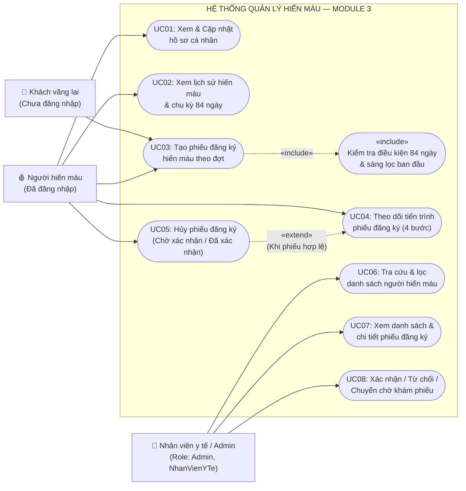
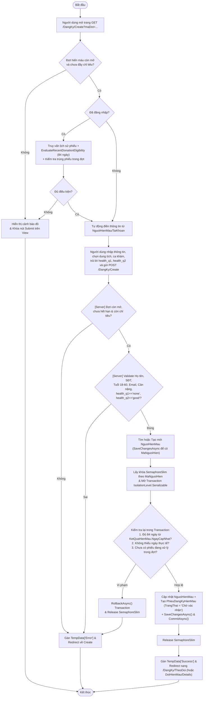
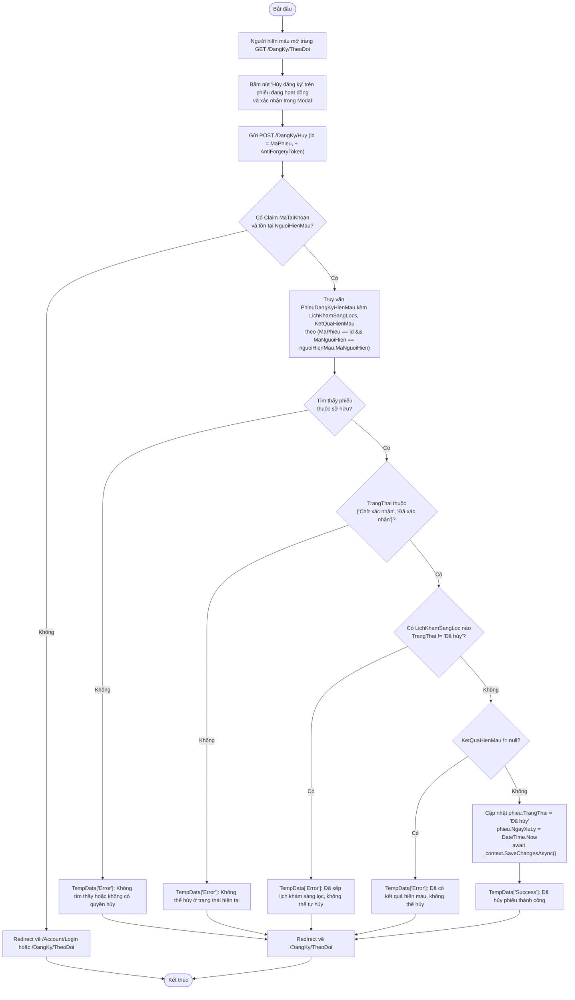
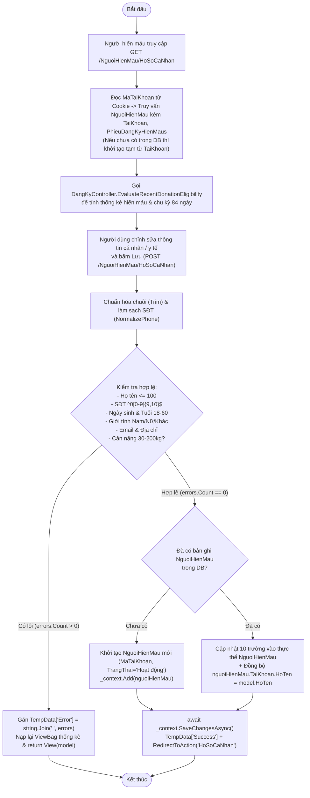
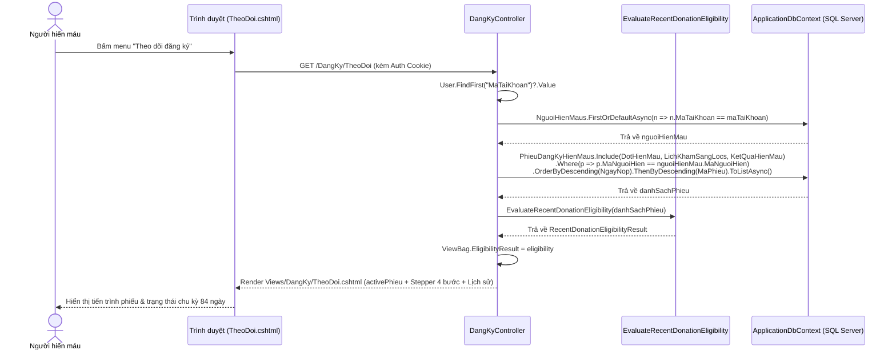
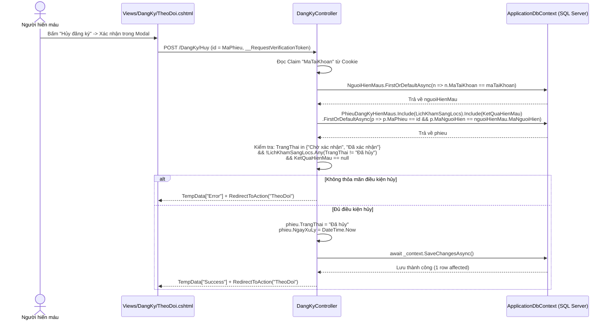
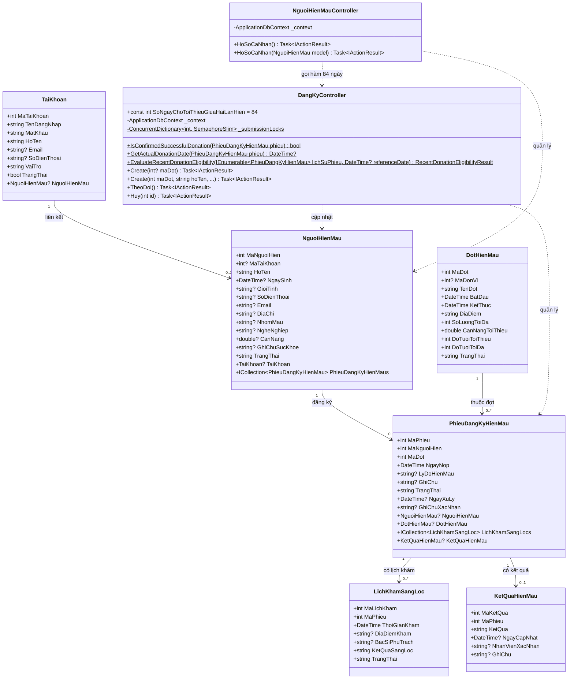

# PHẦN II (NHÓM G): CÂU HỎI VỀ PHÂN TÍCH THIẾT KẾ HỆ THỐNG VÀ BIỂU ĐỒ UML CỦA MODULE 3

> **Lưu ý xác minh tài liệu trong Repository:**
> Qua khảo sát toàn bộ cây thư mục của repository `QuanLyHienMau_UNETI2_TI17A5HN`, dự án hiện **không lưu trữ các file biểu đồ UML gốc** (như `.drawio`, `.asta`, `.vpp`, `.puml`, `.docx`). Do đó, toàn bộ các biểu đồ UML dưới đây (**Use Case Diagram, Activity Diagrams, Sequence Diagrams, Class Diagram**) là **Biểu đồ tham khảo chuẩn xác 100% được trích xuất ngược (Reverse-Engineered) trực tiếp từ mã nguồn thực tế** trên nhánh `DamThuTrang_23103100243`. Sinh viên có thể sử dụng trực tiếp bộ biểu đồ này để đưa vào slide/báo cáo hoặc trả lời câu hỏi bảo vệ môn Phân tích thiết kế hệ thống.

---

## 1. XÁC ĐỊNH TÁC NHÂN (ACTORS) VÀ CA SỬ DỤNG (USE CASES) CỦA MODULE 3

### 1.1. Bảng phân tích các Tác nhân (Actors) tương tác với Module 3

| STT | Tác nhân (Actor) | Vai trò trong code (`VaiTro` / Auth) | Các Use Case thực hiện trong Module 3 |
|---|---|---|---|
| 1 | **Người hiến máu (Registered Donor)** | Đã đăng nhập (`[Authorize]`), thông thường `VaiTro == "NguoiHienMau"` | - UC01: Xem và cập nhật hồ sơ cá nhân (`NguoiHienMau/HoSoCaNhan`) - UC02: Xem thống kê chu kỳ 84 ngày & lịch sử hiến máu (`HoSoCaNhan`, `TheoDoi`) - UC03: Tạo phiếu đăng ký hiến máu (`DangKy/Create`) - UC04: Theo dõi tiến trình phiếu đăng ký (`DangKy/TheoDoi`) - UC05: Hủy phiếu đăng ký hiến máu (`DangKy/Huy`) |
| 2 | **Khách vãng lai (Guest Donor)** | Chưa đăng nhập (`!User.Identity.IsAuthenticated`) | - UC03: Tạo phiếu đăng ký hiến máu trực tuyến qua Số điện thoại (`DangKy/Create`) |
| 3 | **Nhân viên y tế / Quản trị viên (Admin / Medical Staff)** | Đã đăng nhập với `[Authorize(Roles = "Admin,NhanVienYTe")]` | - UC06: Tra cứu & lọc danh sách người hiến máu (`Admin/NguoiHienMau`) - UC07: Quản lý & xem chi tiết phiếu đăng ký (`Admin/PhieuDangKyHienMau`, `ChiTietPhieuDangKy`) - UC08: Duyệt / Từ chối / Chuyển phiếu sang chờ khám (`XacNhanPhieu`, `TuChoiPhieu`, `ChuyenChoKham`) |

---

### 1.2. Biểu đồ Ca sử dụng (Use Case Diagram) của Module 3

---

## 2. BIỂU ĐỒ HOẠT ĐỘNG (ACTIVITY DIAGRAMS) CỦA MODULE 3

### 2.1. Biểu đồ Hoạt động: Tạo phiếu đăng ký hiến máu (`DangKyController.Create`)

---

### 2.2. Biểu đồ Hoạt động: Hủy phiếu đăng ký hiến máu (`DangKyController.Huy`)

---

### 2.3. Biểu đồ Hoạt động: Cập nhật Hồ sơ cá nhân (`NguoiHienMauController.HoSoCaNhan`)

---

## 3. BIỂU ĐỒ TUẦN TỰ (SEQUENCE DIAGRAMS) CỦA MODULE 3

### 3.1. Biểu đồ Tuần tự: Theo dõi phiếu đăng ký (`GET /DangKy/TheoDoi`)

---

### 3.2. Biểu đồ Tuần tự: Hủy phiếu đăng ký (`POST /DangKy/Huy`)

---

## 4. BIỂU ĐỒ LỚP (CLASS DIAGRAM) CỦA MODULE 3 VÀ CÁC LỚP LIÊN QUAN

---

## 5. CÂU HỎI BẢO VỆ VỀ PHÂN TÍCH THIẾT KẾ & UML (NHÓM G)

### Câu G1: Trong biểu đồ Use Case của Module 3, tại sao mối quan hệ giữa Use Case "Tạo phiếu đăng ký hiến máu" và "Kiểm tra điều kiện 84 ngày & sàng lọc ban đầu" lại là `«include»` chứ không phải `«extend»`?
- **Mức độ:** Trung bình
- **Câu trả lời mẫu:**
  Thưa cô, trong UML:
  - Quan hệ **`«include»`** biểu thị một hành vi **bắt buộc phải được thực hiện** mỗi khi Use Case cơ sở được kích hoạt. Trong code `DangKyController.Create`, bất kỳ lần tạo phiếu nào cũng bắt buộc phải chạy qua bước kiểm tra điều kiện 84 ngày (`EvaluateRecentDonationEligibility`) và sàng lọc tuổi/cân nặng/khảo sát sức khỏe. Không có ngoại lệ nào tạo được phiếu mà bỏ qua bước này, nên đây là `«include»`.
  - Ngược lại, quan hệ **`«extend»`** dùng cho hành vi **tùy chọn có điều kiện** (ví dụ: người dùng đang ở Use Case *"Theo dõi tiến trình phiếu đăng ký"*, chỉ khi người dùng có nhu cầu hủy và phiếu đang ở trạng thái `"Chờ xác nhận"` / `"Đã xác nhận"` thì mới kích hoạt Use Case mở rộng *"Hủy phiếu đăng ký"*).

---

### Câu G2: Từ Biểu đồ Tuần tự (Sequence Diagram) và Biểu đồ Lớp (Class Diagram), nhóm đã ánh xạ sang kiến trúc ASP.NET Core MVC như thế nào?
- **Mức độ:** Trung bình / Khó
- **Câu trả lời mẫu:**
  Thưa cô, theo phương pháp phân tích thiết kế hướng đối tượng (OOAD) sử dụng mẫu **Boundary – Control – Entity (BCE)**, nhóm ánh xạ sang ASP.NET Core MVC theo tỷ lệ 1–1 như sau:
  1. **Lớp Biên (Boundary / Interface Classes)** trên Sequence Diagram -> Ánh xạ thành các **Razor Views (`.cshtml`)** trong thư mục `Views/DangKy/` (`Create.cshtml`, `TheoDoi.cshtml`) và `Views/NguoiHienMau/` (`HoSoCaNhan.cshtml`).
  2. **Lớp Điều khiển (Control Classes)** chứa các thông điệp xử lý luồng nghiệp vụ -> Ánh xạ thành các **Controllers** (`DangKyController.cs`, `NguoiHienMauController.cs`, `AdminController.cs`).
  3. **Lớp Thực thể (Entity Classes)** trên Class Diagram và ERD -> Ánh xạ thành các **Model classes** trong thư mục `Models/` (`NguoiHienMau.cs`, `PhieuDangKyHienMau.cs`, `KetQuaHienMau.cs`, `LichKhamSangLoc.cs`, `DotHienMau.cs`, `TaiKhoan.cs`) được quản lý bởi `ApplicationDbContext`.

---

### Câu G3: Giữa Biểu đồ Lớp phân tích (Analysis Class Diagram) và Biểu đồ Thực thể Liên kết vật lý (Physical ERD) của Module 3 có điểm gì khác nhau?
- **Mức độ:** Khó
- **Câu trả lời mẫu:**
  Thưa cô:
  - Trên **Biểu đồ Lớp (Class Diagram)** ở mức hướng đối tượng C#, các mối quan hệ giữa `NguoiHienMau`, `PhieuDangKyHienMau`, `KetQuaHienMau` được biểu diễn thông qua các **Navigation Properties** (thuộc tính điều hướng đối tượng như `public ICollection<PhieuDangKyHienMau> PhieuDangKyHienMaus { get; set; }` và `public KetQuaHienMau? KetQuaHienMau { get; set; }`), đồng thời có thêm các lớp điều khiển như `DangKyController` chứa phương thức hành vi (`EvaluateRecentDonationEligibility`, `Create`, `Huy`).
  - Còn trên **Sơ đồ ERD vật lý trong SQL Server**, không có các phương thức hay `ICollection<T>`, mà các mối quan hệ được hiện thực hóa bằng các cột **Khóa chính (`PK`)**, **Khóa ngoại (`FK`: `MaTaiKhoan`, `MaNguoiHien`, `MaDot`, `MaPhieu`)**, kiểu dữ liệu vật lý (`nvarchar(100)`, `datetime2`, `float`) và các **Chỉ mục (`Unique Filtered Index`)**.
