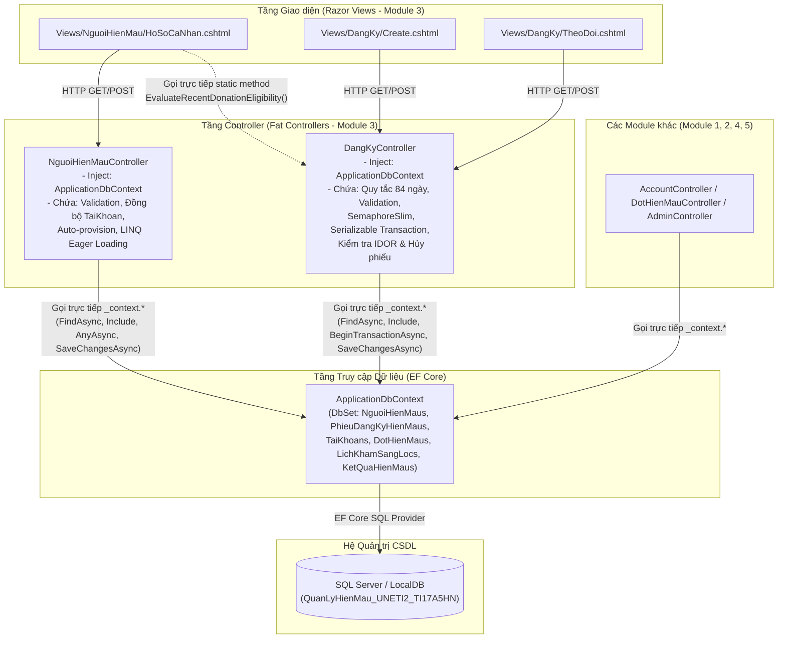
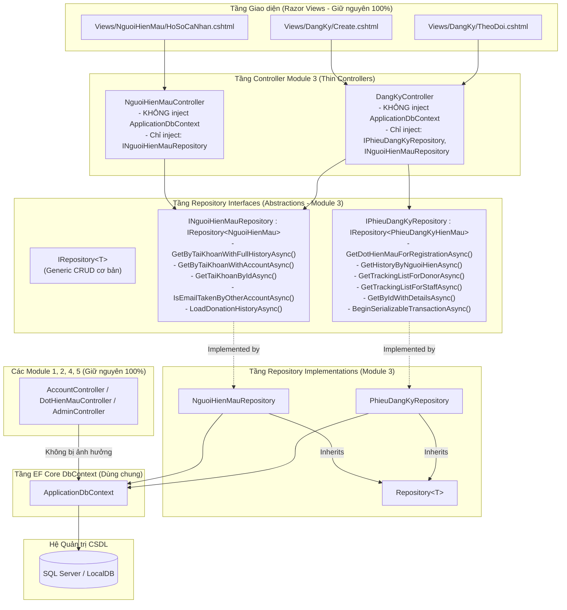
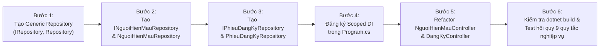

# BÁO CÁO KIỂM TRA KIẾN TRÚC REPOSITORY PATTERN – MODULE 3 (QUẢN LÝ HỒ SƠ NGƯỜI HIẾN MÁU & ĐĂNG KÝ HIẾN MÁU)

- **Dự án**: `QuanLyHienMau_UNETI2_TI17A5HN`
- **Nền tảng kỹ thuật**: ASP.NET Core MVC (`.NET 10.0`), Entity Framework Core (`10.0.5`), SQL Server / LocalDB, Razor Views, Cookie Authentication (`QuanLyHienMau.Auth`).
- **Phạm vi kiểm tra**: **Chỉ riêng Module 3** – Quản lý hồ sơ người hiến máu và Đăng ký hiến máu (`NguoiHienMauController`, `DangKyController`, và phần quản trị danh sách người hiến máu liên quan trong `AdminController.NguoiHienMau`).
- **Trạng thái thực hiện**: **Chỉ kiểm tra tĩnh & lập báo cáo đánh giá kiến trúc (Read-Only Audit)** – Tuyệt đối không chỉnh sửa bất kỳ file `.cs`, `.cshtml`, `.json`, cấu hình hay cơ sở dữ liệu nào.

---

## 1. TỔNG QUAN KIẾN TRÚC TRUY CẬP DATABASE HIỆN TẠI

Qua rà soát toàn bộ mã nguồn thực tế trong dự án [`QuanLyHienMau_UNETI2_TI17A5HN.csproj`](file:///e:/InformationTechnology/visual%20t%C3%ADm/QuanLyHienMau_UNETI2_TI17A5HN/QuanLyHienMau_UNETI2_TI17A5HN/QuanLyHienMau_UNETI2_TI17A5HN.csproj), kiến trúc truy cập dữ liệu hiện tại của toàn hệ thống nói chung và **Module 3** nói riêng đang theo mô hình **Monolithic MVC truyền thống truy cập trực tiếp `DbContext` (Direct DbContext-in-Controller Pattern)**:

1. **Tầng Data Access duy nhất là `ApplicationDbContext`**:
   - File [`Data/ApplicationDbContext.cs`](file:///e:/InformationTechnology/visual%20t%C3%ADm/QuanLyHienMau_UNETI2_TI17A5HN/QuanLyHienMau_UNETI2_TI17A5HN/Data/ApplicationDbContext.cs#L6-L84) kế thừa `DbContext` của Entity Framework Core, khai báo 7 `DbSet<T>`: `TaiKhoans`, `DonViToChucs`, `DotHienMaus`, `NguoiHienMaus`, `PhieuDangKyHienMaus`, `LichKhamSangLocs`, `KetQuaHienMaus`.
   - Trong [`Program.cs`](file:///e:/InformationTechnology/visual%20t%C3%ADm/QuanLyHienMau_UNETI2_TI17A5HN/QuanLyHienMau_UNETI2_TI17A5HN/Program.cs#L11-L12), chỉ có duy nhất `ApplicationDbContext` được đăng ký vào Dependency Injection Container thông qua `builder.Services.AddDbContext<ApplicationDbContext>(...)`.
2. **Hoàn toàn chưa có tầng Repository và chưa có tầng Service**:
   - Trong toàn bộ cây thư mục dự án, **không tồn tại** thư mục `Repositories/`, `Services/`, hay `Interfaces/`.
   - Mọi Controller có tương tác CSDL (`NguoiHienMauController`, `DangKyController`, `AdminController`, `AccountController`, `DotHienMauController`) đều inject trực tiếp `ApplicationDbContext _context` qua Constructor.
3. **Tình trạng "Fat Controller" tại Module 3**:
   - [`DangKyController.cs`](file:///e:/InformationTechnology/visual%20t%C3%ADm/QuanLyHienMau_UNETI2_TI17A5HN/QuanLyHienMau_UNETI2_TI17A5HN/Controllers/DangKyController.cs) (802 dòng) và [`NguoiHienMauController.cs`](file:///e:/InformationTechnology/visual%20t%C3%ADm/QuanLyHienMau_UNETI2_TI17A5HN/QuanLyHienMau_UNETI2_TI17A5HN/Controllers/NguoiHienMauController.cs) (284 dòng) gánh đồng thời 4 trách nhiệm:
     1. Điều phối HTTP Request/Response, đọc Cookie Claims (`ClaimTypes.NameIdentifier`, `ClaimTypes.Role`), gán `ViewBag`/`TempData`.
     2. Thực thi trực tiếp các câu truy vấn LINQ to Entities (`Include`, `ThenInclude`, `Where`, `OrderByDescending`, `AnyAsync`, `FirstOrDefaultAsync`, `ToListAsync`, `FindAsync`).
     3. Xử lý toàn bộ quy tắc nghiệp vụ y tế (kiểm tra chu kỳ 84 ngày từ `KetQuaHienMau.NgayCapNhat`, kiểm tra tuổi 18–60, cân nặng 30–200kg và `>= CanNangToiThieu`, khảo sát sức khỏe, đồng bộ `NguoiHienMau` ↔ `TaiKhoan`).
     4. Quản lý khóa đồng bộ (`SemaphoreSlim`) và giao dịch mức cô lập cao (`_context.Database.BeginTransactionAsync(IsolationLevel.Serializable)`).

---

## 2. DANH SÁCH CONTROLLER MODULE 3 ĐANG SỬ DỤNG `DbContext` TRỰC TIẾP

### 2.1. Bảng tổng hợp các Controller liên quan đến Module 3

| STT | File Controller | Thuộc tính phạm vi | Cách inject `DbContext` | Số phương thức gọi `_context` trực tiếp | Mức độ phụ thuộc `DbContext` |
| :---: | :--- | :--- | :--- | :---: | :---: |
| 1 | [`Controllers/NguoiHienMauController.cs`](file:///e:/InformationTechnology/visual%20t%C3%ADm/QuanLyHienMau_UNETI2_TI17A5HN/QuanLyHienMau_UNETI2_TI17A5HN/Controllers/NguoiHienMauController.cs) | **100% thuộc Module 3** (Quản lý hồ sơ cá nhân người hiến máu) | `private readonly ApplicationDbContext _context;` (dòng 18–23) | **2 / 3** action (`HoSoCaNhan [GET]`, `HoSoCaNhan [POST]`) | **100% trực tiếp** |
| 2 | [`Controllers/DangKyController.cs`](file:///e:/InformationTechnology/visual%20t%C3%ADm/QuanLyHienMau_UNETI2_TI17A5HN/QuanLyHienMau_UNETI2_TI17A5HN/Controllers/DangKyController.cs) | **100% thuộc Module 3** (Đăng ký hiến máu, kiểm tra điều kiện, theo dõi & hủy phiếu) | `private readonly ApplicationDbContext _context;` (dòng 20, 179–182) | **4 / 5** action (`Create [GET]`, `Create [POST]`, `TheoDoi [GET]`, `Huy [POST]`) | **100% trực tiếp** (kèm Transaction) |
| 3 | [`Controllers/AdminController.cs`](file:///e:/InformationTechnology/visual%20t%C3%ADm/QuanLyHienMau_UNETI2_TI17A5HN/QuanLyHienMau_UNETI2_TI17A5HN/Controllers/AdminController.cs) | **File dùng chung đa Module** (Module 2, 3, 4, 5). Trong đó action [`NguoiHienMau`](file:///e:/InformationTechnology/visual%20t%C3%ADm/QuanLyHienMau_UNETI2_TI17A5HN/QuanLyHienMau_UNETI2_TI17A5HN/Controllers/AdminController.cs#L624-L807) được chú thích thuộc Module 3 | `private readonly ApplicationDbContext _context;` (dòng 13–18) | Action `NguoiHienMau` gọi `_context.NguoiHienMaus` trực tiếp 8 lần (dòng 635–732) | **100% trực tiếp** (Dùng chung `_context` với 18 action của Module 2, 4, 5) |

---

### 2.2. Chi tiết từng vị trí truy cập `ApplicationDbContext` trong [`NguoiHienMauController.cs`](file:///e:/InformationTechnology/visual%20t%C3%ADm/QuanLyHienMau_UNETI2_TI17A5HN/QuanLyHienMau_UNETI2_TI17A5HN/Controllers/NguoiHienMauController.cs)

- **Khai báo & Constructor Injection**:
  - Dòng `18`: `private readonly ApplicationDbContext _context;`
  - Dòng `20–23`: `public NguoiHienMauController(ApplicationDbContext context) { _context = context; }`

| Phương thức (Action) | Dòng code | Lệnh gọi `_context` / EF Core trực tiếp | Loại thao tác DB & Truy vấn LINQ |
| :--- | :---: | :--- | :--- |
| [`HoSoCaNhan()` `[HttpGet]`](file:///e:/InformationTechnology/visual%20t%C3%ADm/QuanLyHienMau_UNETI2_TI17A5HN/QuanLyHienMau_UNETI2_TI17A5HN/Controllers/NguoiHienMauController.cs#L33-L76) | `43` | `await _context.TaiKhoans.FindAsync(maTaiKhoan)` | Truy vấn khóa chính bảng `TaiKhoan` kiểm tra trạng thái hoạt động. |
| [`HoSoCaNhan()` `[HttpGet]`](file:///e:/InformationTechnology/visual%20t%C3%ADm/QuanLyHienMau_UNETI2_TI17A5HN/QuanLyHienMau_UNETI2_TI17A5HN/Controllers/NguoiHienMauController.cs#L50-L59) | `50–59` | `await _context.NguoiHienMaus.Include(n => n.TaiKhoan).Include(n => n.PhieuDangKyHienMaus).ThenInclude(p => p.DotHienMau!).ThenInclude(d => d.DonViToChuc).Include(n => n.PhieuDangKyHienMaus).ThenInclude(p => p.LichKhamSangLocs).Include(n => n.PhieuDangKyHienMaus).ThenInclude(p => p.KetQuaHienMau).FirstOrDefaultAsync(n => n.MaTaiKhoan == maTaiKhoan)` | Eager Loading 4 nhánh quan hệ (`TaiKhoan`, `PhieuDangKyHienMaus`, `DotHienMau.DonViToChuc`, `LichKhamSangLocs`, `KetQuaHienMau`) + `FirstOrDefaultAsync`. |
| [`HoSoCaNhan()` `[HttpGet]`](file:///e:/InformationTechnology/visual%20t%C3%ADm/QuanLyHienMau_UNETI2_TI17A5HN/QuanLyHienMau_UNETI2_TI17A5HN/Controllers/NguoiHienMauController.cs#L71-L72) | `71–72` | `_context.NguoiHienMaus.Add(nguoiHienMau); await _context.SaveChangesAsync();` | Thêm mới tự động (auto-provisioning) bản ghi `NguoiHienMau` và lưu DB khi tài khoản đăng nhập lần đầu chưa có hồ sơ. |
| [`HoSoCaNhan(NguoiHienMau model)` `[HttpPost]`](file:///e:/InformationTechnology/visual%20t%C3%ADm/QuanLyHienMau_UNETI2_TI17A5HN/QuanLyHienMau_UNETI2_TI17A5HN/Controllers/NguoiHienMauController.cs#L81-L282) | `89` | `await _context.TaiKhoans.FindAsync(maTaiKhoan)` | Truy vấn `TaiKhoan` theo PK khi submit form cập nhật. |
| [`HoSoCaNhan(NguoiHienMau model)` `[HttpPost]`](file:///e:/InformationTechnology/visual%20t%C3%ADm/QuanLyHienMau_UNETI2_TI17A5HN/QuanLyHienMau_UNETI2_TI17A5HN/Controllers/NguoiHienMauController.cs#L96-L98) | `96–98` | `await _context.NguoiHienMaus.Include(n => n.TaiKhoan).FirstOrDefaultAsync(n => n.MaTaiKhoan == maTaiKhoan)` | Lấy thực thể `NguoiHienMau` kèm `TaiKhoan` (Tracked Entity) để cập nhật. |
| [`HoSoCaNhan(NguoiHienMau model)` `[HttpPost]`](file:///e:/InformationTechnology/visual%20t%C3%ADm/QuanLyHienMau_UNETI2_TI17A5HN/QuanLyHienMau_UNETI2_TI17A5HN/Controllers/NguoiHienMauController.cs#L109) | `109` | `_context.NguoiHienMaus.Add(nguoiHienMau);` | Track thực thể `NguoiHienMau` mới nếu chưa tồn tại. |
| [`HoSoCaNhan(NguoiHienMau model)` `[HttpPost]`](file:///e:/InformationTechnology/visual%20t%C3%ADm/QuanLyHienMau_UNETI2_TI17A5HN/QuanLyHienMau_UNETI2_TI17A5HN/Controllers/NguoiHienMauController.cs#L192-L193) | `192–193` | `await _context.TaiKhoans.AnyAsync(t => t.MaTaiKhoan != maTaiKhoan && t.Email != null && t.Email.ToLower() == email.ToLower())` | Truy vấn LINQ `AnyAsync` kiểm tra trùng lặp Email với tài khoản khác. |
| [`HoSoCaNhan(NguoiHienMau model)` `[HttpPost]`](file:///e:/InformationTechnology/visual%20t%C3%ADm/QuanLyHienMau_UNETI2_TI17A5HN/QuanLyHienMau_UNETI2_TI17A5HN/Controllers/NguoiHienMauController.cs#L241-L248) | `241–248` | `await _context.Entry(nguoiHienMau).Collection(n => n.PhieuDangKyHienMaus).Query().Include(...).LoadAsync()` | Sử dụng trực tiếp ChangeTracker API (`_context.Entry(...).Collection(...).Query().LoadAsync()`) để nạp lại danh sách phiếu khi form lỗi `ModelState`. |
| [`HoSoCaNhan(NguoiHienMau model)` `[HttpPost]`](file:///e:/InformationTechnology/visual%20t%C3%ADm/QuanLyHienMau_UNETI2_TI17A5HN/QuanLyHienMau_UNETI2_TI17A5HN/Controllers/NguoiHienMauController.cs#L279) | `279` | `await _context.SaveChangesAsync();` | Lưu thay đổi của cả `NguoiHienMau` và `TaiKhoan` xuống CSDL. |

---

### 2.3. Chi tiết từng vị trí truy cập `ApplicationDbContext` trong [`DangKyController.cs`](file:///e:/InformationTechnology/visual%20t%C3%ADm/QuanLyHienMau_UNETI2_TI17A5HN/QuanLyHienMau_UNETI2_TI17A5HN/Controllers/DangKyController.cs)

- **Khai báo & Constructor Injection**:
  - Dòng `20`: `private readonly ApplicationDbContext _context;`
  - Dòng `179–182`: `public DangKyController(ApplicationDbContext context) { _context = context; }`

| Phương thức (Action) | Dòng code | Lệnh gọi `_context` / EF Core trực tiếp | Loại thao tác DB, LINQ & Transaction |
| :--- | :---: | :--- | :--- |
| [`Create(int? maDot)` `[HttpGet]`](file:///e:/InformationTechnology/visual%20t%C3%ADm/QuanLyHienMau_UNETI2_TI17A5HN/QuanLyHienMau_UNETI2_TI17A5HN/Controllers/DangKyController.cs#L193-L310) | `201` | `await _context.TaiKhoans.FindAsync(maTaiKhoan)` | Lấy `TaiKhoan` theo PK. |
| [`Create(int? maDot)` `[HttpGet]`](file:///e:/InformationTechnology/visual%20t%C3%ADm/QuanLyHienMau_UNETI2_TI17A5HN/QuanLyHienMau_UNETI2_TI17A5HN/Controllers/DangKyController.cs#L208-L210) | `208–210` | `await _context.NguoiHienMaus.Include(n => n.TaiKhoan).FirstOrDefaultAsync(n => n.MaTaiKhoan == maTaiKhoan)` | Lấy hồ sơ `NguoiHienMau` theo `MaTaiKhoan`. |
| [`Create(int? maDot)` `[HttpGet]`](file:///e:/InformationTechnology/visual%20t%C3%ADm/QuanLyHienMau_UNETI2_TI17A5HN/QuanLyHienMau_UNETI2_TI17A5HN/Controllers/DangKyController.cs#L221-L222) | `221–222` | `_context.NguoiHienMaus.Add(nguoiHienMau); await _context.SaveChangesAsync();` | Tự động khởi tạo `NguoiHienMau` mới nếu chưa có. |
| [`Create(int? maDot)` `[HttpGet]`](file:///e:/InformationTechnology/visual%20t%C3%ADm/QuanLyHienMau_UNETI2_TI17A5HN/QuanLyHienMau_UNETI2_TI17A5HN/Controllers/DangKyController.cs#L235-L247) | `235–247` | `await _context.DotHienMaus.Include(d => d.DonViToChuc).FirstOrDefaultAsync(...)` và `.Where(d => d.TrangThai == "Đang mở đăng ký" && d.NgayBatDauDangKy <= today && d.HanDangKy >= today).OrderByDescending(d => d.NgayBatDauDangKy).FirstOrDefaultAsync()` | Truy vấn `DotHienMau` theo `maDot` hoặc lấy đợt đang mở đăng ký mới nhất. |
| [`Create(int? maDot)` `[HttpGet]`](file:///e:/InformationTechnology/visual%20t%C3%ADm/QuanLyHienMau_UNETI2_TI17A5HN/QuanLyHienMau_UNETI2_TI17A5HN/Controllers/DangKyController.cs#L276-L280) | `276–280` | `await _context.PhieuDangKyHienMaus.Include(p => p.KetQuaHienMau).Include(p => p.DotHienMau).Where(p => p.MaNguoiHien == nguoiHienMau.MaNguoiHien).ToListAsync()` | Lấy toàn bộ lịch sử phiếu kèm `KetQuaHienMau` để kiểm tra điều kiện 84 ngày và kiểm tra trùng phiếu trong đợt. |
| [`Create(...)` `[HttpPost]`](file:///e:/InformationTechnology/visual%20t%C3%ADm/QuanLyHienMau_UNETI2_TI17A5HN/QuanLyHienMau_UNETI2_TI17A5HN/Controllers/DangKyController.cs#L315-L616) | `338` | `await _context.TaiKhoans.FindAsync(maTaiKhoan)` | Kiểm tra tài khoản tồn tại và đang `"Hoạt động"`. |
| [`Create(...)` `[HttpPost]`](file:///e:/InformationTechnology/visual%20t%C3%ADm/QuanLyHienMau_UNETI2_TI17A5HN/QuanLyHienMau_UNETI2_TI17A5HN/Controllers/DangKyController.cs#L345-L347) | `345–347` | `await _context.NguoiHienMaus.Include(n => n.TaiKhoan).FirstOrDefaultAsync(n => n.MaTaiKhoan == maTaiKhoan)` | Lấy hồ sơ `NguoiHienMau` kèm `TaiKhoan`. |
| [`Create(...)` `[HttpPost]`](file:///e:/InformationTechnology/visual%20t%C3%ADm/QuanLyHienMau_UNETI2_TI17A5HN/QuanLyHienMau_UNETI2_TI17A5HN/Controllers/DangKyController.cs#L362-L364) | `362–364` | `await _context.DotHienMaus.Include(d => d.DonViToChuc).FirstOrDefaultAsync(d => d.MaDot == maDot)` | Lấy thông tin đợt hiến máu để kiểm tra trạng thái, hạn đăng ký và `CanNangToiThieu`. |
| [`Create(...)` `[HttpPost]`](file:///e:/InformationTechnology/visual%20t%C3%ADm/QuanLyHienMau_UNETI2_TI17A5HN/QuanLyHienMau_UNETI2_TI17A5HN/Controllers/DangKyController.cs#L412-L416) | `412–416` | `await _context.PhieuDangKyHienMaus.Include(p => p.KetQuaHienMau).Include(p => p.DotHienMau).Where(p => p.MaNguoiHien == nguoiHienMau.MaNguoiHien).ToListAsync()` | Pre-check lịch sử phiếu trước khi vào vùng khóa đồng bộ. |
| [`Create(...)` `[HttpPost]`](file:///e:/InformationTechnology/visual%20t%C3%ADm/QuanLyHienMau_UNETI2_TI17A5HN/QuanLyHienMau_UNETI2_TI17A5HN/Controllers/DangKyController.cs#L483-L484) | `483–484` | `await _context.TaiKhoans.AnyAsync(t => t.MaTaiKhoan != maTaiKhoan && t.Email != null && t.Email.ToLower() == finalEmail.ToLower())` | Kiểm tra trùng Email với tài khoản khác. |
| [`Create(...)` `[HttpPost]`](file:///e:/InformationTechnology/visual%20t%C3%ADm/QuanLyHienMau_UNETI2_TI17A5HN/QuanLyHienMau_UNETI2_TI17A5HN/Controllers/DangKyController.cs#L535-L607) | `535, 546, 561, 607` | `await using var transaction = await _context.Database.BeginTransactionAsync(IsolationLevel.Serializable);` ... `await transaction.RollbackAsync();` ... `await transaction.CommitAsync();` | **Quản lý Transaction trực tiếp trong Controller** với mức cô lập `IsolationLevel.Serializable`. |
| [`Create(...)` `[HttpPost]`](file:///e:/InformationTechnology/visual%20t%C3%ADm/QuanLyHienMau_UNETI2_TI17A5HN/QuanLyHienMau_UNETI2_TI17A5HN/Controllers/DangKyController.cs#L537-L541) | `537–541` | `await _context.PhieuDangKyHienMaus.Include(p => p.KetQuaHienMau).Include(p => p.DotHienMau).Where(p => p.MaNguoiHien == nguoiHienMau.MaNguoiHien).ToListAsync()` | Truy vấn lại lịch sử phiếu bên trong Transaction `Serializable` để chống Race Condition. |
| [`Create(...)` `[HttpPost]`](file:///e:/InformationTechnology/visual%20t%C3%ADm/QuanLyHienMau_UNETI2_TI17A5HN/QuanLyHienMau_UNETI2_TI17A5HN/Controllers/DangKyController.cs#L605-L606) | `605–606` | `_context.PhieuDangKyHienMaus.Add(phieu); await _context.SaveChangesAsync();` | Thêm phiếu đăng ký mới đồng thời lưu các cập nhật trên `nguoiHienMau` và `nguoiHienMau.TaiKhoan`. |
| [`TheoDoi(int? id, string? code)` `[HttpGet]`](file:///e:/InformationTechnology/visual%20t%C3%ADm/QuanLyHienMau_UNETI2_TI17A5HN/QuanLyHienMau_UNETI2_TI17A5HN/Controllers/DangKyController.cs#L620-L716) | `628–629` | `await _context.NguoiHienMaus.FirstOrDefaultAsync(n => n.MaTaiKhoan == maTaiKhoan)` | Tìm `NguoiHienMau` của người dùng hiện tại. |
| [`TheoDoi(int? id, string? code)` `[HttpGet]`](file:///e:/InformationTechnology/visual%20t%C3%ADm/QuanLyHienMau_UNETI2_TI17A5HN/QuanLyHienMau_UNETI2_TI17A5HN/Controllers/DangKyController.cs#L633-L660) | `633–660` | `IQueryable<PhieuDangKyHienMau> query = _context.PhieuDangKyHienMaus.Include(p => p.DotHienMau!).ThenInclude(d => d.DonViToChuc).Include(p => p.NguoiHienMau).Include(p => p.LichKhamSangLocs).Include(p => p.KetQuaHienMau);` + `.Where(...)` / `.Take(30)` + `.ToListAsync()` | Xây dựng cây `IQueryable<PhieuDangKyHienMau>` trực tiếp trong Controller và thực thi `ToListAsync()`. |
| [`TheoDoi(int? id, string? code)` `[HttpGet]`](file:///e:/InformationTechnology/visual%20t%C3%ADm/QuanLyHienMau_UNETI2_TI17A5HN/QuanLyHienMau_UNETI2_TI17A5HN/Controllers/DangKyController.cs#L674-L693) | `674, 693` | `await query.FirstOrDefaultAsync(p => p.MaPhieu == id.Value)` / `parsedId` | Truy vấn trực tiếp `FirstOrDefaultAsync` trên `IQueryable` khi Staff/Admin tra cứu mã phiếu ngoài top 30. |
| [`Huy(int id)` `[HttpPost]`](file:///e:/InformationTechnology/visual%20t%C3%ADm/QuanLyHienMau_UNETI2_TI17A5HN/QuanLyHienMau_UNETI2_TI17A5HN/Controllers/DangKyController.cs#L721-L800) | `729, 736–742, 796` | `await _context.TaiKhoans.FindAsync(maTaiKhoan)`, `await _context.NguoiHienMaus.FirstOrDefaultAsync(...)`, `await _context.PhieuDangKyHienMaus.Include(p => p.LichKhamSangLocs).Include(p => p.KetQuaHienMau).FirstOrDefaultAsync(p => p.MaPhieu == id)`, `await _context.SaveChangesAsync()` | Truy vấn kiểm tra quyền sở hữu phiếu, kiểm tra điều kiện hủy và lưu trạng thái `"Đã hủy"`. |

---

### 2.4. Chi tiết phần thuộc phạm vi Module 3 trong [`AdminController.cs`](file:///e:/InformationTechnology/visual%20t%C3%ADm/QuanLyHienMau_UNETI2_TI17A5HN/QuanLyHienMau_UNETI2_TI17A5HN/Controllers/AdminController.cs#L623-L807)

Tại [`AdminController.cs`](file:///e:/InformationTechnology/visual%20t%C3%ADm/QuanLyHienMau_UNETI2_TI17A5HN/QuanLyHienMau_UNETI2_TI17A5HN/Controllers/AdminController.cs#L623-L625), action `NguoiHienMau` có ghi chú rõ:
```csharp
// GET: /Admin/NguoiHienMau
// Module 3: Quản lý người hiến máu & phân loại nhóm máu hiếm (Admin)
```
Trong phương thức này (dòng `625–807`):
- Dòng `635–640`: Gọi 6 lệnh `await _context.NguoiHienMaus.CountAsync(...)` liên tiếp để đếm tổng người hiến và các nhóm máu hiếm `O-`, `A-`, `B-`, `AB-`.
- Dòng `643–647`: Khởi tạo `allDonorsQuery = _context.NguoiHienMaus.Include(n => n.TaiKhoan).Include(n => n.PhieuDangKyHienMaus).ThenInclude(p => p.KetQuaHienMau).AsQueryable();`.
- Dòng `652–662`: Thực thi `await allDonorsQuery.Select(...).ToListAsync()` để tính KPI người đủ điều kiện và người hiến tích cực.
- Dòng `675–732`: Lọc `IQueryable` theo `search`, `nhomMau`, `rhGroup`, `status` và gọi `await query.OrderByDescending(n => n.MaNguoiHien).ToListAsync()`.

> [!WARNING]
> **Lưu ý quan trọng về ranh giới file dùng chung `AdminController.cs`**:
> `AdminController.cs` là file dùng chung chứa **19 actions** của cả Module 2 (`DonViToChuc`, `CreateDonViToChuc`, `EditDonViToChuc`, `DeleteDonViToChuc`), Module 3 (`NguoiHienMau`), Module 4 (`PhieuDangKyHienMau`, `ChiTietPhieuDangKy`, `XacNhanPhieu`, `TuChoiPhieu`, `ChuyenChoKham`, `LichKhamSangLoc`, `TaoLichKham`, `SuaLichKham`, `HuyLichKham`, `HoanThanhKham`), và Module 5 (`KetQuaHienMau`, `ChiTietKetQua`, `TaoKetQua`, `SuaKetQua`). Do tất cả 18 actions còn lại trong `AdminController` đều đang dùng `private readonly ApplicationDbContext _context`, nếu thay đổi Constructor của `AdminController` sẽ ảnh hưởng trực tiếp tới các thành viên phụ trách Module 2, 4, 5. Giải pháp an toàn cho `AdminController` được phân tích chi tiết tại **Mục 10 & Mục 11**.

---

## 3. DANH SÁCH REPOSITORY ĐÃ TỒN TẠI

Kết quả kiểm tra toàn bộ mã nguồn dự án (`Get-ChildItem -Recurse` và đọc trực tiếp [`Program.cs`](file:///e:/InformationTechnology/visual%20t%C3%ADm/QuanLyHienMau_UNETI2_TI17A5HN/QuanLyHienMau_UNETI2_TI17A5HN/Program.cs)):

| Câu hỏi kiểm tra theo yêu cầu (Mục 4.B) | Kết quả thực tế trong Code | Bằng chứng cụ thể |
| :--- | :---: | :--- |
| 1. Đã có Generic Repository chưa? | **CHƯA CÓ** | Không tồn tại interface `IRepository<T>` hay lớp `Repository<T>` trong toàn bộ solution. |
| 2. Đã có Repository riêng cho Module 3 chưa? | **CHƯA CÓ** | Không tồn tại `NguoiHienMauRepository` hay `PhieuDangKyRepository`. |
| 3. Có interface Repository chưa? | **CHƯA CÓ** | Không có bất kỳ file interface `I*Repository.cs` nào trong dự án. |
| 4. Repository có sử dụng `ApplicationDbContext` bên trong không? | **KHÔNG ÁP DỤNG** | Do chưa có bất kỳ lớp Repository nào được tạo. |
| 5. Repository có được đăng ký Dependency Injection trong `Program.cs` không? | **CHƯA CÓ** | Trong [`Program.cs`](file:///e:/InformationTechnology/visual%20t%C3%ADm/QuanLyHienMau_UNETI2_TI17A5HN/QuanLyHienMau_UNETI2_TI17A5HN/Program.cs#L7-L24), chỉ có 3 lệnh đăng ký DI: `AddControllersWithViews()`, `AddDbContext<ApplicationDbContext>(...)`, và `AddAuthentication(...).AddCookie(...)`. Không có bất kỳ lệnh `AddScoped`, `AddTransient`, hay `AddSingleton` nào cho Repository. |
| 6. Repository có được Controller sử dụng thực tế không? | **KHÔNG** | Tất cả các Controller đều chỉ inject `ApplicationDbContext`. |
| 7. Có tình trạng tạo Repository nhưng Controller vẫn gọi `DbContext` trực tiếp không? | **KHÔNG** | Dự án chưa từng tạo lớp Repository nào; 100% truy cập dữ liệu hiện tại đều đi thẳng từ Controller vào `ApplicationDbContext`. |

---

## 4. DANH SÁCH SERVICE VÀ DEPENDENCY INJECTION ĐÃ TỒN TẠI

Đánh giá theo các tiêu chí tại **Mục 4.C**:

1. **Module 3 có Service Layer không?**
   - **Không có**. Trên nhánh làm việc hiện tại của dự án, hoàn toàn không có thư mục `Services/` và không có bất kỳ class `*Service.cs` nào.
2. **Controller đang phụ thuộc trực tiếp vào Repository hay Service?**
   - **Không phụ thuộc vào cả hai**. [`NguoiHienMauController`](file:///e:/InformationTechnology/visual%20t%C3%ADm/QuanLyHienMau_UNETI2_TI17A5HN/QuanLyHienMau_UNETI2_TI17A5HN/Controllers/NguoiHienMauController.cs#L18-L23) và [`DangKyController`](file:///e:/InformationTechnology/visual%20t%C3%ADm/QuanLyHienMau_UNETI2_TI17A5HN/QuanLyHienMau_UNETI2_TI17A5HN/Controllers/DangKyController.cs#L20) phụ thuộc trực tiếp 100% vào `ApplicationDbContext`.
3. **Có nghiệp vụ nào đang bị đặt trong Controller quá nhiều không?**
   - **Có, rất nhiều nghiệp vụ phức tạp đang nằm trực tiếp trong Controller (và thậm chí View gọi ngược vào static method của Controller)**:
     - **Nghiệp vụ 1 – Đánh giá điều kiện thời gian chờ 84 ngày**: Toàn bộ các hàm `IsConfirmedSuccessfulDonation` (dòng 42–60), `GetActualDonationDate` (dòng 66–78), `EvaluateRecentDonationEligibility` (dòng 83–177) và record `RecentDonationEligibilityResult` (dòng 27–36) đang được đặt ngay trong class [`DangKyController`](file:///e:/InformationTechnology/visual%20t%C3%ADm/QuanLyHienMau_UNETI2_TI17A5HN/QuanLyHienMau_UNETI2_TI17A5HN/Controllers/DangKyController.cs#L27-L177). Đáng chú ý, View [`Views/NguoiHienMau/HoSoCaNhan.cshtml`](file:///e:/InformationTechnology/visual%20t%C3%ADm/QuanLyHienMau_UNETI2_TI17A5HN/QuanLyHienMau_UNETI2_TI17A5HN/Views/NguoiHienMau/HoSoCaNhan.cshtml#L15) (dòng 15, 316, 317) và [`Views/DangKy/Create.cshtml`](file:///e:/InformationTechnology/visual%20t%C3%ADm/QuanLyHienMau_UNETI2_TI17A5HN/QuanLyHienMau_UNETI2_TI17A5HN/Views/DangKy/Create.cshtml#L14) (dòng 14) đang gọi trực tiếp `DangKyController.EvaluateRecentDonationEligibility(...)`, `DangKyController.IsConfirmedSuccessfulDonation(...)`, `DangKyController.GetActualDonationDate(...)`.
     - **Nghiệp vụ 2 – Tự động khởi tạo hồ sơ (`Auto-provisioning`) và đồng bộ `NguoiHienMau` ↔ `TaiKhoan`**: Bị viết lặp lại (duplicate logic) ở 4 nơi: `NguoiHienMauController.HoSoCaNhan [GET]` (dòng 61–73), `NguoiHienMauController.HoSoCaNhan [POST]` (dòng 100–110, 270–277), `DangKyController.Create [GET]` (dòng 212–223), và `DangKyController.Create [POST]` (dòng 583–590).
     - **Nghiệp vụ 3 – Kiểm tra hợp lệ thông tin cá nhân & điều kiện y tế**: Logic kiểm tra độ tuổi 18–60, cân nặng 30–200kg, định dạng SĐT `^0[0-9]{9,10}$`, kiểm tra trùng Email với tài khoản khác bị viết lặp lại ở cả [`NguoiHienMauController.cs`](file:///e:/InformationTechnology/visual%20t%C3%ADm/QuanLyHienMau_UNETI2_TI17A5HN/QuanLyHienMau_UNETI2_TI17A5HN/Controllers/NguoiHienMauController.cs#L121-L221) (dòng 121–221) và [`DangKyController.cs`](file:///e:/InformationTechnology/visual%20t%C3%ADm/QuanLyHienMau_UNETI2_TI17A5HN/QuanLyHienMau_UNETI2_TI17A5HN/Controllers/DangKyController.cs#L426-L528) (dòng 426–528).
     - **Nghiệp vụ 4 – Kiểm soát đồng thời (Concurrency) & Transaction khi nộp phiếu**: `DangKyController` trực tiếp giữ biến static `_submissionLocks` (`ConcurrentDictionary<int, SemaphoreSlim>`, dòng 25) và mở transaction `IsolationLevel.Serializable` (dòng 535).
4. **Cách đăng ký trong `Program.cs` và khả năng cô lập với các Module khác**:
   - Do ASP.NET Core DI Container quản lý `ApplicationDbContext` theo vòng đời `Scoped` (mỗi HTTP request là 1 instance `ApplicationDbContext` duy nhất), nếu chúng ta đăng ký thêm `builder.Services.AddScoped<INguoiHienMauRepository, NguoiHienMauRepository>()` và `builder.Services.AddScoped<IPhieuDangKyRepository, PhieuDangKyRepository>()` trong `Program.cs`, thì:
     - `NguoiHienMauController` và `DangKyController` sẽ nhận Repository qua Constructor.
     - Các Controller của Module 1 (`AccountController`), Module 2 (`DotHienMauController`), Module 4 & 5 (`AdminController`) vẫn tiếp tục nhận `ApplicationDbContext` như cũ mà **không bị ảnh hưởng hay lỗi biên dịch nào**.

---

## 5. SƠ ĐỒ KIẾN TRÚC HIỆN TẠI



---

## 6. SƠ ĐỒ KIẾN TRÚC ĐỀ XUẤT SAU CHUYỂN ĐỔI (CHỈ RIÊNG MODULE 3)

Để vừa đáp ứng chuẩn mực **Repository Pattern** trong ASP.NET Core MVC, vừa tránh tạo thừa file máy móc cho các Entity thuộc module khác (`DonViToChuc`, `LichKhamSangLoc`, `KetQuaHienMau`), kiến trúc đề xuất cho **Module 3** kết hợp **Generic Repository + Specific Repository cho 2 thực thể cốt lõi của Module 3 (`NguoiHienMau`, `PhieuDangKyHienMau`)** (cùng tuỳ chọn Service Layer mỏng hoặc đặt truy vấn đặc thù trong Specific Repository):



---

## 7. BẢNG SO SÁNH TRƯỚC VÀ SAU KHI ÁP DỤNG REPOSITORY PATTERN CHO MODULE 3

| Tiêu chí đánh giá | Trước khi áp dụng (Hiện tại) | Sau khi áp dụng Repository Pattern (Đề xuất cho Module 3) |
| :--- | :--- | :--- |
| **Sự phụ thuộc của `NguoiHienMauController` và `DangKyController`** | Phụ thuộc cứng vào lớp cụ thể `ApplicationDbContext` và `Microsoft.EntityFrameworkCore`. | Chỉ phụ thuộc vào Interface trừu tượng (`INguoiHienMauRepository`, `IPhieuDangKyRepository`). Không còn `using Microsoft.EntityFrameworkCore;` hay biến `_context` trong Controller. |
| **Vị trí chứa các câu truy vấn LINQ & `Include`/`ThenInclude`** | Rải rác trong từng Action của Controller (nhiều đoạn `Include` lặp lại 3–4 lần ở GET/POST `Create` và `HoSoCaNhan`). | Đóng gói tập trung, tái sử dụng trong `NguoiHienMauRepository` và `PhieuDangKyRepository`. |
| **Xử lý Transaction (`IsolationLevel.Serializable`)** | Gọi trực tiếp `_context.Database.BeginTransactionAsync(...)` trong `DangKyController.Create [POST]`. | Thông qua phương thức trừu tượng của `IPhieuDangKyRepository` (ví dụ `BeginSerializableTransactionAsync()` hoặc `ExecuteInSerializableTransactionAsync(...)`), che giấu chi tiết hạ tầng EF Core khỏi Controller. |
| **Khả năng kiểm thử tự động (Unit Testing)** | Khó viết Unit Test cho Controller vì phải khởi tạo `ApplicationDbContext` thật hoặc InMemory Database (nhiều hạn chế với `Serializable` transaction). | Dễ dàng Mock `INguoiHienMauRepository` và `IPhieuDangKyRepository` để kiểm thử 100% luồng điều hướng và nghiệp vụ của `NguoiHienMauController`, `DangKyController`. |
| **Tính cô lập với Module 1, 2, 4, 5** | Mọi Module dùng chung `ApplicationDbContext`. | Chỉ Module 3 sử dụng Repository; `ApplicationDbContext` vẫn giữ nguyên 100% cho các Module 1, 2, 4, 5. |
| **Bảo toàn 9 quy tắc nghiệp vụ cốt lõi của Module 3** | Đang hoạt động đúng. | **Giữ nguyên 100% hành vi, thông báo lỗi, quy tắc 84 ngày, chống trùng phiếu, kiểm tra cân nặng/tuổi/sức khỏe và đồng bộ `TaiKhoan`.** |

---

## 8. DANH SÁCH FILE CẦN TẠO MỚI (KHI ĐƯỢC PHÊ DUYỆT TRIỂN KHAI)

Khi chuyển đổi sang Repository Pattern theo hướng kết hợp **Generic Repository + Specific Repository cho Module 3** (gọn gàng, đúng trọng tâm học thuật và thực tế dự án), cần tạo mới **6 file** trong thư mục `Repositories/`:

| STT | Đường dẫn file dự kiến tạo mới | Loại file | Vai trò & Các phương thức chính |
| :---: | :--- | :--- | :--- |
| 1 | `QuanLyHienMau_UNETI2_TI17A5HN/Repositories/Interfaces/IRepository.cs` | Interface Generic | Định nghĩa các thao tác dữ liệu nền tảng: `GetByIdAsync(int id)`, `GetAllAsync()`, `FindAsync(Expression<Func<T, bool>> predicate)`, `AnyAsync(Expression<Func<T, bool>> predicate)`, `AddAsync(T entity)`, `Update(T entity)`, `Remove(T entity)`, `SaveChangesAsync()`. |
| 2 | `QuanLyHienMau_UNETI2_TI17A5HN/Repositories/Repository.cs` | Class Generic | Triển khai `IRepository<T>` sử dụng `protected readonly ApplicationDbContext _context` và `protected readonly DbSet<T> _dbSet`. |
| 3 | `QuanLyHienMau_UNETI2_TI17A5HN/Repositories/Interfaces/INguoiHienMauRepository.cs` | Interface Specific (Module 3) | Kế thừa `IRepository<NguoiHienMau>`, bổ sung các phương thức đặc thù của hồ sơ người hiến:<br>- `GetTaiKhoanByIdAsync(int maTaiKhoan)`<br>- `GetByTaiKhoanAsync(int maTaiKhoan, bool includeTaiKhoan = true)`<br>- `GetProfileWithFullHistoryAsync(int maTaiKhoan)` (Eager load `TaiKhoan`, `PhieuDangKyHienMaus`, `DotHienMau.DonViToChuc`, `LichKhamSangLocs`, `KetQuaHienMau`)<br>- `LoadDonationHistoryCollectionAsync(NguoiHienMau nguoiHienMau)` (Thay cho `_context.Entry(...).Collection(...).LoadAsync()`)<br>- `IsEmailTakenByOtherAccountAsync(int currentMaTaiKhoan, string email)` |
| 4 | `QuanLyHienMau_UNETI2_TI17A5HN/Repositories/NguoiHienMauRepository.cs` | Class Specific (Module 3) | Triển khai `INguoiHienMauRepository` bằng các câu truy vấn EF Core hiện có trong `NguoiHienMauController` và `DangKyController`. |
| 5 | `QuanLyHienMau_UNETI2_TI17A5HN/Repositories/Interfaces/IPhieuDangKyRepository.cs` | Interface Specific (Module 3) | Kế thừa `IRepository<PhieuDangKyHienMau>`, bổ sung các phương thức đặc thù của đăng ký hiến máu:<br>- `GetDotHienMauByIdWithDonViAsync(int maDot)`<br>- `GetLatestOpenDotHienMauAsync(DateTime today)`<br>- `GetHistoryByNguoiHienAsync(int maNguoiHien)` (Kèm `KetQuaHienMau`, `DotHienMau`)<br>- `GetPhieuListByNguoiHienWithDetailsAsync(int maNguoiHien)`<br>- `GetRecentPhieuListForStaffAsync(int limit = 30)`<br>- `GetPhieuWithDetailsByIdAsync(int maPhieu)`<br>- `GetPhieuForCancelAsync(int maPhieu)` (Kèm `LichKhamSangLocs`, `KetQuaHienMau`)<br>- `BeginSerializableTransactionAsync()` (Trả về `IDbContextTransaction`) |
| 6 | `QuanLyHienMau_UNETI2_TI17A5HN/Repositories/PhieuDangKyRepository.cs` | Class Specific (Module 3) | Triển khai `IPhieuDangKyRepository` sử dụng `ApplicationDbContext`. |

*(Lưu ý: Nếu bạn muốn tách thêm tầng Service cho Module 3, có thể tạo thêm `Services/Interfaces/IDangKyHienMauService.cs` và `Services/DangKyHienMauService.cs`, được phân tích ở Mục 13.5).*

---

## 9. DANH SÁCH FILE CẦN CHỈNH SỬA (KHI ĐƯỢC PHÊ DUYỆT TRIỂN KHAI)

Chỉ cần chỉnh sửa **tối thiểu 3 file** (không đụng chạm bất kỳ View hay Model nào):

| STT | Đường dẫn file cần chỉnh sửa | Phạm vi ảnh hưởng | Nội dung chỉnh sửa cụ thể |
| :---: | :--- | :---: | :--- |
| 1 | [`QuanLyHienMau_UNETI2_TI17A5HN/Controllers/NguoiHienMauController.cs`](file:///e:/InformationTechnology/visual%20t%C3%ADm/QuanLyHienMau_UNETI2_TI17A5HN/QuanLyHienMau_UNETI2_TI17A5HN/Controllers/NguoiHienMauController.cs) | Chỉ nội bộ Module 3 | - Thay `private readonly ApplicationDbContext _context;` bằng `private readonly INguoiHienMauRepository _nguoiHienMauRepo;`.<br>- Thay toàn bộ 8 vị trí gọi `_context` trong `HoSoCaNhan [GET]` và `HoSoCaNhan [POST]` sang gọi `_nguoiHienMauRepo`.<br>- Xóa `using Microsoft.EntityFrameworkCore;` và `using QuanLyHienMau_UNETI2_TI17A5HN.Data;`. |
| 2 | [`QuanLyHienMau_UNETI2_TI17A5HN/Controllers/DangKyController.cs`](file:///e:/InformationTechnology/visual%20t%C3%ADm/QuanLyHienMau_UNETI2_TI17A5HN/QuanLyHienMau_UNETI2_TI17A5HN/Controllers/DangKyController.cs) | Chỉ nội bộ Module 3 | - Thay `private readonly ApplicationDbContext _context;` bằng `private readonly IPhieuDangKyRepository _phieuDangKyRepo;` và `private readonly INguoiHienMauRepository _nguoiHienMauRepo;`.<br>- Thay toàn bộ 17 vị trí gọi `_context` trong `Create [GET]`, `Create [POST]`, `TheoDoi [GET]`, `Huy [POST]` sang gọi 2 Repository.<br>- **Giữ nguyên 100% chữ ký (`signature`) của `RecentDonationEligibilityResult`, `IsConfirmedSuccessfulDonation`, `GetActualDonationDate`, `EvaluateRecentDonationEligibility`** trên `DangKyController` để không làm gãy 2 file View `HoSoCaNhan.cshtml` và `Create.cshtml`. |
| 3 | [`QuanLyHienMau_UNETI2_TI17A5HN/Program.cs`](file:///e:/InformationTechnology/visual%20t%C3%ADm/QuanLyHienMau_UNETI2_TI17A5HN/QuanLyHienMau_UNETI2_TI17A5HN/Program.cs#L13) | Dùng chung (chỉ thêm 3 dòng đăng ký DI) | Bổ sung đăng ký Scoped DI ngay sau `AddDbContext<ApplicationDbContext>` (tại dòng 13):<br>`builder.Services.AddScoped(typeof(IRepository<>), typeof(Repository<>));`<br>`builder.Services.AddScoped<INguoiHienMauRepository, NguoiHienMauRepository>();`<br>`builder.Services.AddScoped<IPhieuDangKyRepository, PhieuDangKyRepository>();` |

---

## 10. ĐÁNH GIÁ MỨC ĐỘ PHỨC TẠP VÀ RỦI RO

| Hạng mục rủi ro / Kỹ thuật | Mức độ phức tạp | Mức độ rủi ro | Phân tích nguyên nhân & Biện pháp kiểm soát |
| :--- | :---: | :---: | :--- |
| **1. Đồng bộ Change Tracking giữa nhiều Repository trong cùng 1 Request (`DangKyController.Create [POST]`)** | Trung bình | **Trung bình – Cao** | Trong `DangKyController.Create [POST]` (dòng 567–606), hệ thống lấy `nguoiHienMau` (kèm `TaiKhoan`), sửa thuộc tính của `nguoiHienMau` và `nguoiHienMau.TaiKhoan`, sau đó thêm `phieu` mới và gọi `_context.SaveChangesAsync()` 1 lần duy nhất trong Transaction. **Cách xử lý**: Vì `ApplicationDbContext`, `INguoiHienMauRepository` và `IPhieuDangKyRepository` đều được đăng ký là `Scoped`, DI Container của ASP.NET Core đảm bảo cả 2 Repository trong cùng 1 HTTP Request **dùng chung đúng 1 instance `ApplicationDbContext`**. Khi gọi `_phieuDangKyRepo.SaveChangesAsync()`, mọi thay đổi trên `nguoiHienMau` và `TaiKhoan` đã được Tracked bởi `NguoiHienMauRepository` sẽ cùng được lưu nguyên tử (atomic) trong cùng 1 Transaction. |
| **2. Quản lý Transaction `IsolationLevel.Serializable` kết hợp `SemaphoreSlim`** | Trung bình | **Trung bình** | Tại [`DangKyController.cs`](file:///e:/InformationTechnology/visual%20t%C3%ADm/QuanLyHienMau_UNETI2_TI17A5HN/QuanLyHienMau_UNETI2_TI17A5HN/Controllers/DangKyController.cs#L531-L615) (dòng 531–615), việc mở Transaction nằm bên trong khối `await userLock.WaitAsync()`. Khi chuyển sang Repository, `IPhieuDangKyRepository.BeginSerializableTransactionAsync()` phải trả về `Task<IDbContextTransaction>` từ `_context.Database.BeginTransactionAsync(IsolationLevel.Serializable)` để giữ nguyên 100% cơ chế khóa chống nộp phiếu trùng đồng thời. |
| **3. Phụ thuộc của Razor Views vào các hàm static trong `DangKyController`** | Thấp | **Cao (nếu xóa nhầm)** | Qua kiểm tra thực tế, [`Views/NguoiHienMau/HoSoCaNhan.cshtml`](file:///e:/InformationTechnology/visual%20t%C3%ADm/QuanLyHienMau_UNETI2_TI17A5HN/QuanLyHienMau_UNETI2_TI17A5HN/Views/NguoiHienMau/HoSoCaNhan.cshtml#L15) (dòng 15, 316, 317) và [`Views/DangKy/Create.cshtml`](file:///e:/InformationTechnology/visual%20t%C3%ADm/QuanLyHienMau_UNETI2_TI17A5HN/QuanLyHienMau_UNETI2_TI17A5HN/Views/DangKy/Create.cshtml#L14) (dòng 14) gọi trực tiếp `QuanLyHienMau_UNETI2_TI17A5HN.Controllers.DangKyController.EvaluateRecentDonationEligibility(...)`, `IsConfirmedSuccessfulDonation(...)`, `GetActualDonationDate(...)` và ép kiểu `DangKyController.RecentDonationEligibilityResult`. **Cách xử lý**: Bắt buộc giữ nguyên các hàm `public static` và `record` này trong `DangKyController` (hoặc nếu tách sang Service thì giữ hàm wrapper tại `DangKyController`) để các View biên dịch thành công mà không cần sửa file `.cshtml`. |
| **4. Nạp lại Navigation Collection khi `ModelState` không hợp lệ tại `NguoiHienMauController.HoSoCaNhan [POST]`** | Thấp | **Thấp** | Tại [`NguoiHienMauController.cs`](file:///e:/InformationTechnology/visual%20t%C3%ADm/QuanLyHienMau_UNETI2_TI17A5HN/QuanLyHienMau_UNETI2_TI17A5HN/Controllers/NguoiHienMauController.cs#L241-L248) (dòng 241–248), Controller dùng `_context.Entry(nguoiHienMau).Collection(n => n.PhieuDangKyHienMaus).Query()...LoadAsync()`. Cần đưa nguyên vẹn đoạn lệnh này vào phương thức `INguoiHienMauRepository.LoadDonationHistoryCollectionAsync(NguoiHienMau nguoiHienMau)` để khi trả lại View lúc nhập sai dữ liệu không bị mất danh sách lịch sử hiến máu bên dưới. |

---

## 11. NHỮNG THÀNH PHẦN DÙNG CHUNG CÓ NGUY CƠ BỊ ẢNH HƯỞNG

1. **[`Program.cs`](file:///e:/InformationTechnology/visual%20t%C3%ADm/QuanLyHienMau_UNETI2_TI17A5HN/QuanLyHienMau_UNETI2_TI17A5HN/Program.cs)**:
   - Là file khởi tạo dùng chung của toàn bộ 5 Module.
   - **Đánh giá tác động**: Chỉ thêm 3 dòng `builder.Services.AddScoped(...)` đăng ký Repository của Module 3. Hoàn toàn **không sửa, không xóa** cấu hình `AddDbContext<ApplicationDbContext>`, Cookie Authentication hay `DbInitializer.Initialize(context)`. Nguy cơ xung đột gần như bằng 0.
2. **[`Data/ApplicationDbContext.cs`](file:///e:/InformationTechnology/visual%20t%C3%ADm/QuanLyHienMau_UNETI2_TI17A5HN/QuanLyHienMau_UNETI2_TI17A5HN/Data/ApplicationDbContext.cs)**:
   - Dùng chung cho tất cả các Module.
   - **Đánh giá tác động**: Repository của Module 3 chỉ inject `ApplicationDbContext` để sử dụng, **tuyệt đối không cần chỉnh sửa `ApplicationDbContext.cs`**.
3. **[`Controllers/AdminController.cs`](file:///e:/InformationTechnology/visual%20t%C3%ADm/QuanLyHienMau_UNETI2_TI17A5HN/QuanLyHienMau_UNETI2_TI17A5HN/Controllers/AdminController.cs)**:
   - Như đã phân tích tại Mục 2.4, `AdminController.cs` chứa 18 actions của Module 2, 4, 5 và chỉ có 1 action `NguoiHienMau` (dòng 625–807) mang nhãn Module 3.
   - **Khuyến nghị an toàn**:
     - **Phương án 1 (Khuyến nghị ưu tiên – An toàn tuyệt đối 100% cho nhóm)**: Chỉ chuyển đổi `NguoiHienMauController.cs` và `DangKyController.cs` (2 Controller 100% thuộc Module 3) sang dùng Repository; giữ nguyên `AdminController.cs` để không chạm vào file dùng chung của Module 2, 4, 5.
     - **Phương án 2 (Nếu bắt buộc cả `AdminController.NguoiHienMau` cũng phải qua Repository)**: Sử dụng `[FromServices] INguoiHienMauRepository nguoiHienMauRepo` ngay tại tham số của riêng phương thức `public async Task<IActionResult> NguoiHienMau([FromServices] INguoiHienMauRepository nguoiHienMauRepo, ...)` thay vì sửa Constructor của `AdminController`. Cách này giúp 18 actions còn lại của `AdminController` và Constructor của nó giữ nguyên 100%.

---

## 12. KẾ HOẠCH CHUYỂN ĐỔI THEO TỪNG BƯỚC

Khi nhận được phê duyệt triển khai từ bạn, quá trình chuyển đổi sẽ được thực hiện tuần tự qua **6 bước an toàn**:



1. **Bước 1 – Xây dựng Generic Repository cơ sở**:
   - Tạo `Repositories/Interfaces/IRepository.cs` và `Repositories/Repository.cs` đóng gói `ApplicationDbContext`.
2. **Bước 2 – Xây dựng `NguoiHienMauRepository`**:
   - Tạo `INguoiHienMauRepository` và `NguoiHienMauRepository`, chuyển toàn bộ các câu truy vấn `NguoiHienMaus` và `TaiKhoans` (tìm theo `MaTaiKhoan`, eager load lịch sử hiến máu, kiểm tra trùng email, explicit load collection) từ Controller vào Repository.
3. **Bước 3 – Xây dựng `PhieuDangKyRepository`**:
   - Tạo `IPhieuDangKyRepository` và `PhieuDangKyRepository`, chuyển toàn bộ các câu truy vấn `PhieuDangKyHienMaus`, `DotHienMaus` và phương thức khởi tạo `BeginSerializableTransactionAsync()` vào Repository.
4. **Bước 4 – Đăng ký Dependency Injection trong `Program.cs`**:
   - Đăng ký `AddScoped` cho `IRepository<>`, `INguoiHienMauRepository`, `IPhieuDangKyRepository`.
5. **Bước 5 – Chuyển đổi `NguoiHienMauController` và `DangKyController`**:
   - Loại bỏ `ApplicationDbContext _context` khỏi cả 2 Controller của Module 3.
   - Thay thế bằng lệnh gọi qua `_nguoiHienMauRepo` và `_phieuDangKyRepo`, bảo toàn 100% toàn bộ 9 quy tắc kiểm tra điều kiện và luồng trạng thái.
6. **Bước 6 – Kiểm tra biên dịch (`dotnet build`) và đối chiếu hồi quy**:
   - Chạy `dotnet build` đảm bảo `0 Error(s)`, `0 Warning(s)`.
   - Kiểm tra lại toàn bộ 9 quy tắc nghiệp vụ của Module 3.

---

## 13. KẾT LUẬN & TRẢ LỜI 7 CÂU HỎI TRỌNG TÂM

### Kết luận chung: Module 3 hiện tại đã sử dụng Repository Pattern đúng nghĩa chưa?
> **CHƯA.** Module 3 hiện tại **hoàn toàn chưa sử dụng Repository Pattern**. Cả [`NguoiHienMauController`](file:///e:/InformationTechnology/visual%20t%C3%ADm/QuanLyHienMau_UNETI2_TI17A5HN/QuanLyHienMau_UNETI2_TI17A5HN/Controllers/NguoiHienMauController.cs#L18-L23) và [`DangKyController`](file:///e:/InformationTechnology/visual%20t%C3%ADm/QuanLyHienMau_UNETI2_TI17A5HN/QuanLyHienMau_UNETI2_TI17A5HN/Controllers/DangKyController.cs#L20) đều đang inject trực tiếp `ApplicationDbContext` và thực hiện toàn bộ truy vấn LINQ, Eager Loading (`Include`/`ThenInclude`), Change Tracking (`Entry().Collection().LoadAsync()`), `SaveChangesAsync()` và quản lý Transaction (`BeginTransactionAsync`) ngay bên trong các Action của Controller.

---

### Trả lời chi tiết 7 câu hỏi tại Mục 7:

#### 1. Module 3 hiện tại có đang truy cập database trực tiếp bằng `DbContext` không?
- **Có, 100%.**
- Bằng chứng:
  - [`NguoiHienMauController.cs`](file:///e:/InformationTechnology/visual%20t%C3%ADm/QuanLyHienMau_UNETI2_TI17A5HN/QuanLyHienMau_UNETI2_TI17A5HN/Controllers/NguoiHienMauController.cs#L18-L280) khai báo `private readonly ApplicationDbContext _context;` (dòng 18) và gọi trực tiếp `_context.TaiKhoans`, `_context.NguoiHienMaus`, `_context.Entry(...)`, `_context.SaveChangesAsync()` tại 8 vị trí (dòng 43, 50–59, 71–72, 89, 96–98, 109, 192–193, 241–248, 279).
  - [`DangKyController.cs`](file:///e:/InformationTechnology/visual%20t%C3%ADm/QuanLyHienMau_UNETI2_TI17A5HN/QuanLyHienMau_UNETI2_TI17A5HN/Controllers/DangKyController.cs#L20-L796) khai báo `private readonly ApplicationDbContext _context;` (dòng 20) và gọi trực tiếp `_context.TaiKhoans`, `_context.NguoiHienMaus`, `_context.DotHienMaus`, `_context.PhieuDangKyHienMaus`, `_context.Database.BeginTransactionAsync(...)`, `_context.SaveChangesAsync()` tại 17 vị trí (dòng 201, 208–210, 221–222, 235–247, 276–280, 338, 345–347, 362–364, 412–416, 483–484, 535, 537–541, 605–607, 628–629, 633–660, 674/693, 729–742, 796).

#### 2. Những Controller nào cần chuyển đổi?
- **Bắt buộc chuyển đổi (100% thuộc Module 3)**:
  1. [`QuanLyHienMau_UNETI2_TI17A5HN/Controllers/NguoiHienMauController.cs`](file:///e:/InformationTechnology/visual%20t%C3%ADm/QuanLyHienMau_UNETI2_TI17A5HN/QuanLyHienMau_UNETI2_TI17A5HN/Controllers/NguoiHienMauController.cs)
  2. [`QuanLyHienMau_UNETI2_TI17A5HN/Controllers/DangKyController.cs`](file:///e:/InformationTechnology/visual%20t%C3%ADm/QuanLyHienMau_UNETI2_TI17A5HN/QuanLyHienMau_UNETI2_TI17A5HN/Controllers/DangKyController.cs)
- **Tùy chọn (Action thuộc Module 3 nằm trong Controller dùng chung)**:
  3. Phương thức `NguoiHienMau(...)` (dòng 625–807) trong [`QuanLyHienMau_UNETI2_TI17A5HN/Controllers/AdminController.cs`](file:///e:/InformationTechnology/visual%20t%C3%ADm/QuanLyHienMau_UNETI2_TI17A5HN/QuanLyHienMau_UNETI2_TI17A5HN/Controllers/AdminController.cs#L625-L807) — nên giữ nguyên để tránh đụng file chung của nhóm, hoặc nếu chuyển đổi thì inject cục bộ bằng `[FromServices] INguoiHienMauRepository` ngay trên tham số của action `NguoiHienMau`.

#### 3. Có thể áp dụng Repository Pattern riêng cho Module 3 mà không ảnh hưởng Module khác không?
- **Hoàn toàn có thể (100% không ảnh hưởng).**
- Lý do kỹ thuật: `ApplicationDbContext` vẫn được giữ nguyên trong `Program.cs` với vòng đời `Scoped`. Các Controller của Module 1 (`AccountController`), Module 2 (`DotHienMauController`), Module 4 & 5 (`AdminController`) vẫn inject `ApplicationDbContext` như cũ. Chỉ riêng `NguoiHienMauController` và `DangKyController` của Module 3 inject `INguoiHienMauRepository` và `IPhieuDangKyRepository`.

#### 4. Nên dùng Generic Repository, Specific Repository hay kết hợp cả hai?
- **Nên KẾT HỢP CẢ HAI (`Generic Repository` + `Specific Repository` cho `NguoiHienMau` và `PhieuDangKyHienMau`).**
- Lý do:
  - Nếu **chỉ dùng Generic Repository (`IRepository<T>`)**: Sẽ không thể xử lý được các câu truy vấn đặc thù của Module 3 có `Include` sâu 3–4 cấp (`PhieuDangKyHienMaus -> DotHienMau -> DonViToChuc`, `LichKhamSangLocs`, `KetQuaHienMau`), kiểm tra trùng Email khác `MaTaiKhoan`, hay mở `IsolationLevel.Serializable` Transaction mà không làm lộ `IQueryable` / `DbContext` ra lại Controller.
  - Khi **kết hợp cả hai**: `IRepository<T>` cung cấp bộ khung chuẩn (`GetByIdAsync`, `AddAsync`, `Update`, `Remove`, `SaveChangesAsync`), còn `INguoiHienMauRepository` và `IPhieuDangKyRepository` kế thừa `IRepository<T>` và định nghĩa các phương thức truy vấn nghiệp vụ giàu ngữ nghĩa của riêng Module 3. Đồng thời, chúng ta **không tạo máy móc** Repository cho các bảng của module khác (`DonViToChuc`, `LichKhamSangLoc`, `KetQuaHienMau`).

#### 5. Có cần Service Layer không?
- **Không bắt buộc nếu mục tiêu chính là áp dụng Repository Pattern, nhưng có thể cân nhắc như một bước nâng cao tùy yêu cầu báo cáo của bạn**:
  - **Phương án A (Khuyến nghị ưu tiên – Tinh gọn, sát mục tiêu Repository Pattern)**: `Controller → Repository Interface → Repository Implementation → ApplicationDbContext`. Giữ các hàm kiểm tra nghiệp vụ thuần túy (như `EvaluateRecentDonationEligibility`, kiểm tra tuổi/cân nặng/sức khỏe) tại Controller (hoặc Helper), còn toàn bộ100% thao tác truy cập CSDL và Transaction chuyển vào `INguoiHienMauRepository` và `IPhieuDangKyRepository`. Phương án này ít rủi ro nhất, số file tạo mới vừa phải (6 file) và dễ giải thích khi bảo vệ đồ án.
  - **Phương án B (Mở rộng đầy đủ 3-Tier)**: Tạo thêm `IDangKyHienMauService` / `INguoiHienMauService` đứng giữa Controller và Repository để chuyển cả phần kiểm tra điều kiện 84 ngày, tuổi, cân nặng, khóa `SemaphoreSlim` từ Controller sang Service.

#### 6. Những file nào bắt buộc phải chỉnh sửa?
Chỉ có **3 file** bắt buộc phải chỉnh sửa:
1. [`QuanLyHienMau_UNETI2_TI17A5HN/Controllers/NguoiHienMauController.cs`](file:///e:/InformationTechnology/visual%20t%C3%ADm/QuanLyHienMau_UNETI2_TI17A5HN/QuanLyHienMau_UNETI2_TI17A5HN/Controllers/NguoiHienMauController.cs)
2. [`QuanLyHienMau_UNETI2_TI17A5HN/Controllers/DangKyController.cs`](file:///e:/InformationTechnology/visual%20t%C3%ADm/QuanLyHienMau_UNETI2_TI17A5HN/QuanLyHienMau_UNETI2_TI17A5HN/Controllers/DangKyController.cs)
3. [`QuanLyHienMau_UNETI2_TI17A5HN/Program.cs`](file:///e:/InformationTechnology/visual%20t%C3%ADm/QuanLyHienMau_UNETI2_TI17A5HN/QuanLyHienMau_UNETI2_TI17A5HN/Program.cs) *(chỉ thêm đúng 3 dòng đăng ký DI cho Repository của Module 3)*.

#### 7. Những rủi ro nào cần xử lý trước khi chuyển đổi?
Có **4 rủi ro kỹ thuật** đã được nhận diện rõ và có phương án xử lý triệt để:
1. **Rủi ro gãy biên dịch Razor View (`HoSoCaNhan.cshtml` và `Create.cshtml`)**: Hai View này đang gọi trực tiếp `DangKyController.EvaluateRecentDonationEligibility`, `DangKyController.IsConfirmedSuccessfulDonation`, `DangKyController.GetActualDonationDate` và `DangKyController.RecentDonationEligibilityResult`. **Cách xử lý**: Giữ nguyên chữ ký `public static` của các hàm và record này trong `DangKyController`.
2. **Rủi ro mất tính nguyên tử (Atomicity) khi lưu đồng thời `NguoiHienMau`, `TaiKhoan` và `PhieuDangKyHienMau`**: Trong `DangKyController.Create [POST]`, cả 3 thực thể được cập nhật/thêm mới và lưu trong cùng một `Serializable` Transaction. **Cách xử lý**: Đăng ký `INguoiHienMauRepository` và `IPhieuDangKyRepository` cùng lifetime `Scoped` để dùng chung một instance `ApplicationDbContext` trong mỗi request, và thực hiện `SaveChangesAsync()` + `CommitAsync()` bên trong cùng Transaction đó.
3. **Rủi ro mất dữ liệu hiển thị lịch sử khi cập nhật hồ sơ bị lỗi Validation**: Trong `NguoiHienMauController.HoSoCaNhan [POST]` (dòng 241–248), cần chuyển thao tác Explicit Loading (`_context.Entry(nguoiHienMau).Collection(...).LoadAsync()`) vào phương thức `LoadDonationHistoryCollectionAsync` của `INguoiHienMauRepository`.
4. **Rủi ro xung đột code với thành viên khác tại `AdminController.cs`**: Không sửa Constructor của `AdminController.cs`; giữ nguyên `AdminController` hoặc chỉ dùng `[FromServices]` cục bộ nếu bạn yêu cầu chuyển đổi cả action `AdminController.NguoiHienMau`.
