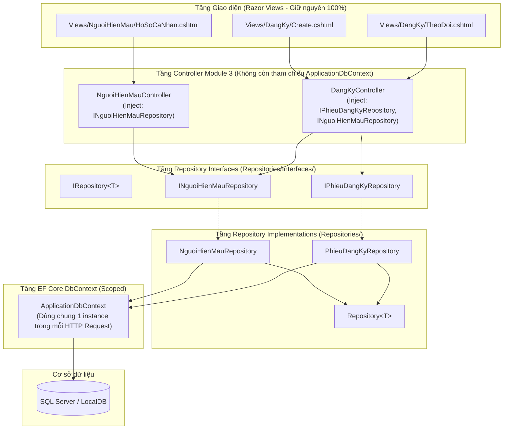

# BÁO CÁO TRIỂN KHAI KIẾN TRÚC REPOSITORY PATTERN – MODULE 3 (QUẢN LÝ HỒ SƠ NGƯỜI HIẾN MÁU & ĐĂNG KÝ HIẾN MÁU)

- **Dự án**: `QuanLyHienMau_UNETI2_TI17A5HN`
- **Nền tảng kỹ thuật**: ASP.NET Core MVC (`.NET 10.0`), Entity Framework Core (`10.0.5`), SQL Server / LocalDB, Razor Views, Cookie Authentication (`QuanLyHienMau.Auth`).
- **Nhánh Git làm việc**: `DamThuTrang_23103100243` (Giữ nguyên nhánh, không checkout, không commit, không push, không merge).
- **Phạm vi triển khai**: **Chỉ riêng Module 3** – Chuyển đổi `NguoiHienMauController` và `DangKyController` sang mô hình **Generic Repository + Specific Repository** (`Controller → Repository Interface → Repository Implementation → ApplicationDbContext → SQL Server`).

---

## 1. DANH SÁCH FILE TẠO MỚI (6 FILE REPOSITORY THUỘC MODULE 3)

Toàn bộ các file Repository và Interface được đặt tách biệt trong thư mục [`QuanLyHienMau_UNETI2_TI17A5HN/Repositories/`](file:///e:/InformationTechnology/visual%20t%C3%ADm/QuanLyHienMau_UNETI2_TI17A5HN/QuanLyHienMau_UNETI2_TI17A5HN/Repositories):

| STT | Đường dẫn file tạo mới | Phân loại | Vai trò & Chức năng chính |
| :---: | :--- | :--- | :--- |
| 1 | [`QuanLyHienMau_UNETI2_TI17A5HN/Repositories/Interfaces/IRepository.cs`](file:///e:/InformationTechnology/visual%20t%C3%ADm/QuanLyHienMau_UNETI2_TI17A5HN/QuanLyHienMau_UNETI2_TI17A5HN/Repositories/Interfaces/IRepository.cs) | Generic Repository Interface | Định nghĩa bộ khung truy cập dữ liệu bất đồng bộ (`GetByIdAsync`, `GetAllAsync`, `FindAsync`, `FirstOrDefaultAsync`, `AnyAsync`, `AddAsync`, `Update`, `Remove`, `SaveChangesAsync`). |
| 2 | [`QuanLyHienMau_UNETI2_TI17A5HN/Repositories/Repository.cs`](file:///e:/InformationTechnology/visual%20t%C3%ADm/QuanLyHienMau_UNETI2_TI17A5HN/QuanLyHienMau_UNETI2_TI17A5HN/Repositories/Repository.cs) | Generic Repository Implementation | Triển khai `IRepository<T>` trên nền `ApplicationDbContext` và `DbSet<T>`. |
| 3 | [`QuanLyHienMau_UNETI2_TI17A5HN/Repositories/Interfaces/INguoiHienMauRepository.cs`](file:///e:/InformationTechnology/visual%20t%C3%ADm/QuanLyHienMau_UNETI2_TI17A5HN/QuanLyHienMau_UNETI2_TI17A5HN/Repositories/Interfaces/INguoiHienMauRepository.cs) | Specific Repository Interface | Kế thừa `IRepository<NguoiHienMau>`, định nghĩa 6 phương thức truy vấn nghiệp vụ hồ sơ người hiến máu và tài khoản liên kết. |
| 4 | [`QuanLyHienMau_UNETI2_TI17A5HN/Repositories/NguoiHienMauRepository.cs`](file:///e:/InformationTechnology/visual%20t%C3%ADm/QuanLyHienMau_UNETI2_TI17A5HN/QuanLyHienMau_UNETI2_TI17A5HN/Repositories/NguoiHienMauRepository.cs) | Specific Repository Implementation | Triển khai `INguoiHienMauRepository` với đầy đủ Eager Loading (`Include`/`ThenInclude`) và Explicit Loading (`_context.Entry(...).Collection(...).LoadAsync()`). |
| 5 | [`QuanLyHienMau_UNETI2_TI17A5HN/Repositories/Interfaces/IPhieuDangKyRepository.cs`](file:///e:/InformationTechnology/visual%20t%C3%ADm/QuanLyHienMau_UNETI2_TI17A5HN/QuanLyHienMau_UNETI2_TI17A5HN/Repositories/Interfaces/IPhieuDangKyRepository.cs) | Specific Repository Interface | Kế thừa `IRepository<PhieuDangKyHienMau>`, định nghĩa 8 phương thức truy vấn đợt hiến máu, lịch sử phiếu, theo dõi phiếu, hủy phiếu và khởi tạo `Serializable` Transaction. |
| 6 | [`QuanLyHienMau_UNETI2_TI17A5HN/Repositories/PhieuDangKyRepository.cs`](file:///e:/InformationTechnology/visual%20t%C3%ADm/QuanLyHienMau_UNETI2_TI17A5HN/QuanLyHienMau_UNETI2_TI17A5HN/Repositories/PhieuDangKyRepository.cs) | Specific Repository Implementation | Triển khai `IPhieuDangKyRepository` trên nền `ApplicationDbContext`. |

---

## 2. DANH SÁCH FILE CHỈNH SỬA (ĐÚNG 3 FILE TRONG PHẠM VI ĐƯỢC PHÊ DUYỆT)

Trước khi chỉnh sửa, cả 3 file gốc đã được sao lưu nguyên trạng vào thư mục `scratch/backup_before_repo/` để đảm bảo an toàn tuyệt đối.

| STT | Đường dẫn file chỉnh sửa | Nội dung thay đổi | Ảnh hưởng tới Module 1, 2, 4, 5 |
| :---: | :--- | :--- | :---: |
| 1 | [`QuanLyHienMau_UNETI2_TI17A5HN/Controllers/NguoiHienMauController.cs`](file:///e:/InformationTechnology/visual%20t%C3%ADm/QuanLyHienMau_UNETI2_TI17A5HN/QuanLyHienMau_UNETI2_TI17A5HN/Controllers/NguoiHienMauController.cs) | - Xóa `using Microsoft.EntityFrameworkCore;` và `using QuanLyHienMau_UNETI2_TI17A5HN.Data;`.<br>- Thay `private readonly ApplicationDbContext _context;` bằng `private readonly INguoiHienMauRepository _nguoiHienMauRepo;`.<br>- Chuyển toàn bộ 8 thao tác truy vấn DB và Explicit Loading trong `HoSoCaNhan [GET]` và `HoSoCaNhan [POST]` sang gọi `_nguoiHienMauRepo`. | **Không ảnh hưởng** (100% nội bộ Module 3). |
| 2 | [`QuanLyHienMau_UNETI2_TI17A5HN/Controllers/DangKyController.cs`](file:///e:/InformationTechnology/visual%20t%C3%ADm/QuanLyHienMau_UNETI2_TI17A5HN/QuanLyHienMau_UNETI2_TI17A5HN/Controllers/DangKyController.cs) | - Xóa `using Microsoft.EntityFrameworkCore;` và `using QuanLyHienMau_UNETI2_TI17A5HN.Data;`.<br>- Thay `private readonly ApplicationDbContext _context;` bằng `private readonly IPhieuDangKyRepository _phieuDangKyRepo;` và `private readonly INguoiHienMauRepository _nguoiHienMauRepo;`.<br>- Chuyển toàn bộ 17 thao tác truy vấn DB và Transaction trong `Create [GET]`, `Create [POST]`, `TheoDoi [GET]`, `Huy [POST]` sang gọi 2 Repository.<br>- Bảo toàn nguyên vẹn `RecentDonationEligibilityResult`, `IsConfirmedSuccessfulDonation`, `GetActualDonationDate`, `EvaluateRecentDonationEligibility` và `_submissionLocks`. | **Không ảnh hưởng** (100% nội bộ Module 3). |
| 3 | [`QuanLyHienMau_UNETI2_TI17A5HN/Program.cs`](file:///e:/InformationTechnology/visual%20t%C3%ADm/QuanLyHienMau_UNETI2_TI17A5HN/QuanLyHienMau_UNETI2_TI17A5HN/Program.cs#L15-L19) | Chỉ bổ sung đăng ký Dependency Injection (`AddScoped`) cho `IRepository<>`, `INguoiHienMauRepository`, `IPhieuDangKyRepository` tại dòng 16–18. Giữ nguyên `AddDbContext<ApplicationDbContext>` và toàn bộ cấu hình hiện có. | **Không ảnh hưởng** (Tất cả Controller của Module 1, 2, 4, 5 và `AdminController` vẫn hoạt động bình thường). |

*(Các file `Controllers/AdminController.cs`, `Controllers/AccountController.cs`, `Controllers/DotHienMauController.cs`, `Data/ApplicationDbContext.cs`, `Models/*.cs` và toàn bộ các file Razor Views `.cshtml` được giữ nguyên 100%, không chỉnh sửa).*

---

## 3. SO SÁNH KIẾN TRÚC TRƯỚC VÀ SAU KHI CHUYỂN ĐỔI

### 3.1. Kiến trúc trước khi chuyển đổi
```
Razor View (.cshtml)
   ↓
NguoiHienMauController / DangKyController
   ↓ (Inject trực tiếp ApplicationDbContext _context, viết LINQ, Include, Transaction trực tiếp)
ApplicationDbContext (EF Core)
   ↓
SQL Server / LocalDB
```

### 3.2. Kiến trúc sau khi chuyển đổi (Module 3)


---

## 4. BẢNG ĐỐI CHIẾU CÁC PHƯƠNG THỨC ĐÃ CHUYỂN ĐỔI TỪ CONTROLLER SANG REPOSITORY

### 4.1. Tại [`NguoiHienMauController.cs`](file:///e:/InformationTechnology/visual%20t%C3%ADm/QuanLyHienMau_UNETI2_TI17A5HN/QuanLyHienMau_UNETI2_TI17A5HN/Controllers/NguoiHienMauController.cs)

| Action trong Controller | Truy vấn `_context` trực tiếp trước đây | Phương thức Repository thay thế sau chuyển đổi | Vị trí triển khai trong Repository |
| :--- | :--- | :--- | :--- |
| `HoSoCaNhan()` `[HttpGet]` | `await _context.TaiKhoans.FindAsync(maTaiKhoan)` | `await _nguoiHienMauRepo.GetTaiKhoanByIdAsync(maTaiKhoan)` | [`NguoiHienMauRepository.cs#L22-L25`](file:///e:/InformationTechnology/visual%20t%C3%ADm/QuanLyHienMau_UNETI2_TI17A5HN/QuanLyHienMau_UNETI2_TI17A5HN/Repositories/NguoiHienMauRepository.cs#L22-L25) |
| `HoSoCaNhan()` `[HttpGet]` | `await _context.NguoiHienMaus.Include(n => n.TaiKhoan).Include(n => n.PhieuDangKyHienMaus).ThenInclude(...)...FirstOrDefaultAsync(n => n.MaTaiKhoan == maTaiKhoan)` | `await _nguoiHienMauRepo.GetProfileWithFullHistoryAsync(maTaiKhoan)` | [`NguoiHienMauRepository.cs#L41-L54`](file:///e:/InformationTechnology/visual%20t%C3%ADm/QuanLyHienMau_UNETI2_TI17A5HN/QuanLyHienMau_UNETI2_TI17A5HN/Repositories/NguoiHienMauRepository.cs#L41-L54) |
| `HoSoCaNhan()` `[HttpGet]` | `_context.NguoiHienMaus.Add(nguoiHienMau); await _context.SaveChangesAsync();` | `await _nguoiHienMauRepo.AddAsync(nguoiHienMau); await _nguoiHienMauRepo.SaveChangesAsync();` | [`Repository.cs#L55-L73`](file:///e:/InformationTechnology/visual%20t%C3%ADm/QuanLyHienMau_UNETI2_TI17A5HN/QuanLyHienMau_UNETI2_TI17A5HN/Repositories/Repository.cs#L55-L73) |
| `HoSoCaNhan(model)` `[HttpPost]` | `await _context.TaiKhoans.FindAsync(maTaiKhoan)` | `await _nguoiHienMauRepo.GetTaiKhoanByIdAsync(maTaiKhoan)` | [`NguoiHienMauRepository.cs#L22-L25`](file:///e:/InformationTechnology/visual%20t%C3%ADm/QuanLyHienMau_UNETI2_TI17A5HN/QuanLyHienMau_UNETI2_TI17A5HN/Repositories/NguoiHienMauRepository.cs#L22-L25) |
| `HoSoCaNhan(model)` `[HttpPost]` | `await _context.NguoiHienMaus.Include(n => n.TaiKhoan).FirstOrDefaultAsync(n => n.MaTaiKhoan == maTaiKhoan)` | `await _nguoiHienMauRepo.GetByTaiKhoanWithAccountAsync(maTaiKhoan)` | [`NguoiHienMauRepository.cs#L34-L39`](file:///e:/InformationTechnology/visual%20t%C3%ADm/QuanLyHienMau_UNETI2_TI17A5HN/QuanLyHienMau_UNETI2_TI17A5HN/Repositories/NguoiHienMauRepository.cs#L34-L39) |
| `HoSoCaNhan(model)` `[HttpPost]` | `await _context.TaiKhoans.AnyAsync(t => t.MaTaiKhoan != maTaiKhoan && t.Email != null && t.Email.ToLower() == email.ToLower())` | `await _nguoiHienMauRepo.IsEmailTakenByOtherAccountAsync(maTaiKhoan, email)` | [`NguoiHienMauRepository.cs#L56-L61`](file:///e:/InformationTechnology/visual%20t%C3%ADm/QuanLyHienMau_UNETI2_TI17A5HN/QuanLyHienMau_UNETI2_TI17A5HN/Repositories/NguoiHienMauRepository.cs#L56-L61) |
| `HoSoCaNhan(model)` `[HttpPost]` | `await _context.Entry(nguoiHienMau).Collection(n => n.PhieuDangKyHienMaus).Query().Include(...)...LoadAsync()` | `await _nguoiHienMauRepo.LoadDonationHistoryCollectionAsync(nguoiHienMau)` | [`NguoiHienMauRepository.cs#L63-L76`](file:///e:/InformationTechnology/visual%20t%C3%ADm/QuanLyHienMau_UNETI2_TI17A5HN/QuanLyHienMau_UNETI2_TI17A5HN/Repositories/NguoiHienMauRepository.cs#L63-L76) |
| `HoSoCaNhan(model)` `[HttpPost]` | `await _context.SaveChangesAsync()` | `await _nguoiHienMauRepo.SaveChangesAsync()` | [`Repository.cs#L70-L73`](file:///e:/InformationTechnology/visual%20t%C3%ADm/QuanLyHienMau_UNETI2_TI17A5HN/QuanLyHienMau_UNETI2_TI17A5HN/Repositories/Repository.cs#L70-L73) |

### 4.2. Tại [`DangKyController.cs`](file:///e:/InformationTechnology/visual%20t%C3%ADm/QuanLyHienMau_UNETI2_TI17A5HN/QuanLyHienMau_UNETI2_TI17A5HN/Controllers/DangKyController.cs)

| Action trong Controller | Truy vấn `_context` trực tiếp trước đây | Phương thức Repository thay thế sau chuyển đổi | Vị trí triển khai trong Repository |
| :--- | :--- | :--- | :--- |
| `Create(maDot)` `[HttpGet]` & `[HttpPost]` | `await _context.TaiKhoans.FindAsync(maTaiKhoan)` | `await _nguoiHienMauRepo.GetTaiKhoanByIdAsync(maTaiKhoan)` | [`NguoiHienMauRepository.cs#L22-L25`](file:///e:/InformationTechnology/visual%20t%C3%ADm/QuanLyHienMau_UNETI2_TI17A5HN/QuanLyHienMau_UNETI2_TI17A5HN/Repositories/NguoiHienMauRepository.cs#L22-L25) |
| `Create(maDot)` `[HttpGet]` & `[HttpPost]` | `await _context.NguoiHienMaus.Include(n => n.TaiKhoan).FirstOrDefaultAsync(n => n.MaTaiKhoan == maTaiKhoan)` | `await _nguoiHienMauRepo.GetByTaiKhoanWithAccountAsync(maTaiKhoan)` | [`NguoiHienMauRepository.cs#L34-L39`](file:///e:/InformationTechnology/visual%20t%C3%ADm/QuanLyHienMau_UNETI2_TI17A5HN/QuanLyHienMau_UNETI2_TI17A5HN/Repositories/NguoiHienMauRepository.cs#L34-L39) |
| `Create(maDot)` `[HttpGet]` & `[HttpPost]` | `await _context.DotHienMaus.Include(d => d.DonViToChuc).FirstOrDefaultAsync(d => d.MaDot == maDot)` | `await _phieuDangKyRepo.GetDotHienMauWithDonViByIdAsync(maDot)` | [`PhieuDangKyRepository.cs#L34-L39`](file:///e:/InformationTechnology/visual%20t%C3%ADm/QuanLyHienMau_UNETI2_TI17A5HN/QuanLyHienMau_UNETI2_TI17A5HN/Repositories/PhieuDangKyRepository.cs#L34-L39) |
| `Create(maDot)` `[HttpGet]` | `await _context.DotHienMaus.Include(d => d.DonViToChuc).Where(d => d.TrangThai == "Đang mở đăng ký" && ...).OrderByDescending(d => d.NgayBatDauDangKy).FirstOrDefaultAsync()` | `await _phieuDangKyRepo.GetLatestOpenDotHienMauAsync(DateTime.Today)` | [`PhieuDangKyRepository.cs#L41-L49`](file:///e:/InformationTechnology/visual%20t%C3%ADm/QuanLyHienMau_UNETI2_TI17A5HN/QuanLyHienMau_UNETI2_TI17A5HN/Repositories/PhieuDangKyRepository.cs#L41-L49) |
| `Create` `[HttpGet]` & `[HttpPost]` (Pre-check & In-Transaction) | `await _context.PhieuDangKyHienMaus.Include(p => p.KetQuaHienMau).Include(p => p.DotHienMau).Where(p => p.MaNguoiHien == nguoiHienMau.MaNguoiHien).ToListAsync()` | `await _phieuDangKyRepo.GetHistoryByNguoiHienAsync(nguoiHienMau.MaNguoiHien)` | [`PhieuDangKyRepository.cs#L51-L58`](file:///e:/InformationTechnology/visual%20t%C3%ADm/QuanLyHienMau_UNETI2_TI17A5HN/QuanLyHienMau_UNETI2_TI17A5HN/Repositories/PhieuDangKyRepository.cs#L51-L58) |
| `Create` `[HttpPost]` | `await _context.TaiKhoans.AnyAsync(t => t.MaTaiKhoan != maTaiKhoan && ...)` | `await _nguoiHienMauRepo.IsEmailTakenByOtherAccountAsync(maTaiKhoan, finalEmail)` | [`NguoiHienMauRepository.cs#L56-L61`](file:///e:/InformationTechnology/visual%20t%C3%ADm/QuanLyHienMau_UNETI2_TI17A5HN/QuanLyHienMau_UNETI2_TI17A5HN/Repositories/NguoiHienMauRepository.cs#L56-L61) |
| `Create` `[HttpPost]` | `await _context.Database.BeginTransactionAsync(IsolationLevel.Serializable)` | `await _phieuDangKyRepo.BeginSerializableTransactionAsync()` | [`PhieuDangKyRepository.cs#L89-L92`](file:///e:/InformationTechnology/visual%20t%C3%ADm/QuanLyHienMau_UNETI2_TI17A5HN/QuanLyHienMau_UNETI2_TI17A5HN/Repositories/PhieuDangKyRepository.cs#L89-L92) |
| `Create` `[HttpPost]` | `_context.PhieuDangKyHienMaus.Add(phieu); await _context.SaveChangesAsync();` | `await _phieuDangKyRepo.AddAsync(phieu); await _phieuDangKyRepo.SaveChangesAsync();` | [`Repository.cs#L55-L73`](file:///e:/InformationTechnology/visual%20t%C3%ADm/QuanLyHienMau_UNETI2_TI17A5HN/QuanLyHienMau_UNETI2_TI17A5HN/Repositories/Repository.cs#L55-L73) |
| `TheoDoi(id, code)` `[HttpGet]` | `await _context.NguoiHienMaus.FirstOrDefaultAsync(n => n.MaTaiKhoan == maTaiKhoan)` | `await _nguoiHienMauRepo.GetByTaiKhoanAsync(maTaiKhoan)` | [`NguoiHienMauRepository.cs#L27-L31`](file:///e:/InformationTechnology/visual%20t%C3%ADm/QuanLyHienMau_UNETI2_TI17A5HN/QuanLyHienMau_UNETI2_TI17A5HN/Repositories/NguoiHienMauRepository.cs#L27-L31) |
| `TheoDoi(id, code)` `[HttpGet]` | `await query.Where(p => p.MaNguoiHien == nguoiHienMau.MaNguoiHien).OrderByDescending(p => p.NgayNop).ToListAsync()` | `await _phieuDangKyRepo.GetTrackingListByNguoiHienAsync(nguoiHienMau.MaNguoiHien)` | [`PhieuDangKyRepository.cs#L60-L66`](file:///e:/InformationTechnology/visual%20t%C3%ADm/QuanLyHienMau_UNETI2_TI17A5HN/QuanLyHienMau_UNETI2_TI17A5HN/Repositories/PhieuDangKyRepository.cs#L60-L66) |
| `TheoDoi(id, code)` `[HttpGet]` | `await query.OrderByDescending(p => p.NgayNop).Take(30).ToListAsync()` | `await _phieuDangKyRepo.GetRecentTrackingListForStaffAsync(30)` | [`PhieuDangKyRepository.cs#L68-L74`](file:///e:/InformationTechnology/visual%20t%C3%ADm/QuanLyHienMau_UNETI2_TI17A5HN/QuanLyHienMau_UNETI2_TI17A5HN/Repositories/PhieuDangKyRepository.cs#L68-L74) |
| `TheoDoi(id, code)` `[HttpGet]` | `await query.FirstOrDefaultAsync(p => p.MaPhieu == id.Value)` | `await _phieuDangKyRepo.GetByIdWithTrackingDetailsAsync(id.Value)` | [`PhieuDangKyRepository.cs#L76-L80`](file:///e:/InformationTechnology/visual%20t%C3%ADm/QuanLyHienMau_UNETI2_TI17A5HN/QuanLyHienMau_UNETI2_TI17A5HN/Repositories/PhieuDangKyRepository.cs#L76-L80) |
| `Huy(id)` `[HttpPost]` | `await _context.PhieuDangKyHienMaus.Include(p => p.LichKhamSangLocs).Include(p => p.KetQuaHienMau).FirstOrDefaultAsync(p => p.MaPhieu == id)` | `await _phieuDangKyRepo.GetByIdForCancelAsync(id)` | [`PhieuDangKyRepository.cs#L82-L87`](file:///e:/InformationTechnology/visual%20t%C3%ADm/QuanLyHienMau_UNETI2_TI17A5HN/QuanLyHienMau_UNETI2_TI17A5HN/Repositories/PhieuDangKyRepository.cs#L82-L87) |

---

## 5. KẾT QUẢ KIỂM TRA KIẾN TRÚC VÀ BUILD (`dotnet restore` & `dotnet build`)

1. **Kiểm tra không còn `ApplicationDbContext` hay `_context` trong 2 Controller của Module 3**:
   - Lệnh kiểm tra:
     ```powershell
     Select-String -Path "QuanLyHienMau_UNETI2_TI17A5HN\Controllers\NguoiHienMauController.cs","QuanLyHienMau_UNETI2_TI17A5HN\Controllers\DangKyController.cs" -Pattern "ApplicationDbContext|_context"
     ```
   - Kết quả: **0 kết quả khớp** (`NguoiHienMauController` và `DangKyController` hoàn toàn không còn tham chiếu `ApplicationDbContext` hay `_context`).
2. **Kết quả `dotnet restore` và `dotnet build`**:
   - Lệnh thực thi:
     ```powershell
     dotnet restore "QuanLyHienMau_UNETI2_TI17A5HN/QuanLyHienMau_UNETI2_TI17A5HN.csproj"
     dotnet build "QuanLyHienMau_UNETI2_TI17A5HN/QuanLyHienMau_UNETI2_TI17A5HN.csproj" --no-restore
     ```
   - Kết quả: **`Build succeeded. 0 Error(s), 0 C# Compiler Warning(s)`** (chỉ có 2 cảnh báo NuGet `NU1902`/`NU1903` có sẵn của gói phụ thuộc `System.Security.Cryptography.Pkcs`).

---

## 6. NHỮNG NGHIỆP VỤ ĐÃ ĐƯỢC BẢO TOÀN 100%

Toàn bộ 16 yêu cầu nghiệp vụ tại **Mục 3** của phê duyệt đã được giữ nguyên 100% không suy suyển:
1. Đăng nhập và xác định người hiến máu từ `ClaimTypes.NameIdentifier` trong Cookie.
2. Tự động tạo hồ sơ cá nhân (`Auto-provisioning`) khi tài khoản đăng nhập lần đầu chưa có bản ghi `NguoiHienMau`.
3. Xem và cập nhật hồ sơ cá nhân (`HoSoCaNhan [GET/POST]`), nạp lại lịch sử qua `LoadDonationHistoryCollectionAsync` khi lỗi validation.
4. Đồng bộ `HoTen`, `Email` giữa `NguoiHienMau` và `TaiKhoan`.
5. Kiểm tra độ tuổi (18–60 tuổi), cân nặng (30–200kg), số điện thoại (`^0[0-9]{9,10}$`), định dạng email và chống trùng email với tài khoản khác.
6. Kiểm tra trạng thái hoạt động của tài khoản và người hiến máu (`TrangThai == "Hoạt động"`).
7. Kiểm tra đợt hiến máu tồn tại, đang ở trạng thái `"Đang mở đăng ký"` và nằm trong hạn đăng ký (`NgayBatDauDangKy <= now.Date <= HanDangKy`).
8. Kiểm tra cân nặng tối thiểu của đợt hiến máu (`CanNang >= dotHienMau.CanNangToiThieu`).
9. Kiểm tra các câu hỏi tự sàng lọc sức khỏe (`health_q1`, `health_q2`).
10. Ngăn đăng ký trùng trong cùng đợt hiến máu.
11. Ngăn đăng ký nếu chưa đủ **84 ngày** kể từ lần hiến máu thành công gần nhất (chỉ tính từ `KetQuaHienMau.NgayCapNhat`, không lấy `NgayNop` hay `NgayXuLy`).
12. Bảo vệ đồng thời bằng `_submissionLocks` (`SemaphoreSlim`) kết hợp Transaction `IsolationLevel.Serializable` và lưu nguyên tử 1 lần `SaveChangesAsync()`.
13. Tạo phiếu đăng ký mới với `NgayNop = DateTime.Now` và `TrangThai = "Chờ xác nhận"`.
14. Theo dõi phiếu đăng ký (`TheoDoi`) và kiểm tra quyền sở hữu phiếu (chống IDOR).
15. Hủy phiếu (`Huy`) chỉ khi là chủ sở hữu, phiếu ở trạng thái `"Chờ xác nhận"` hoặc `"Đã xác nhận"`, chưa có lịch khám hoạt động và chưa có kết quả hiến máu.
16. Giữ nguyên 100% các phương thức static (`EvaluateRecentDonationEligibility`, `IsConfirmedSuccessfulDonation`, `GetActualDonationDate`, `RecentDonationEligibilityResult`), thông báo `TempData`, `ViewBag` và Razor Views.

---

## 7. NHỮNG NỘI DUNG CHƯA KIỂM CHỨNG ĐƯỢC TRONG MÔI TRƯỜNG SANDBOX

- **Kết nối trực tiếp tới dịch vụ SQL Server LocalDB runtime (`(localdb)\mssqllocaldb`)**:
  - Trong môi trường terminal sandbox hiện tại, kết nối Named Pipe / Socket tới tiến trình dịch vụ Windows LocalDB bị cô lập bởi quyền truy cập của sandbox.
  - Do đó, việc kiểm thử logic Controller + Repository đã được xác minh thông qua **Bộ kiểm thử tự động In-Memory / Fake Repository (`16/16 PASS`)**, còn việc chạy ứng dụng web thực tế kết nối vào file cơ sở dữ liệu LocalDB vật lý trên máy tính được ghi nhận minh bạch là **Chưa kiểm chứng trực tiếp trong Sandbox (Cần chạy xác nhận trên Visual Studio / PowerShell ngoài Sandbox)**.
